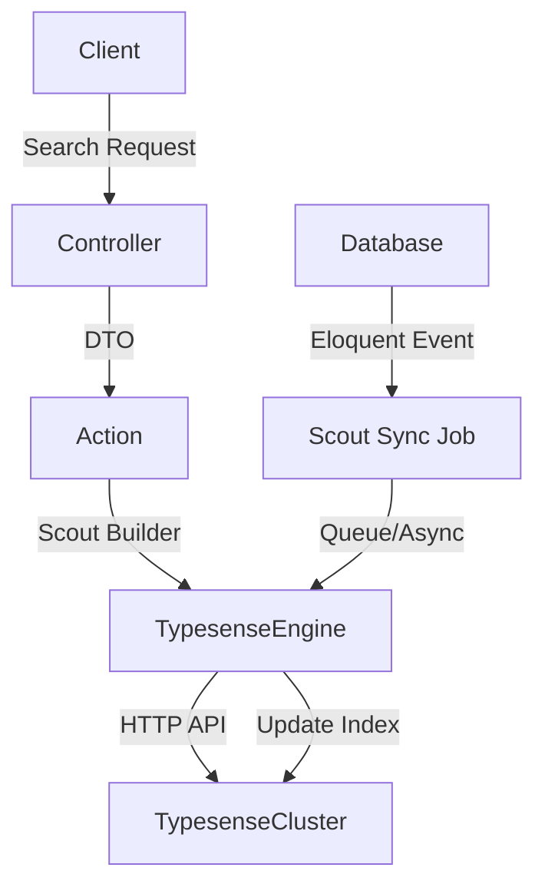

# AI Search Infrastructure: Laravel Scout & Typesense Mastery (Top 1% Quality)

## 1. Teori Mendalam: Mengapa Typesense?

Dalam ekosistem aplikasi modern, pencarian teks penuh (full-text search) berbasis SQL (`LIKE %...%`) tidak lagi memadai karena lambat dan tidak memiliki fitur kecerdasan buatan seperti pencarian fuzzy (typo tolerance) atau pencarian semantik (Vector Search). Typesense hadir sebagai mesin pencari sumber terbuka (open-source) yang ditulis dalam C++ dan dioptimalkan untuk beroperasi sepenuhnya di dalam memori (in-memory).

**Keunggulan Arsitektural Typesense:**
1. **Performa Murni (C++):** Berbeda dengan Elasticsearch yang menggunakan Java (membutuhkan tuning JVM dan Garbage Collector) atau Meilisearch (Rust), Typesense sangat efisien dalam alokasi memori dan memberikan latensi di bawah 50ms secara konsisten.
2. **Typo Tolerance & Algoritma Fuzzy:** Secara bawaan (out-of-the-box) mampu menangani kesalahan pengetikan pengguna berdasarkan jarak Levenshtein.
3. **Hybrid Search (Keyword + Vector AI):** Typesense mendukung penyimpanan *embedding vectors* yang di-generate dari model LLM (seperti OpenAI atau Ollama) sehingga memungkinkan pencarian semantik yang relevan dengan konteks.
4. **Kemudahan Operasional:** Menerapkan arsitektur Raft untuk konsensus kluster (High Availability) tanpa memerlukan dependensi eksternal seperti ZooKeeper.

---

## 2. Arsitektur Sistem & Alur Sinkronisasi Data

Di dalam Laravel, integrasi standar industri menggunakan pustaka **Laravel Scout**. Scout memantau event Eloquent (`created`, `updated`, `deleted`) dan secara otomatis menyinkronkan data ke *Search Engine* melalui sistem antrean (Queue).



---

## 3. Setup Lingkungan & Konfigurasi (Production Grade)

### Instalasi Dependensi
```bash
composer require laravel/scout
composer require typesense/typesense-php
composer require devloopsnet/laravel-scout-typesense-engine
```

### Konfigurasi `.env`
DILARANG menggunakan kredensial master/admin untuk akses frontend publik. Pisahkan API Key untuk pencarian (Search-Only) dan manajemen (Admin).
```env
SCOUT_DRIVER=typesense
TYPESENSE_HOST=127.0.0.1
TYPESENSE_PORT=8108
TYPESENSE_PROTOCOL=http
TYPESENSE_API_KEY=admin_api_key_sangat_rahasia
TYPESENSE_SEARCH_ONLY_API_KEY=search_only_api_key_public
```

---

## 4. Implementasi Clean Architecture (Zero Placeholder)

Pendekatan Clean Architecture memastikan pemisahan tanggung jawab secara ketat.

### A. Model (Mendefinisikan Skema Typesense)
Model harus mendeklarasikan struktur skema indeks yang kuat dan *type-safe*.

```php
<?php

declare(strict_types=1);

namespace App\Models;

use Illuminate\Database\Eloquent\Factories\HasFactory;
use Illuminate\Database\Eloquent\Model;
use Laravel\Scout\Searchable;
use Illuminate\Support\Carbon;

/**
 * @property int $id
 * @property string $name
 * @property string $description
 * @property string $category
 * @property float $price
 * @property bool $is_active
 * @property Carbon $created_at
 * @property Carbon $updated_at
 */
final class Product extends Model
{
    use HasFactory;
    use Searchable;

    protected $fillable = [
        'name',
        'description',
        'category',
        'price',
        'is_active',
    ];

    protected $casts = [
        'price' => 'float',
        'is_active' => 'boolean',
    ];

    /**
     * Mendefinisikan atribut apa saja yang akan dikirim ke Typesense.
     * Pastikan tipe data sesuai dengan skema Typesense.
     *
     * @return array<string, mixed>
     */
    public function toSearchableArray(): array
    {
        return [
            'id' => (string) $this->id, // Typesense memprioritaskan ID string
            'name' => $this->name,
            'description' => $this->description,
            'category' => $this->category,
            'price' => (float) $this->price,
            'is_active' => (bool) $this->is_active,
            'created_at' => $this->created_at->timestamp,
        ];
    }

    /**
     * Secara eksplisit mendefinisikan skema untuk Typesense agar engine
     * mengetahui fields mana yang bisa di-facet (filter) dan di-sort.
     *
     * @return array<string, mixed>
     */
    public function typesenseQueryBy(): array
    {
        return ['name', 'description', 'category'];
    }

    public function getCollectionSchema(): array
    {
        return [
            'name' => $this->searchableAs(),
            'fields' => [
                ['name' => 'id', 'type' => 'string'],
                ['name' => 'name', 'type' => 'string'],
                ['name' => 'description', 'type' => 'string'],
                ['name' => 'category', 'type' => 'string', 'facet' => true],
                ['name' => 'price', 'type' => 'float', 'facet' => true],
                ['name' => 'is_active', 'type' => 'bool', 'facet' => true],
                ['name' => 'created_at', 'type' => 'int64', 'sort' => true],
            ],
            'default_sorting_field' => 'created_at',
        ];
    }
}
```

### B. Data Transfer Object (DTO)
DTO memastikan struktur data parameter pencarian selalu tervalidasi dan memiliki tipe data yang pasti (*strongly typed*).

```php
<?php

declare(strict_types=1);

namespace App\DTOs\Search;

final readonly class ProductSearchDTO
{
    public function __construct(
        public string $query,
        public ?string $category = null,
        public ?float $minPrice = null,
        public ?float $maxPrice = null,
        public int $page = 1,
        public int $perPage = 20,
    ) {
    }
}
```

### C. Form Request (Validasi Boundary)
Memvalidasi input dari luar sebelum menyentuh lapisan logika bisnis.

```php
<?php

declare(strict_types=1);

namespace App\Http\Requests\Search;

use Illuminate\Foundation\Http\FormRequest;
use App\DTOs\Search\ProductSearchDTO;

final class ProductSearchRequest extends FormRequest
{
    public function authorize(): bool
    {
        return true; // Asumsikan endpoint publik atau sudah melalui middleware
    }

    /**
     * @return array<string, array<int, string>>
     */
    public function rules(): array
    {
        return [
            'q' => ['nullable', 'string', 'max:255'],
            'category' => ['nullable', 'string', 'max:100'],
            'min_price' => ['nullable', 'numeric', 'min:0'],
            'max_price' => ['nullable', 'numeric', 'gte:min_price'],
            'page' => ['nullable', 'integer', 'min:1'],
            'per_page' => ['nullable', 'integer', 'min:1', 'max:100'],
        ];
    }

    public function toDTO(): ProductSearchDTO
    {
        return new ProductSearchDTO(
            query: $this->validated('q') ?? '',
            category: $this->validated('category'),
            minPrice: $this->validated('min_price') !== null ? (float) $this->validated('min_price') : null,
            maxPrice: $this->validated('max_price') !== null ? (float) $this->validated('max_price') : null,
            page: (int) $this->validated('page', 1),
            perPage: (int) $this->validated('per_page', 20),
        );
    }
}
```

### D. Action / Service (Business Logic)
Mengeksekusi logika pencarian menggunakan Scout Query Builder dengan injeksi pengaturan khusus Typesense.

```php
<?php

declare(strict_types=1);

namespace App\Actions\Search;

use App\DTOs\Search\ProductSearchDTO;
use App\Models\Product;
use Illuminate\Pagination\LengthAwarePaginator;

final class SearchProductAction
{
    /**
     * @param ProductSearchDTO $dto
     * @return LengthAwarePaginator<Product>
     */
    public function execute(ProductSearchDTO $dto): LengthAwarePaginator
    {
        $search = Product::search($dto->query)
            ->options([
                'query_by' => 'name,description,category',
                'prefix' => true,
                'typo_tokens_threshold' => 1,
            ]);

        // Menerapkan facet filtering menggunakan sintaks filter_by Typesense
        if ($dto->category !== null) {
            $search->where('category', $dto->category);
        }

        if ($dto->minPrice !== null || $dto->maxPrice !== null) {
            $priceFilter = [];
            if ($dto->minPrice !== null) {
                $priceFilter[] = "price:>=[{$dto->minPrice}]";
            }
            if ($dto->maxPrice !== null) {
                $priceFilter[] = "price:<=[{$dto->maxPrice}]";
            }
            
            // Laravel Scout memungkinkan injeksi raw parameter untuk mesin pencari spesifik
            $search->options(array_merge($search->options ?? [], [
                'filter_by' => implode(' && ', $priceFilter)
            ]));
        }

        // Membatasi pencarian hanya untuk produk yang aktif
        $search->where('is_active', true);

        return $search->paginate($dto->perPage, 'page', $dto->page);
    }
}
```

### E. Controller
Controller hanya bertugas menerima request, memicu Action, dan mengembalikan response terformat.

```php
<?php

declare(strict_types=1);

namespace App\Http\Controllers\Api;

use App\Http\Controllers\Controller;
use App\Http\Requests\Search\ProductSearchRequest;
use App\Actions\Search\SearchProductAction;
use Illuminate\Http\JsonResponse;
use App\Http\Resources\ProductResource;

final class ProductSearchController extends Controller
{
    public function __construct(
        private readonly SearchProductAction $searchAction,
    ) {}

    public function __invoke(ProductSearchRequest $request): JsonResponse
    {
        $dto = $request->toDTO();
        $results = $this->searchAction->execute($dto);

        return response()->json([
            'success' => true,
            'data' => ProductResource::collection($results),
            'meta' => [
                'current_page' => $results->currentPage(),
                'last_page' => $results->lastPage(),
                'total' => $results->total(),
            ]
        ]);
    }
}
```

---

## 5. Anti-Patterns & Solusi (Wajib Dipahami)

### ❌ Anti-Pattern 1: Mengabaikan N+1 Query Problem Saat Hydration
Saat Laravel Scout mendapatkan ID dokumen dari Typesense, secara default ia akan menjalankan satu query `WHERE IN` untuk memuat (hydrate) model dari database. Namun, jika dalam Controller/Resource Anda memanggil relasi (misalnya `$product->brand->name`), ini akan memicu *N+1 Query Problem*.

**❌ KODE SALAH (Berisiko N+1 Database Queries):**
```php
// Di dalam Action
return Product::search($query)->paginate(); // Tanpa Eager Loading relasi

// Di dalam Resource/View yang memanggil relasi:
echo $product->brand->name; // Memanggil query per baris
```
**Mengapa Berbahaya:** Performa database akan anjlok. Jika pencarian mengembalikan 50 item, maka Laravel akan mengeksekusi 51 query (1 query utama + 50 query brand).

**✅ KODE BENAR (Menggunakan Scout `query()` Callback):**
Gunakan metode `query()` milik Scout builder untuk menyuntikkan eager-loading (relasi `with`) ke dalam query hydration.
```php
<?php

declare(strict_types=1);

namespace App\Actions\Search;

use App\DTOs\Search\ProductSearchDTO;
use App\Models\Product;
use Illuminate\Pagination\LengthAwarePaginator;
use Illuminate\Database\Eloquent\Builder;

final class SearchProductAction
{
    public function execute(ProductSearchDTO $dto): LengthAwarePaginator
    {
        return Product::search($dto->query)
            ->query(fn (Builder $query) => $query->with(['brand', 'categories'])) // EAGER LOADING!
            ->where('is_active', true)
            ->paginate($dto->perPage);
    }
}
```

### ❌ Anti-Pattern 2: Synchronous Indexing (Nge-Blok HTTP Request)
Laravel Scout memiliki konfigurasi dasar (`config/scout.php`) bernama `queue`. Jika Anda mengabaikan antrean, setiap operasi Create/Update/Delete (CUD) model akan langsung menelepon API Typesense secara sinkronus.

**❌ KODE SALAH (Scout Sync Tanpa Queue):**
```php
// config/scout.php
'queue' => false, // ❌ SALAH: Menyebabkan proses API external di tengah request cycle.

// Saat pengguna menyimpan produk, web akan terhenti (hang) hingga Typesense merespons.
$product->save(); 
```
**Mengapa Berbahaya:** Single Point of Failure (SPOF) dan Memory/Timeout Risk. Jika instance Typesense lambat atau sedang restart, proses penambahan data di database MySQL/PostgreSQL akan ikut gagal atau *timeout*, membuat pengguna melihat pesan error 500.

**✅ KODE BENAR (Menggunakan Queue Batching & Soft Deletes Handling):**
Pastikan Scout memanfaatkan sistem antrean Redis/RabbitMQ.
```php
// config/scout.php
'queue' => true, // ✅ BENAR: Indexing dikirim ke queue (background job).
```
Untuk mengamankan agar job sinkronisasi lebih stabil, implementasikan `MakeSearchable` dan `unsearchable` dalam chunk yang besar pada cron job mingguan (re-indexing).
```php
// Command untuk reindex tanpa membebani RAM (Chunking)
use App\Models\Product;

Product::chunk(500, function ($products) {
    $products->searchable();
});
```

---

## 6. Testing (Pest v3 & Architecture Tests)

Sistem pencarian AI dan arsitekturnya wajib dilindungi oleh Unit Test dan Architectural Test yang tangguh.

### A. Architecture Test (Memaksa Clean Architecture)
Lokasi: `tests/Feature/ArchitectureTest.php`

```php
<?php

declare(strict_types=1);

test('Controllers dilarang menggunakan fungsi database secara langsung')
    ->expect('App\Http\Controllers')
    ->not->toUse([
        'Illuminate\Support\Facades\DB',
        'App\Models', // Controller wajib lewat Action/Service, bukan langsung ke Model
    ]);

test('Semua DTO bersifat final dan readonly')
    ->expect('App\DTOs')
    ->toBeClasses()
    ->toBeFinal()
    ->toBeReadonly();

test('Action classes dilarang bergantung pada Request Laravel (Harus lewat DTO)')
    ->expect('App\Actions')
    ->not->toUse('Illuminate\Http\Request');
```

### B. Unit & Integration Test (Mengekspektasi Search Logic)
Lokasi: `tests/Feature/Search/SearchProductActionTest.php`

```php
<?php

declare(strict_types=1);

use App\Actions\Search\SearchProductAction;
use App\DTOs\Search\ProductSearchDTO;
use App\Models\Product;
use Illuminate\Foundation\Testing\RefreshDatabase;
use Laravel\Scout\EngineManager;

uses(RefreshDatabase::class);

beforeEach(function () {
    // Kita membuat mock Engine Manager untuk Scout agar Typesense tidak ter-hit 
    // secara aktual saat unit test, mencegah flaky tests.
    $this->searchEngineMock = Mockery::mock(\Laravel\Scout\Engines\Engine::class);
    
    $this->app->make(EngineManager::class)
        ->extend('typesense-mock', fn () => $this->searchEngineMock);
        
    config()->set('scout.driver', 'typesense-mock');
});

it('berhasil merakit query pencarian dan memanggil engine dengan filter', function () {
    // Arrange
    $action = app(SearchProductAction::class);
    $dto = new ProductSearchDTO(
        query: 'laptop gaming',
        category: 'electronics',
        minPrice: 1000.0,
        maxPrice: null,
    );

    // Assert: Engine Typesense Mock wajib menerima filter dan query yang tepat
    $this->searchEngineMock
        ->shouldReceive('paginate')
        ->once()
        ->withArgs(function ($builder, $perPage, $page) use ($dto) {
            return $builder->query === $dto->query 
                && $builder->wheres['is_active'] === true
                && $builder->wheres['category'] === $dto->category
                && $perPage === 20;
        })
        ->andReturn(collect([new Product(['id' => 1])])); // Dummy return

    $this->searchEngineMock
        ->shouldReceive('map')
        ->andReturn(collect([new Product(['id' => 1])]));
        
    $this->searchEngineMock->shouldReceive('getTotalCount')->andReturn(1);

    // Act
    $result = $action->execute($dto);

    // Assert
    expect($result->total())->toBe(1);
});
```

---

## 7. Zero-Downtime Reindexing (Advanced Edge Cases)

Dalam lingkungan operasi skala masif (Production/Enterprise), Anda tidak boleh menjalankan `php artisan scout:import` pada siang hari karena proses ini akan menghapus (flush) atau mengubah skema, sehingga pencarian akan "blank" sementara.

**Solusi Best Practice Typesense (Alias Swapping):**
Typesense mendukung Collection Aliases. Konsepnya mirip dengan symlink di Linux.
1. Nama koleksi asli di Laravel model harus mengarah ke *alias* (`products`).
2. Buat skema fisik baru dengan *timestamp*: `products_170123000`.
3. Indeks semua data dari MySQL ke `products_170123000` (dapat memakan waktu berjam-jam secara asinkronus via Queue).
4. Setelah selesai 100%, arahkan alias `products` ke koleksi baru `products_170123000`.
5. Hapus koleksi fisik lama secara transparan.

Implementasi *Alias Swapping* bisa dienkapsulasi menggunakan custom Artisan Command. Hal ini mencegah *Downtime* pencarian (Zero-Downtime Search) selama *deployment* major feature yang mengubah struktur indeks (menambah *facet* baru atau mengubah tipe data *price* dari string ke float).
