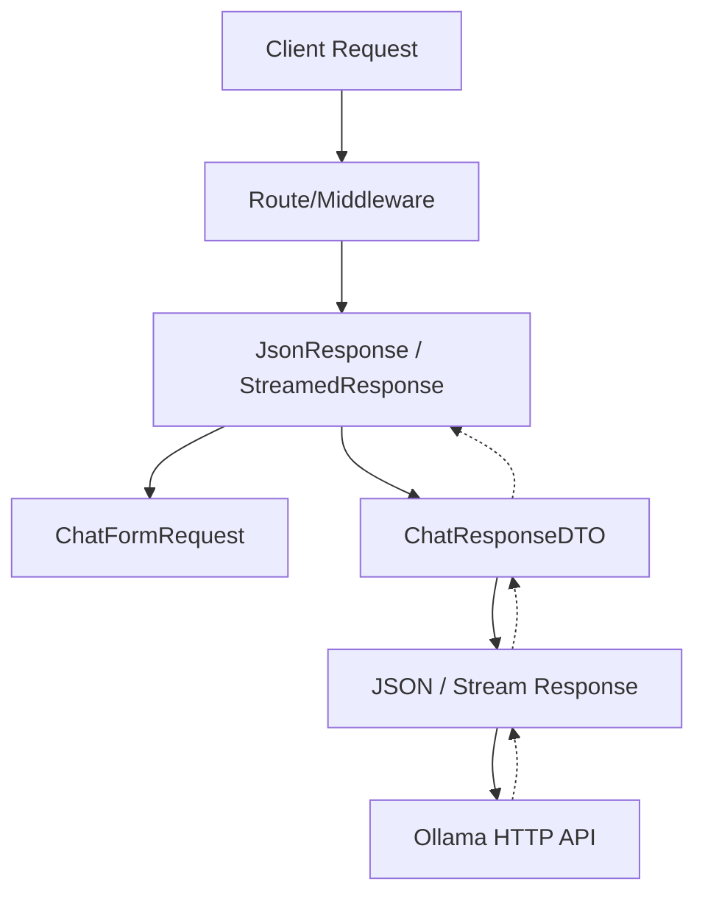

# Ollama Local LLM Integration di Laravel 11/12: Top 1% Quality Engineering

## 1. Pendahuluan & Teori Infrastruktur Lokal LLM

Dalam era AI modern, tidak semua data dapat dikirim ke layanan pihak ketiga (seperti OpenAI atau Anthropic) karena alasan regulasi (HIPAA, GDPR, UU PDP), privasi, atau biaya operasional pada skala besar. Ollama hadir sebagai jembatan untuk menjalankan model Large Language Model (LLM) secara lokal (on-premise atau private cloud) dengan performa tinggi menggunakan llama.cpp di bawah kap.

### Mengapa Memilih Ollama untuk Backend Laravel?
- **Data Privacy & Security**: Prompts, dokumen perusahaan, dan PII (Personally Identifiable Information) tidak pernah meninggalkan infrastruktur Anda.
- **Cost Efficiency**: Pengurangan biaya inferensi per token. Setelah capex awal untuk GPU (atau penggunaan instance GPU cloud yang efisien), marginal cost untuk inferensi mendekati nol.
- **Low Latency & High Throughput**: Mengurangi network overhead jika di-host di VPC yang sama dengan aplikasi Laravel.
- **Model Flexibility**: Bebas menggunakan model Open Weights seperti Llama 3 (Meta), Mistral, Gemma, Phi-3, atau model fine-tuned khusus domain perusahaan.

### Konsep Teknis: Quantization, Context Window, dan VRAM
Untuk menjalankan LLM di production, pemahaman tentang VRAM (Video RAM) dan Quantization sangat penting. Model `Llama 3 8B` dalam format float16 (FP16) membutuhkan sekitar 16GB VRAM. Namun, dengan teknik quantization (misal GGUF Q4_K_M), model ini dapat dijalankan dengan VRAM hanya 5-6GB tanpa penurunan kualitas output yang signifikan. Laravel backend harus dirancang dengan kesadaran bahwa waktu inferensi bervariasi bergantung pada ukuran model, context length (jumlah token di prompt), dan jumlah concurrent request.

## 2. Arsitektur Sistem (Clean Architecture)

Implementasi Ollama di Laravel tidak boleh diletakkan begitu saja di dalam Controller. Kita harus menggunakan pola Clean Architecture untuk memisahkan *domain logic* AI dari lapisan presentasi (HTTP) dan infrastruktur (Ollama API).



**Komponen Arsitektur:**
1. **FormRequest**: Validasi parameter input (model, prompt, temperature).
2. **Controller**: Entry point, meretrieve valid data, memanggil Action.
3. **Action (Use Case)**: Mengorkestrasi business logic, mempersiapkan prompt/konteks (misalnya untuk RAG).
4. **Service/Repository**: Interface ke Ollama API. Bertanggung jawab atas HTTP call, timeout, retry strategy, dan parsing response.
5. **DTO (Data Transfer Object)**: Merepresentasikan payload dan response secara strongly-typed.

## 3. Implementasi Kode Production-Ready

### A. Konfigurasi Ollama
Buat file konfigurasi `config/ollama.php`:
```php
<?php
declare(strict_types=1);

return [
    'base_url' => env('OLLAMA_BASE_URL', 'http://127.0.0.1:11434'),
    'default_model' => env('OLLAMA_DEFAULT_MODEL', 'llama3:8b'),
    'timeout' => (int) env('OLLAMA_TIMEOUT', 120),
    'connect_timeout' => (int) env('OLLAMA_CONNECT_TIMEOUT', 10),
    'retry_times' => (int) env('OLLAMA_RETRY_TIMES', 3),
    'retry_sleep' => (int) env('OLLAMA_RETRY_SLEEP', 1000), // in milliseconds
];
```

### B. DTO (Data Transfer Object)
Kita gunakan `readonly class` (PHP 8.2+) untuk menjamin immutability DTO.

```php
<?php
declare(strict_types=1);

namespace App\Domain\AiSearch\DTOs;

final readonly class OllamaRequestDto
{
    public function __construct(
        public string $prompt,
        public string $model = 'llama3:8b',
        public float $temperature = 0.7,
        public int $maxTokens = 2048,
        public bool $stream = false,
    ) {}
}

namespace App\Domain\AiSearch\DTOs;

final readonly class OllamaResponseDto
{
    public function __construct(
        public string $model,
        public string $response,
        public int $promptEvalCount,
        public int $evalCount,
        public int $totalDurationMs,
    ) {}
}
```

### C. Exception Handling Custom
```php
<?php
declare(strict_types=1);

namespace App\Domain\AiSearch\Exceptions;

use Exception;

final class OllamaConnectionException extends Exception
{
    public static function timeout(string $message): self
    {
        return new self("Ollama Connection Timeout: {$message}");
    }

    public static function modelNotFound(string $model): self
    {
        return new self("Ollama Model Not Found or not pulled: {$model}");
    }
}
```

### D. Service / Repository Layer
Service ini menggunakan facade `Http` bawaan Laravel dengan fitur resilience (retry, timeout) yang wajib untuk aplikasi enterprise.

```php
<?php
declare(strict_types=1);

namespace App\Domain\AiSearch\Services;

use App\Domain\AiSearch\DTOs\OllamaRequestDto;
use App\Domain\AiSearch\DTOs\OllamaResponseDto;
use App\Domain\AiSearch\Exceptions\OllamaConnectionException;
use Illuminate\Http\Client\ConnectionException;
use Illuminate\Http\Client\PendingRequest;
use Illuminate\Support\Facades\Config;
use Illuminate\Support\Facades\Http;
use Illuminate\Support\Facades\Log;
use Throwable;

final class OllamaService
{
    private PendingRequest $client;

    public function __construct()
    {
        $baseUrl = Config::get('ollama.base_url');
        $timeout = Config::get('ollama.timeout');
        $connectTimeout = Config::get('ollama.connect_timeout');
        $retryTimes = Config::get('ollama.retry_times');
        $retrySleep = Config::get('ollama.retry_sleep');

        $this->client = Http::baseUrl($baseUrl)
            ->timeout($timeout)
            ->connectTimeout($connectTimeout)
            ->retry($retryTimes, $retrySleep, function (Throwable $exception, PendingRequest $request): bool {
                return $exception instanceof ConnectionException;
            })
            ->acceptJson()
            ->asJson();
    }

    /**
     * @throws OllamaConnectionException
     */
    public function generate(OllamaRequestDto $dto): OllamaResponseDto
    {
        try {
            $response = $this->client->post('/api/generate', [
                'model' => $dto->model,
                'prompt' => $dto->prompt,
                'temperature' => $dto->temperature,
                'stream' => $dto->stream,
                'options' => [
                    'num_predict' => $dto->maxTokens,
                ],
            ]);

            if ($response->status() === 404) {
                throw OllamaConnectionException::modelNotFound($dto->model);
            }

            if ($response->failed()) {
                Log::error('Ollama API Error', [
                    'status' => $response->status(),
                    'body' => $response->body(),
                ]);
                throw new OllamaConnectionException('Failed to generate response from Ollama API.');
            }

            $data = $response->json();

            return new OllamaResponseDto(
                model: $data['model'] ?? $dto->model,
                response: $data['response'] ?? '',
                promptEvalCount: (int) ($data['prompt_eval_count'] ?? 0),
                evalCount: (int) ($data['eval_count'] ?? 0),
                totalDurationMs: (int) (($data['total_duration'] ?? 0) / 1_000_000), // convert nano to ms
            );
        } catch (ConnectionException $e) {
            Log::critical('Ollama API Connection Failed', ['exception' => $e->getMessage()]);
            throw OllamaConnectionException::timeout($e->getMessage());
        } catch (OllamaConnectionException $e) {
            throw $e;
        } catch (Throwable $e) {
            Log::error('Unexpected error during Ollama generation', ['exception' => $e->getMessage()]);
            throw new OllamaConnectionException('Unexpected error occurred: ' . $e->getMessage());
        }
    }
}
```

### E. Action / Use Case Layer
Layer ini murni mengorkestrasi alur logika, memanggil repository/service, dan mengemas data yang siap dikirimkan kembali.

```php
<?php
declare(strict_types=1);

namespace App\Domain\AiSearch\Actions;

use App\Domain\AiSearch\DTOs\OllamaRequestDto;
use App\Domain\AiSearch\DTOs\OllamaResponseDto;
use App\Domain\AiSearch\Services\OllamaService;

final class GenerateChatResponseAction
{
    public function __construct(
        private readonly OllamaService $ollamaService,
    ) {}

    public function execute(string $prompt, string $model, float $temperature): OllamaResponseDto
    {
        // Di sini bisa ditambahkan logika RAG, menyisipkan konteks dari vector database,
        // guardrails filter untuk prompt injection, dsb.

        $sanitizedPrompt = $this->applyGuardrails($prompt);

        $dto = new OllamaRequestDto(
            prompt: $sanitizedPrompt,
            model: $model,
            temperature: $temperature,
            stream: false,
        );

        return $this->ollamaService->generate($dto);
    }

    private function applyGuardrails(string $prompt): string
    {
        // Contoh sederhana mencegah eksekusi SQL Injection atau instruksi berbahaya (Prompt Injection)
        // Implementasi nyata membutuhkan library NLP atau layer pengamanan tambahan.
        $forbiddenKeywords = ['DROP TABLE', 'IGNORE ALL PREVIOUS INSTRUCTIONS'];
        
        foreach ($forbiddenKeywords as $keyword) {
            if (stripos($prompt, $keyword) !== false) {
                return "Maaf, permintaan Anda tidak dapat diproses karena melanggar kebijakan keamanan.";
            }
        }

        return trim($prompt);
    }
}
```

### F. HTTP Layer (FormRequest & Controller)

```php
<?php
declare(strict_types=1);

namespace App\Http\Requests\AiSearch;

use Illuminate\Foundation\Http\FormRequest;

final class ChatFormRequest extends FormRequest
{
    public function authorize(): bool
    {
        return true; // Autentikasi dihandle oleh middleware API (misal Sanctum)
    }

    public function rules(): array
    {
        return [
            'prompt' => ['required', 'string', 'min:3', 'max:10000'],
            'model' => ['sometimes', 'string', 'in:llama3:8b,mistral,gemma:7b'],
            'temperature' => ['sometimes', 'numeric', 'min:0', 'max:2'],
        ];
    }
}
```

```php
<?php
declare(strict_types=1);

namespace App\Http\Controllers\AiSearch;

use App\Http\Controllers\Controller;
use App\Http\Requests\AiSearch\ChatFormRequest;
use App\Domain\AiSearch\Actions\GenerateChatResponseAction;
use App\Domain\AiSearch\Exceptions\OllamaConnectionException;
use Illuminate\Http\JsonResponse;
use Illuminate\Support\Facades\Config;
use Symfony\Component\HttpFoundation\Response;

final class OllamaChatController extends Controller
{
    public function __construct(
        private readonly GenerateChatResponseAction $action,
    ) {}

    public function __invoke(ChatFormRequest $request): JsonResponse
    {
        try {
            $prompt = $request->validated('prompt');
            $model = $request->validated('model', Config::get('ollama.default_model'));
            $temperature = (float) $request->validated('temperature', 0.7);

            $responseDto = $this->action->execute($prompt, $model, $temperature);

            return response()->json([
                'success' => true,
                'data' => [
                    'reply' => $responseDto->response,
                    'model' => $responseDto->model,
                    'meta' => [
                        'duration_ms' => $responseDto->totalDurationMs,
                        'prompt_tokens' => $responseDto->promptEvalCount,
                        'completion_tokens' => $responseDto->evalCount,
                    ]
                ],
            ], Response::HTTP_OK);

        } catch (OllamaConnectionException $e) {
            return response()->json([
                'success' => false,
                'error' => 'Layanan AI sedang tidak tersedia (Connection Error).',
                'details' => config('app.debug') ? $e->getMessage() : null,
            ], Response::HTTP_SERVICE_UNAVAILABLE);
        } catch (\Throwable $e) {
            return response()->json([
                'success' => false,
                'error' => 'Terjadi kesalahan internal server.',
                'details' => config('app.debug') ? $e->getMessage() : null,
            ], Response::HTTP_INTERNAL_SERVER_ERROR);
        }
    }
}
```

## 4. Anti-Patterns & Best Practices

### Anti-Pattern 1: Blocking / Synchronous Execution Tanpa Timeout & Resilience
Sangat berbahaya memanggil Ollama API secara langsung dan synchronous tanpa mengatur timeout yang ketat dan retry logic. Jika instance Ollama mengalami overload atau proses inferensi model terlalu lama, web server (PHP-FPM/Octane) worker akan terkunci (hung), menyebabkan **Denial of Service (DoS)** secara perlahan.

❌ **KODE SALAH (Anti-Pattern)**
```php
public function generate(Request $request)
{
    // BAHAYA 1: Http::post default tanpa timeout. Jika Ollama hang, worker PHP mati.
    // BAHAYA 2: Tidak ada retry logic.
    // BAHAYA 3: Tidak ada exception handling jika body response bukan JSON atau tidak ada field 'response'.
    $response = Http::post('http://localhost:11434/api/generate', [
        'model' => 'llama3:8b',
        'prompt' => $request->prompt,
        'stream' => false,
    ]);
    
    return response()->json(['reply' => $response->json()['response']]);
}
```

✅ **KODE BENAR (Best Practice)**
Gunakan `timeout()`, `retry()`, dan tangkap `ConnectionException` dengan anggun. Selain itu, jika task memungkinkan asynchronicity, gunakan Laravel Job/Queue untuk memproses di background. (Lihat implementasi `OllamaService` di atas).

### Anti-Pattern 2: Untyped Array Responses & Hardcoded Prompts
Mengandalkan kembalian array bebas (`$response->json()`) membuat aplikasi rapuh. Jika Ollama mengubah struktur respons atau mengembalikan null, aplikasi akan memunculkan `TypeError`. Selain itu, merangkai string prompt langsung dalam controller rawan terhadap serangan injeksi prompt.

❌ **KODE SALAH (Anti-Pattern)**
```php
public function ask(Request $request) {
    $prompt = "Tolong rangkum teks ini: " . $request->input('text'); // BAHAYA: Injeksi Prompt mudah terjadi.
    
    $res = Http::post('...', ['prompt' => $prompt])->json();
    
    // BAHAYA: Jika $res['response'] tidak ada, akan throw "Undefined array key"
    $reply = $res['response']; 
    
    return $reply;
}
```

✅ **KODE BENAR (Best Practice)**
Selalu petakan response JSON ke dalam Strongly Typed DTO (seperti `OllamaResponseDto` di atas). Gunakan template/guardrails (seperti metode `applyGuardrails` pada action layer) atau gunakan System Prompts standar untuk membentengi dari *jailbreaking*.

## 5. Real-World Edge Cases & Solusi

1. **OOM (Out of Memory) pada VRAM**:
   - *Masalah*: Ollama API dapat crash atau mengembalikan HTTP 500 jika konteks pengguna melewati batas atau model tidak muat di GPU memory.
   - *Solusi*: Selalu batasi parameter `num_predict` (max_tokens) dan batasi ukuran `$prompt`. Jika memungkinkan, configure `OLLAMA_KEEP_ALIVE` pada docker container agar model unload saat tidak digunakan jika VRAM dipakai berbagi dengan service lain.

2. **Model Loading Time / Cold Start**:
   - *Masalah*: Jika model di-unload dari memory, *first inference* bisa sangat lambat (membutuhkan waktu untuk me-load model GGUF dari SSD ke VRAM). Timeout default web server bisa terlampaui.
   - *Solusi*: Atur `connect_timeout` (misal 10 detik) dan `timeout` (misal 120 detik) terpisah. Terapkan strategi "Model Preloading" saat container start, atau set `keep_alive = -1` (selamanya di RAM) jika resources mencukupi.

3. **Concurrency Bottleneck**:
   - *Masalah*: Ollama umumnya memproses *requests* secara antrian (queue) by default, kecuali Anda menjalankan model dengan parameter paralel tinggi. 5 user me-request bersamaan bisa menyebabkan user ke-5 menunggu 5 kali lipat durasi inferensi tunggal.
   - *Solusi*: Desain antarmuka secara asynchronous menggunakan WebSockets (Laravel Reverb). Controller merespons "Sedang diproses" (HTTP 202 Accepted), dan mengirimkan hasil menggunakan Queue / Event Broadcasting ketika selesai.

## 6. Testing: Pest v3 & Architecture Tests

Kita perlu menguji bahwa implementasi Ollama terisolasi dengan baik, melakukan *mocking* pada HTTP client, dan memastikan arsitektur tidak dilanggar.

### Unit Test (Mocking Ollama HTTP Client)
File: `tests/Unit/Domain/AiSearch/Services/OllamaServiceTest.php`

```php
<?php
declare(strict_types=1);

use App\Domain\AiSearch\DTOs\OllamaRequestDto;
use App\Domain\AiSearch\Exceptions\OllamaConnectionException;
use App\Domain\AiSearch\Services\OllamaService;
use Illuminate\Support\Facades\Http;
use Illuminate\Http\Client\ConnectionException;
use Illuminate\Support\Facades\Config;

beforeEach(function () {
    Config::set('ollama.base_url', 'http://localhost:11434');
    Config::set('ollama.timeout', 10);
    Config::set('ollama.connect_timeout', 2);
    Config::set('ollama.retry_times', 0); // Disable retry for tests
});

it('can generate a response successfully', function () {
    Http::fake([
        'localhost:11434/api/generate' => Http::response([
            'model' => 'llama3:8b',
            'response' => 'Halo! Saya asisten AI lokal.',
            'prompt_eval_count' => 15,
            'eval_count' => 10,
            'total_duration' => 1500000000, // 1.5 detik
        ], 200),
    ]);

    $service = new OllamaService();
    $requestDto = new OllamaRequestDto(prompt: 'Halo', stream: false);
    $response = $service->generate($requestDto);

    expect($response->response)->toBe('Halo! Saya asisten AI lokal.')
        ->and($response->model)->toBe('llama3:8b')
        ->and($response->totalDurationMs)->toBe(1500);
});

it('throws exception when model is not found', function () {
    Http::fake([
        'localhost:11434/api/generate' => Http::response(['error' => 'model not found'], 404),
    ]);

    $service = new OllamaService();
    $requestDto = new OllamaRequestDto(prompt: 'Halo', model: 'invalid_model');

    $service->generate($requestDto);
})->throws(OllamaConnectionException::class, 'Ollama Model Not Found or not pulled: invalid_model');

it('throws exception on connection timeout', function () {
    Http::fake([
        'localhost:11434/api/generate' => function () {
            throw new ConnectionException('cURL error 28: Connection timed out');
        },
    ]);

    $service = new OllamaService();
    $requestDto = new OllamaRequestDto(prompt: 'Halo');

    $service->generate($requestDto);
})->throws(OllamaConnectionException::class, 'Ollama Connection Timeout');
```

### Architecture Tests (Pest Arch)
File: `tests/Arch/AiSearchArchitectureTest.php`

```php
<?php
declare(strict_types=1);

arch('controllers should not use Ollama HTTP client directly')
    ->expect('App\Http\Controllers\AiSearch')
    ->not->toUse('Illuminate\Support\Facades\Http')
    ->not->toUse('App\Domain\AiSearch\Services\OllamaService')
    ->toUse('App\Domain\AiSearch\Actions\GenerateChatResponseAction');

arch('domain dtos should be readonly classes')
    ->expect('App\Domain\AiSearch\DTOs')
    ->toBeReadonly();

arch('actions should not return responses')
    ->expect('App\Domain\AiSearch\Actions')
    ->not->toUse('Illuminate\Http\JsonResponse')
    ->not->toUse('Illuminate\Http\Response');

arch('exceptions must extend global exception')
    ->expect('App\Domain\AiSearch\Exceptions')
    ->toExtend('Exception');
```

## 7. Kesimpulan

Mengintegrasikan Ollama LLM secara lokal ke dalam ekosistem Laravel memerlukan perhatian ekstra terhadap stabilitas jaringan dan alokasi sumber daya. Dengan menggunakan Clean Architecture (DTO, Service, Action), kita melindungi Core Application dari kerentanan API eksternal dan perubahan struktur JSON. Menerapkan Timeout, Retry logic, dan Error Handling komprehensif adalah langkah mutlak menuju sistem AI yang tangguh di tingkat *Enterprise*.
