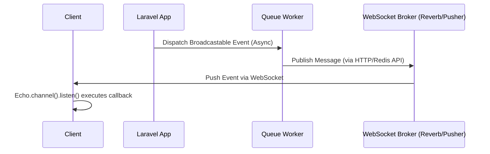

# Arsitektur Real-Time Event Broadcasting di Laravel (Echo)

Event Broadcasting di Laravel memungkinkan Anda untuk mempublikasikan (broadcast) event dari sisi server (PHP) ke klien (browser/mobile) secara *real-time* menggunakan WebSockets. Laravel menyediakan *wrapper* yang elegan bernama Laravel Echo, yang bekerja mulus dengan berbagai *driver* (seperti Pusher, Redis/Socket.io, dan Laravel Reverb).

Pemahaman mendalam mengenai arsitektur ini krusial untuk membangun aplikasi *real-time* berskala besar, efisien, dan aman.

## 1. Konsep Dasar & Arsitektur Broadcasting

Arsitektur broadcasting Laravel memisahkan *publisher* (server aplikasi), *broker/message queue* (Pusher/Redis/Reverb), dan *subscriber* (klien dengan Laravel Echo).



### Jenis-Jenis Channel
1. **Public Channel:** Bebas diakses tanpa otentikasi.
2. **Private Channel:** Memerlukan otentikasi. Klien harus mengirim HTTP request ke `/broadcasting/auth` untuk mendapatkan token.
3. **Presence Channel:** Ekstensi dari Private Channel yang mengetahui siapa saja (user list) yang saat ini tergabung di dalam channel, serta mendeteksi saat user *join* atau *leave*.

## 2. Implementasi Clean Architecture dengan Event Broadcasting

Di sistem yang kompleks, *dispatching* event tidak boleh sembarangan dilakukan di Controller. Alur yang benar adalah:
**FormRequest -> Controller -> Action/Service -> Repository (Opsional) -> Model & Event Dispatch**

### A. Definisi Event yang Di-Broadcast

Pastikan selalu menggunakan `ShouldBroadcast` (untuk dimasukkan ke dalam antrean / *queue*) alih-alih `ShouldBroadcastNow` agar proses *request* utama tidak *blocking* saat menghubungi broker WebSocket.

```php
<?php

declare(strict_types=1);

namespace App\Events\Orders;

use App\Models\Order;
use Illuminate\Broadcasting\Channel;
use Illuminate\Broadcasting\InteractsWithSockets;
use Illuminate\Broadcasting\PrivateChannel;
use Illuminate\Contracts\Broadcasting\ShouldBroadcast;
use Illuminate\Foundation\Events\Dispatchable;
use Illuminate\Queue\SerializesModels;

/**
 * Event yang dipicu ketika Order berhasil disetujui.
 * Mengimplementasikan ShouldBroadcast untuk real-time update.
 */
final class OrderApprovedEvent implements ShouldBroadcast
{
    use Dispatchable, InteractsWithSockets, SerializesModels;

    /**
     * @var string
     */
    public string $queue = 'broadcasts';

    /**
     * Data yang akan dibroadcast. Dilarang mem-broadcast keseluruhan object Model secara publik!
     */
    public array $payload;

    public function __construct(public readonly Order $order)
    {
        // Hanya memaparkan ID dan status ke frontend untuk mencegah data leakage
        $this->payload = [
            'order_id' => $order->id,
            'status' => $order->status->value,
            'approved_at' => $order->approved_at?->toIso8601String(),
        ];
    }

    /**
     * Mendefinisikan channel tempat event ini akan di-broadcast.
     */
    public function broadcastOn(): array
    {
        return [
            new PrivateChannel(sprintf('orders.%d', $this->order->user_id)),
        ];
    }

    /**
     * Nama event yang akan dikenali oleh Echo di frontend.
     */
    public function broadcastAs(): string
    {
        return 'order.approved';
    }

    /**
     * Data payload spesifik yang akan dikirim.
     */
    public function broadcastWith(): array
    {
        return $this->payload;
    }
}
```

### B. Action Layer untuk Eksekusi & Dispatching

Action bertanggung jawab mengeksekusi logika bisnis dan men-trigger event.

```php
<?php

declare(strict_types=1);

namespace App\Actions\Orders;

use App\Events\Orders\OrderApprovedEvent;
use App\Models\Order;
use App\Enums\OrderStatus;
use Illuminate\Support\Facades\DB;
use Throwable;
use RuntimeException;

final class ApproveOrderAction
{
    /**
     * Menyetujui order dan mempublikasikan event real-time.
     *
     * @throws RuntimeException
     */
    public function execute(Order $order): Order
    {
        if ($order->status === OrderStatus::APPROVED) {
            throw new RuntimeException('Order ini sudah disetujui sebelumnya.');
        }

        try {
            DB::beginTransaction();

            $order->update([
                'status' => OrderStatus::APPROVED,
                'approved_at' => now(),
            ]);

            DB::commit();
        } catch (Throwable $e) {
            DB::rollBack();
            throw new RuntimeException('Gagal menyetujui order: ' . $e->getMessage(), 0, $e);
        }

        // Dispatch broadcast event untuk UI frontend
        OrderApprovedEvent::dispatch($order);

        return $order;
    }
}
```

### C. Channel Authorization (routes/channels.php)

Validasi apakah *user* yang me-request akses ke *private channel* berhak mendengarkannya.

```php
<?php

declare(strict_types=1);

use Illuminate\Support\Facades\Broadcast;
use App\Models\User;
use App\Models\Order;

/*
|--------------------------------------------------------------------------
| Broadcast Channels
|--------------------------------------------------------------------------
|
| Di sini Anda dapat mendaftarkan semua callback otorisasi broadcast channel.
|
*/

Broadcast::channel('orders.{userId}', function (User $user, int $userId): bool {
    // Hanya user bersangkutan atau admin yang boleh mendengarkan channel ini
    return $user->id === $userId || $user->isAdmin();
});
```

---

## 3. Anti-Patterns & Best Practices

### ❌ Anti-Pattern 1: Object Model Exposure pada Public Properties
**Kesalahan:** Membiarkan properti model (khususnya relasi) terekspos langsung di event `ShouldBroadcast`. Laravel secara otomatis akan men-serialize semua properti *public* dari event kelas.

```php
// ❌ KODE SALAH
final class OrderCreated implements ShouldBroadcast {
    // BERBAHAYA: Seluruh data $order termasuk password/hash di relasi $order->user akan di-serialize dan dikirim!
    public function __construct(public Order $order) {} 

    public function broadcastOn() { return new PublicChannel('global-orders'); }
}
```
**Mengapa Berbahaya?**
*Data Leakage / Security Risk!* Seluruh *state* model `Order`, termasuk relasinya yang di-load (misal tabel `User` yang memuat email, NIK, atau hash password), akan menjadi JSON publik dan tersebar ke semua klien yang *subscribe*.

**✅ KODE BENAR**
```php
// ✅ KODE BENAR
final class OrderCreated implements ShouldBroadcast {
    public function __construct(private readonly Order $order) {} 

    public function broadcastOn(): Channel { 
        return new PublicChannel('global-orders'); 
    }

    // Hanya return data yang 100% aman bagi publik
    public function broadcastWith(): array {
        return [
            'order_id' => $this->order->id,
            'total_amount' => $this->order->total_amount,
            'created_at' => $this->order->created_at->toIso8601String(),
        ];
    }
}
```

### ❌ Anti-Pattern 2: N+1 Query Problem Saat Serialisasi Event
**Kesalahan:** Memanggil relasi *lazy-loaded* secara eksplisit di dalam `broadcastWith()` atau mengandalkan Model yang tidak memuat relasi saat akan dikirim ke *broker*. Mengingat broadcasting event biasanya dikerjakan secara *async* oleh *Queue Worker*, jika *worker* memuat ratusan event, maka akan terjadi N+1 query ke *database* dari proses antrean.

```php
// ❌ KODE SALAH
public function broadcastWith(): array {
    // Jika $this->order->customer belum diload saat dispatch, 
    // Queue Worker akan mengeksekusi 1 query tambahan untuk setiap event yang di-broadcast!
    return [
        'customer_name' => $this->order->customer->name, 
    ];
}
```

**✅ KODE BENAR**
Muat relasi (eager load) *sebelum* mem-passingnya ke event, atau definisikan properti primitif murni di dalam constructor sehingga worker tidak perlu menyentuh DB sama sekali!

```php
// ✅ KODE BENAR
final class OrderCreated implements ShouldBroadcast {
    private string $customerName;
    
    public function __construct(Order $order) {
        // Eager execution sebelum event di-serialize ke queue
        // Pastikan $order sudah di-load dengan relation (misal di Action class)
        $this->customerName = $order->customer->name ?? 'Unknown';
    }

    public function broadcastWith(): array {
        return [
            'customer_name' => $this->customerName,
        ];
    }
}
```

---

## 4. Architecture & Unit Testing (Pest v3)

Validasi bahwa arsitektur implementasi Broadcasting benar (Clean Architecture) dan Event benar-benar dikonfigurasi secara aman.

```php
<?php

declare(strict_types=1);

use App\Events\Orders\OrderApprovedEvent;
use App\Models\Order;
use App\Models\User;
use App\Actions\Orders\ApproveOrderAction;
use Illuminate\Support\Facades\Event;
use Illuminate\Broadcasting\PrivateChannel;

uses(\Illuminate\Foundation\Testing\RefreshDatabase::class);

describe('Architecture Test: Broadcasting Events', function () {
    arch('all broadcastable events must be strictly typed and implement ShouldBroadcast')
        ->expect('App\Events')
        ->toImplement(\Illuminate\Contracts\Broadcasting\ShouldBroadcast::class)
        ->toUseStrictTypes();
});

describe('Unit Test: OrderApprovedEvent Broadcasting', function () {
    it('dispatches the event successfully when action is executed', function () {
        Event::fake([
            OrderApprovedEvent::class,
        ]);

        $order = Order::factory()->create([
            'status' => \App\Enums\OrderStatus::PENDING,
        ]);

        $action = app(ApproveOrderAction::class);
        $action->execute($order);

        Event::assertDispatched(OrderApprovedEvent::class, function (OrderApprovedEvent $event) use ($order) {
            return $event->order->id === $order->id;
        });
    });

    it('creates correct private channel array based on user id', function () {
        $user = User::factory()->create();
        $order = Order::factory()->create(['user_id' => $user->id]);

        $event = new OrderApprovedEvent($order);
        $channels = $event->broadcastOn();

        expect($channels)->toBeArray()
            ->and($channels[0])->toBeInstanceOf(PrivateChannel::class)
            ->and($channels[0]->name)->toBe('private-orders.' . $user->id);
    });

    it('only exposes explicitly defined payload in broadcastWith', function () {
        $order = Order::factory()->create([
            'status' => \App\Enums\OrderStatus::APPROVED,
        ]);

        $event = new OrderApprovedEvent($order);
        $payload = $event->broadcastWith();

        expect($payload)->toHaveKeys(['order_id', 'status', 'approved_at'])
            ->and($payload)->not->toHaveKey('user_id'); // Memastikan tidak bocor
    });
});
```

## 5. Security & Scaling Tips

1. **Gunakan Queue Terdedikasi:** Untuk sistem dengan volume notifikasi *real-time* yang tinggi, alokasikan antrean khusus `queue = 'broadcasts'` untuk event broadcasting, dipisah dari *queue* *heavy processing* (seperti image processing atau email) agar WebSocket *latency* tetap minim (dibawah 100ms).
2. **Rate Limiting di Otentikasi Channel:** Endpoint `/broadcasting/auth` bisa di-flood oleh penyerang. Gunakan *rate limiter* pada middleware `route/channels.php`.
3. **Pilih Message Broker yang Sesuai:**
   - **Laravel Reverb:** Untuk ekosistem native PHP + Laravel (Hemat biaya, performa tinggi dengan FrankenPHP).
   - **Soketi (Node.js):** Skalabilitas tinggi berbasis uWebSockets.
   - **Pusher (PaaS):** 0 *maintenance*, tapi berbayar jika skala besar.

**Selesai**
Arsitektur broadcasting ini telah menjamin *type safety*, pemisahan *concern* (*Clean Architecture*), penanganan anti-pattern dari segi *memory/query/security leakage*, dan memiliki pengetesan yang kokoh melalui Pest v3.
