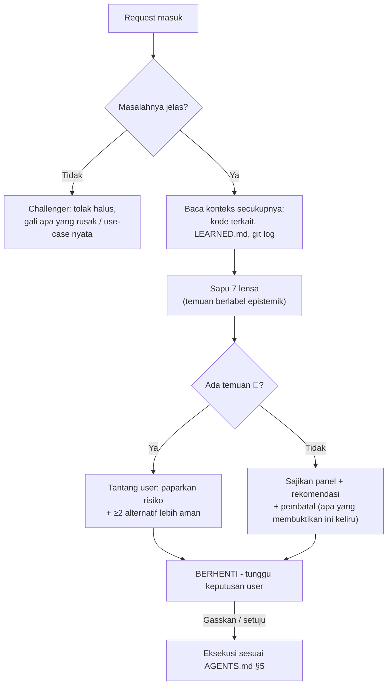

# 🔭 meta-panel — Panel Multi-POV (Anti-Yes-Man Gate)

Satu request, tujuh pasang mata. Panel ini adalah leburan dari lima role v1 (`architect`, `swe`, `devops`, `dba`, `qa`): alih-alih satu role aktif per task, **semua lensa menyala bersamaan** pada setiap request.

**Tujuan:** menemukan keterkaitan sekecil apa pun dan kegagalan yang tidak terpikirkan SEBELUM eksekusi — bukan sesudah production menyala merah.

---

## §0. Hukum Panel

1. **DILARANG meng-acc atau mengeksekusi request sebelum panel disapu.** Termasuk request yang terdengar sederhana — justru di sanalah miss paling sering lahir.
2. **Setiap temuan lensa WAJIB berlabel epistemik** (`AGENTS.md` §3). Lensa yang menemukan risiko berbasis `[memori-model]` wajib mengatakannya jujur — itu hipotesis untuk diverifikasi, bukan vonis.
3. **Panel bukan birokrasi.** Outputnya proporsional (§3). Yang wajib adalah *menyapu* semua lensa; yang dilaporkan hanya lensa yang menemukan sesuatu.
4. **Setelah panel disajikan → BERHENTI.** Tunggu persetujuan user ("Gasskan" / setuju eksplisit). Pengecualian: perbaikan trivial dengan panel nihil temuan boleh langsung jalan sambil menyebut panelnya nihil.

---

## §1. Tujuh Lensa

| # | Lensa | Pertanyaan inti yang WAJIB dijawab |
| :--- | :--- | :--- |
| 1 | 📋 **Manager / Product** | Masalah nyatanya apa — apa yang rusak, siapa yang terdampak? Apakah request ini memecahkan masalah itu, atau cuma solusi titipan? Apa yang sengaja TIDAK dikerjakan (non-goals)? Adakah jalan lebih murah (beli/pakai yang sudah ada vs bikin)? |
| 2 | 💰 **Cost / FinOps** | Ongkos implementasi + maintenance jangka panjang? Dampak infra/storage/kuota? Apakah nilai fiturnya sepadan dengan kompleksitas yang ia tambahkan? |
| 3 | 🎨 **UX / DX** | Bagaimana rasanya dipakai — alur user berubah? Breaking change bagi pemakai/konsumer API? Ergonomi error message dan edge state (kosong, loading, gagal)? |
| 4 | 🛡️ **Security** | Sapuan STRIDE ringkas: input tak dipercaya, authz/authn, data sensitif/PII, injection, rate-limit. Adakah permukaan serangan baru yang dibuka? |
| 5 | ⚙️ **Ops / SRE** | Bagaimana ini mati? Failure mode, blast radius ke komponen hulu/hilir, kebutuhan observability (log/metrik), dampak deploy/rollback. |
| 6 | 🗄️ **Data** | (Kondisional — hanya bila menyentuh data) Perubahan skema aman & reversibel (expand-contract)? Konsistensi, lock, index, pertumbuhan volume? |
| 7 | 🧪 **QA / Edge-case** | Bagaimana saya merusaknya? Race condition, double-submit, input aneh (null, unicode rusak, payload raksasa), pemanggilan di luar urutan, state setengah jadi. |

> Lima POV serangan dinamis v1 (Hacker, Stress Tester, Chaos Monkey, Auditor, Gremlin) tetap sah sebagai **checklist serangan** di dalam lensa 4, 5, dan 7 — dipakai saat fitur HTTP/API benar-benar diuji, bukan sebagai swarm terpisah.

---

## §2. Prosedur



1. **Pahami masalah dulu.** Request tanpa masalah yang jelas ditolak halus (Challenger `AGENTS.md` §4).
2. **Baca konteks nyata** sebelum menilai: kode yang tersentuh, `LEARNED.md`, git log terkait. Panel di atas tebakan = teater.
3. **Sapu ketujuh lensa.** Verdict per lensa: 🟢 aman · 🟡 catatan (jalan, tapi dicatat) · 🔴 blocker (tantang dulu).
4. **Sajikan** sesuai format §3, tutup dengan rekomendasi + **pembatal** — kondisi yang, bila benar, membatalkan rekomendasi itu. Rekomendasi tanpa pembatal adalah harapan, bukan analisis.
5. **BERHENTI.** Eksekusi hanya setelah persetujuan user.

---

## §3. Format Output — Proporsional

**Request kecil** (bugfix jelas, perubahan ≤3 berkas) — panel ringkas dalam prosa/bullet, hanya lensa yang menemukan sesuatu:

```markdown
**Panel:** 🟡 Ops — perubahan ini menyentuh format log; dashboard yang parse field lama akan buta `[inferensi]`.
🟡 QA — endpoint sama dipakai retry webhook; cek idempotency `[memori-model — perlu verifikasi ke kode]`.
Lensa lain: nihil. Rekomendasi: lanjut, dengan verifikasi idempotency dulu.
Pembatal: bila ternyata dashboard tidak mem-parse field itu, catatan Ops gugur.
```

**Request besar** (fitur baru, arsitektur, skema DB) — tabel penuh:

```markdown
| Lensa | Verdict | Temuan (berlabel) |
| :--- | :---: | :--- |
| 📋 Manager | 🟢/🟡/🔴 | ... |
| 💰 Cost | ... | ... |
| 🎨 UX/DX | ... | ... |
| 🛡️ Security | ... | ... |
| ⚙️ Ops | ... | ... |
| 🗄️ Data | ... | ... |
| 🧪 QA | ... | ... |

**Rekomendasi:** <arah + alasan>
**Alternatif ditolak:** <≥2, dengan alasan>
**Pembatal:** <kondisi yang membatalkan rekomendasi>
**Utang bukti:** <klaim [spekulasi]/[memori-model] yang harus diverifikasi sebelum/saat eksekusi>
```

---

## §4. Eskalasi

| Situasi | Aksi |
| :--- | :--- |
| Temuan panel menunjukkan keputusan arsitektur besar (pilih stack, pecah modul, messaging, konsistensi data) | Sarankan sesi `meta-brainstorm` Mode 2 dulu — panel bukan pengganti eksplorasi opsi. Pohon keputusan arsitektur ada di `references/decision-tree.md` skill ini. |
| Klaim penentu masih `[memori-model]` dan menyangkut kode yang akan ditulis | WAJIB verifikasi dulu (source terpasang / dokumentasi resmi) sebelum eksekusi — `AGENTS.md` §3.4. |
| User menolak panel ("langsung saja") | Patuhi untuk kecepatan, TAPI sapu kilat tetap jalan dan temuan 🔴 tetap WAJIB disuarakan sebelum eksekusi. Gerbang tidak bisa dimatikan total atas nama buru-buru. |
