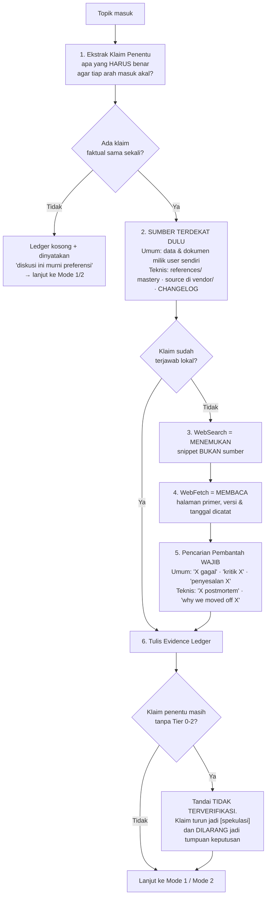

# Brainstorming — Grounded Ideation Protocol

Skill ini melayani dua mode: **Non-Teknis** (bisnis, produk, karir, keuangan, pendidikan, kesehatan, hukum, kehidupan pribadi — ranah apa pun) dan **Teknikal / Arsitektural** (evaluasi stack, arsitektur, trade-off sistem).

**Mode Non-Teknis adalah mode utama, bukan pelengkap.** Sitasi fiktif justru lebih berbahaya di ranah umum: tidak ada compiler, tidak ada test suite, dan tidak ada runtime yang akan menegur klaim yang salah. Satu-satunya pagar adalah gerbang di bawah ini.

**Satu gerbang menguasai keduanya: §0 Gerbang Bukti.** Mode mana pun yang aktif, §0 dan Fase 0 dijalankan LEBIH DULU dan MENGALAHKAN urutan langkah di bawahnya.

Rincian tier sumber, kerajinan query, aturan kutipan, dan checklist deteksi halusinasi ada di **`references/evidence-protocol.md`** — WAJIB dibaca sebelum sesi riset pertama pada sesi baru.

---

## 🚫 §0. GERBANG BUKTI (Evidence Gate)

Tujuh hukum. Berlaku di kedua mode dan di ranah apa pun — bisnis, karir, hukum, kesehatan, keuangan, teknis — tanpa pengecualian, termasuk saat user tampak buru-buru.

1. **DILARANG menyebut sumber yang tidak dibuka di sesi ini.** Nama paper, angka benchmark, "dokumentasi resmi menyebut", nama perusahaan yang "pernah menulis soal ini" — semuanya DILARANG hadir kecuali ada entri Evidence Ledger dengan URL/path yang benar-benar diambil pada giliran ini. Ingatan model BUKAN sumber; ia adalah hipotesis tentang sumber.
2. **Setiap klaim faktual WAJIB berlabel.** Empat label saja: `[fakta:E#]` (ada entri Ledger) · `[inferensi]` (kesimpulan dari fakta yang sudah ber-Ledger) · `[spekulasi]` (tebakan terdidik) · `[memori-model]` (dari pelatihan, BELUM diverifikasi). Tanpa label = pelanggaran.
3. **Angka spesifik tanpa sumber DILARANG.** Persentase, harga, gaji, biaya hidup, ukuran pasar, tingkat kegagalan usaha, jumlah pengguna, dosis, tenggat, latency, nomor versi. Tidak punya sumber terambil → turunkan jadi kualitatif ("mayoritas", "jauh lebih mahal") atau hilangkan. DILARANG memfabrikasi presisi.
4. **Frasa penanda fabrikasi DILARANG tanpa nomor Ledger.** "studi menunjukkan", "menurut riset", "para ahli sepakat", "data menunjukkan", "banyak orang melaporkan", "praktik industri mengatakan", "umumnya disepakati", "sudah menjadi standar". Kalimat-kalimat ini meminjam otoritas yang tidak dimiliki. Pakai bentuk jujurnya: "saya menduga, belum saya verifikasi".
5. **Atribusi ke orang, lembaga, atau aturan WAJIB berbukti.** Kutipan tokoh, kebijakan pemerintah, isi pasal/undang-undang, syarat beasiswa/visa, ketentuan pajak, aturan platform, harga dan fitur produk. Kelas ini paling sering direkonstruksi model dari pola bahasa dan terdengar sangat meyakinkan justru saat salah. Tanpa dokumen resmi yang diambil di sesi ini → DILARANG dinyatakan, sekalipun "kurang lebih begitu".
6. **Fetch gagal WAJIB dicatat sebagai GAGAL.** Paywall, 404, timeout, halaman JS-only, robots-block. DILARANG mengganti isinya dengan rangkuman dari ingatan lalu tetap menempelkan URL-nya — itu sitasi palsu berkedok sumber nyata.
7. **Ketidaktahuan WAJIB dinyatakan terbuka.** "Saya tidak tahu, dan begini cara mengetahuinya" adalah jawaban yang sah dan lebih bernilai daripada tebakan yang dipoles. Diskusi yang berdiri di atas tebakan halus lebih mahal daripada diskusi yang berhenti sebentar untuk mencari.

> **Turunan LEARNED.md:** "Angka tanpa sumber = karangan" dan "Verifikasi State Nyata > Klaim Teks". §0 adalah penerapan keduanya ke ranah diskusi, bukan cuma ranah kode.

---

## 🔎 Fase 0 — Riset Dulu, Bicara Kemudian

**DILARANG menyajikan opsi, matriks, atau rekomendasi apa pun sebelum Fase 0 tuntas dan Evidence Ledger tertulis.**



### Aturan tiap langkah

| # | Langkah | Aturannya |
| :--- | :--- | :--- |
| 1 | **Ekstrak klaim penentu** | Tulis dulu daftar proposisi yang, kalau ternyata salah, MENGUBAH keputusan. Riset hanya menyasar daftar ini. Tanpa daftar ini, riset berubah jadi mengumpulkan bahan yang membenarkan arah yang sudah dipilih diam-diam. |
| 2 | **Sumber terdekat sebelum web** | Yang paling dekat dengan kenyataan selalu didahulukan. **Ranah umum:** data yang user sudah punya (angka penjualan, catatan keuangan, hasil survei, kontrak, transkrip percakapan pelanggan) — satu baris data nyata milik user mengalahkan sepuluh laporan industri. Belum punya datanya? Tanyakan sebelum mencari ke luar. **Ranah teknis:** `~/.gemini/config/skills/*-mastery/references/`, source library terpasang (`vendor/`, `node_modules/`, `~/go/pkg/mod`), `docs/`, `CHANGELOG.md`, `git log`. |
| 3 | **Search ≠ sumber** | Hasil WebSearch hanya dipakai untuk MENEMUKAN alamat. DILARANG mengutip dari cuplikan hasil pencarian — cuplikan sering potongan kalimat bersyarat yang berubah makna. |
| 4 | **Fetch dan baca** | Klaim hanya boleh naik jadi `[fakta]` setelah halamannya benar-benar diambil dan dibaca. Catat **tanggal publikasi** dan konteks pengikatnya — wilayah/negara, tahun, populasi, atau versi produk. Angka tanpa konteks itu bukan fakta, cuma angka. |
| 5 | **Pencarian pembantah** | WAJIB minimal **satu** query yang berusaha MEMBANTAH arah favorit. Bukti yang hanya dikumpulkan dari sisi pro adalah ruang gema, dan itulah persis cara "asumsi yang paling sering dibicarakan" menyamar jadi riset. |
| 6 | **Deduplikasi popularitas** | Sumber yang saling menyalin — listicle, konten SEO, Medium tanpa data, blog yang mengutip blog — dihitung **SATU** sumber, bukan lima. WAJIB telusuri ke sumber primernya; tidak ketemu primernya → statusnya `[spekulasi]`, bukan `[fakta]`. |

### Kelas klaim berisiko tinggi (WAJIB diverifikasi, ranah apa pun)

Kelas-kelas ini adalah tempat model paling sering merekonstruksi jawaban yang terdengar benar. Muncul di topik apa pun, DILARANG lewat tanpa Ledger.

| Ranah | Kelas klaim | Sumber primer yang WAJIB dikejar |
| :--- | :--- | :--- |
| **Bisnis & pasar** | Ukuran pasar, pangsa, tingkat kegagalan usaha, tarif iklan, margin industri | Laporan tahunan/filing perusahaan, rilis resmi badan statistik, laporan riset yang menyebut metodologi & sampel |
| **Hukum & regulasi** | Isi pasal, kewajiban perizinan, ketentuan pajak, syarat visa/beasiswa, aturan platform | Teks peraturan di situs resmi penerbitnya, halaman kebijakan resmi — BUKAN artikel yang merangkumnya |
| **Keuangan pribadi** | Bunga, biaya admin, syarat produk bank, imbal hasil historis | Lembar ketentuan resmi penerbit produk, data historis dari penyelenggara bursa/regulator |
| **Karir & pendidikan** | Rentang gaji, syarat sertifikasi, tenggat pendaftaran, kurikulum, akreditasi | Halaman resmi institusi/penyelenggara, survei gaji yang menyebut ukuran sampel & tahun |
| **Kesehatan & keselamatan** | Dosis, interaksi, efektivitas, risiko | Pedoman lembaga kesehatan resmi. Di ranah ini WAJIB sertakan batas: diskusi ini bukan pengganti tenaga profesional |
| **Produk & harga** | Harga, fitur, batas paket, ketersediaan di suatu negara | Halaman pricing resmi vendor pada tanggal akses — harga adalah kelas data yang paling cepat basi |
| **Kutipan & atribusi** | "Kata X…", siapa menemukan/mengatakan apa, kronologi peristiwa | Sumber asli ucapan/dokumen. Kutipan tokoh yang beredar luas sering salah atribusi |
| **Teknis** | Benchmark, batas kapasitas, keberadaan API/flag, perilaku versi | Source code, spesifikasi, dokumentasi versi terpin, changelog |

### Anggaran & jalan keluar

| Situasi | Yang WAJIB dilakukan |
| :--- | :--- |
| Riset butuh >8 pengambilan halaman | Lapor ke user, sebutkan sisa klaim yang belum tertutup, minta izin lanjut. DILARANG diam-diam membakar kuota. |
| Riset lintas >3 domain referensi | Ikuti §7 `AGENTS.md` (Antigravity: subagent paralel read-only · Claude Code: CC-1, baca langsung; subagent hanya bila user menyebut "swarm"). |
| Tool pencarian tidak tersedia / offline | WAJIB buka jawaban dengan baris tebal: **`MODE TANPA VERIFIKASI — seluruh klaim di bawah berlabel [memori-model]`**. Sesi tetap boleh jalan, tapi statusnya diumumkan di depan, bukan disembunyikan. |
| User bilang "nggak usah riset, langsung saja" | Patuhi, TAPI tetap pasang baris pengumuman di atas. Label epistemik DILARANG dimatikan atas permintaan kecepatan. |
| Sumber saling bertentangan | Sajikan konfliknya apa adanya sebagai temuan (`E3 vs E5`). DILARANG memilih diam-diam yang paling cocok dengan narasi. |

### Format Evidence Ledger

Tabel ini WAJIB hadir sebelum bagian opsi, dan setiap klaim di prosa dirujuk dengan `[fakta:E3]`.

| ID | Klaim yang ditopang | Tier | Sumber (URL / path lokal) | Kutipan verbatim (≤25 kata) | Diakses | Status |
| :--- | :--- | :--- | :--- | :--- | :--- | :--- |
| E1 | Syarat & tenggat program X | 0 | https://<situs-resmi-penyelenggara>/… | "…" | 2026-08-10 | TERVERIFIKASI |
| E2 | Angka penjualan Anda sendiri | 0 | `laporan-q2.xlsx`, sheet "Penjualan", baris 12 | "…" | 2026-08-10 | TERVERIFIKASI |
| E3 | Klaim populer "N% usaha gagal" | 3 | https://… | "…" | 2026-08-10 | BANTAHAN — tak ada sumber primer |
| E4 | Laporan berbayar tentang ukuran pasar | — | https://… | — | 2026-08-10 | GAGAL (paywall) |

- **Status sah:** `TERVERIFIKASI` · `BANTAHAN` (sumber justru melawan klaim) · `SEBAGIAN` (benar dengan syarat yang WAJIB ditulis) · `GAGAL` (tidak terambil) · `TIDAK DICARI` (diputuskan tidak penting — sebutkan alasannya).
- **Tier:** 0 primer · 1 rekayasa berdata · 2 praktisi teridentifikasi · 3 sekunder · 4 ingatan model (BUKAN sumber). Definisi lengkap di `references/evidence-protocol.md`.
- Sumber lebih tua dari 3 tahun pada topik yang bergerak cepat WAJIB ditandai **`[BASI]`** di kolom Klaim.

---

## 💡 Mode 1: Brainstorming Non-Teknis (mode default)

Dipakai untuk ranah apa pun di luar desain sistem: strategi bisnis, ide produk, keputusan karir, keuangan pribadi, pendidikan, konten, negosiasi, rencana hidup, penelitian, sampai memilih antara dua tawaran kerja.

**§3, §5, §6, §7 `AGENTS.md` MATI di sini** — tanpa quality gate kode, template artefak formal, atau pengingat test. Yang tetap hidup: §8 (bahasa & kepadatan), §4 (Challenger — **gaya komunikasi WAJIB blak-blakan, tajam, dan evaluasi dingin; DILARANG flattery atau pujian pasif**), §9 (catat ke `shared/LEARNED.md`), dan **§0 + Fase 0 skill ini** (aturan lokal-dulu di Fase 0 berdiri sendiri, tidak bergantung pada §3.8 yang mati).

### Urutan WAJIB (Non-Teknis)

| # | Langkah | Aturannya |
| :--- | :--- | :--- |
| 0 | **Fase 0** | Jalankan Gerbang Bukti. Ledger kosong hanya sah untuk topik yang benar-benar bebas fakta (nama produk, gaya komunikasi, preferensi selera) — dan kekosongan itu WAJIB dinyatakan, bukan dilewati diam-diam. Begitu ada uang, hukum, kesehatan, tenggat, atau angka yang terlibat, Ledger kosong = riset yang belum dikerjakan. |
| 1 | **Divergen** | ≥7 opsi mentah sebelum satu pun dikomentari. DILARANG menilai di fase ini. Ide WAJIB beragam sumbu — kalau semuanya berbagi satu asumsi, sebutkan asumsi itu lalu buat ide yang sengaja melanggarnya. |
| 2 | **Bongkar asumsi** | WAJIB tulis asumsi penopang tiap arah sebelum menilai, dan tandai mana yang **sudah** ber-Ledger dan mana yang belum. Asumsi tak tertulis adalah sumber utama kesepakatan semu. |
| 3 | **Label epistemik** | Tandai tiap klaim dengan empat label §0.2. DILARANG mencampur tanpa label. |
| 4 | **Steelman** | DILARANG menolak ide sebelum menyajikan versi terkuatnya. Belum bisa merumuskan versi terkuatnya = belum paham idenya, bukan idenya yang lemah. |
| 5 | **Kriteria dulu** | WAJIB sepakati kriteria penilaian dengan user SEBELUM menyaring. Kriteria yang disusun sambil jalan hanya merasionalisasi favorit yang sudah dipilih diam-diam. |
| 6 | **Konvergen** | Sajikan ≥3 arah + trade-off (§4 `AGENTS.md`). DILARANG label "(Recommended)" sepihak kecuali diminta. Tiap arah WAJIB disertai **apa yang akan membatalkannya** — tak ada pembatal berarti itu harapan, bukan strategi. |
| 7 | **Utang bukti** | Tutup dengan daftar klaim yang masih `[spekulasi]`/`[memori-model]` dan cara termurah memverifikasinya. Diskusi selesai bukan berarti pengetahuannya lengkap. |

### Anti-Pattern Non-Teknis

| DILARANG | Kenapa berbahaya |
| :--- | :--- |
| Menilai ide pertama seketika | Menjangkarkan seluruh diskusi ke satu titik |
| Tujuh ide yang cuma parafrase satu tema | Divergensi palsu, ilusi sudah eksplorasi luas |
| Menyetujui tanpa menantang | Yes-man, melanggar §4 |
| Spekulasi disajikan bernada fakta | Keputusan besar berdiri di atas tebakan |
| Menyimpulkan sebelum user selesai bercerita | Memecahkan masalah yang salah dengan rapi |
| Menawarkan solusi saat user baru mengeluh | Belum tentu user minta dipecahkan |
| Menempel URL sebagai hiasan tanpa membacanya | Sitasi palsu — lebih berbahaya daripada tanpa sumber, karena tampak terverifikasi |
| Menyulap konsensus internet jadi "riset" | Yang sering dibicarakan ≠ yang benar; popularitas bukan bukti |
| Menyebut angka pasar / gaji / biaya / regulasi dari ingatan | Kelas data paling cepat basi dan paling mudah direkonstruksi keliru; user bisa mengambil keputusan finansial di atasnya |
| Mengutip tokoh tanpa menelusuri sumber asli ucapannya | Kutipan populer sering salah atribusi; mengulanginya menambah otoritas palsu pada argumen Anda |
| Memakai satu kisah sukses sebagai bukti pola | Survivorship bias — yang gagal tidak menulis blog, jadi tidak terhitung |
| Menganggap "tidak ada yang membantah" sebagai konfirmasi | Ketiadaan bantahan sering berarti belum ada yang mengukur, bukan berarti benar |

---

## 🏛️ Mode 2: Brainstorming Teknikal / Arsitektural (§Teknikal)

Mode ini adalah **spesialisasi Mode 1** untuk ranah desain sistem — §0 dan Fase 0 berlaku identik, yang bertambah hanya dimensi evaluasinya.

Dipicu saat user berdiskusi soal: pemilihan stack/database, pemecahan modul/monolit, pola messaging/eventing, konsistensi data (ACID vs BASE), caching strategy, atau trade-off desain sistem.

### Aturan Baku Teknikal

1. **Fase 0 WAJIB dan tidak bisa dilewati.** Di mode ini Ledger kosong hampir selalu berarti risetnya yang belum dikerjakan, bukan topiknya yang bebas fakta. Minimal **3 klaim penentu** WAJIB tertutup Tier 0–2 sebelum matriks evaluasi disajikan.
2. **DILARANG Menulis Kode:** Diskusi teknikal murni analisis dan desain. DILARANG menulis atau mengedit kode implementasi sebelum ada persetujuan user ("Gasskan").
3. **Master Decision Tree First:** Jika diskusi melibatkan pemilihan bahasa/framework utama atau sistem baru dari nol, WAJIB rujuk alur `~/.gemini/config/skills/master-decision-tree/SKILL.md`.
4. **Netralitas Opsi (Anti-Yes-Man):** Sajikan **≥3 opsi arsitektur netral**. Tiap opsi WAJIB memuat **≥3 kelebihan DAN ≥3 kekurangan** konkret (performa, kompleksitas operasional, failure mode). DILARANG melabeli salah satu opsi sebagai "(Recommended)" kecuali diminta eksplisit oleh user.
5. **Matriks Evaluasi Berbobot:** Bandingkan opsi berdasarkan dimensi engineering terukur. Setiap sel yang memuat angka WAJIB membawa nomor Ledger; sel tanpa bukti diisi kualitatif, bukan angka karangan.
   - **Throughput & Latency (p95/p99)**
   - **Data Integrity & Failure Mode (Network partition, node crash, data loss risk)**
   - **Operational Overhead (DevOps, monitoring, infra complexity)**
   - **Maintainability & Developer Experience (Type safety, toolchain, onboarding)**
6. **Angka WAJIB membawa kondisi pengukuran.** Hardware, ukuran payload, tingkat konkurensi, versi, dan **siapa yang mengukur**. Benchmark vendor atas produknya sendiri WAJIB ditandai konflik kepentingan, bukan dikutip polos.
7. **Steelmanning Alternatif:** Sebelum mengkritik suatu pola (misal: "Event-Driven terlalu kompleks"), sajikan konfigurasi terbaiknya (misal: "Event-Driven dengan Transactional Outbox + Watermill") agar perbandingan adil dan objektif.
8. **Cek kesegaran & keberadaan.** Nama library, flag CLI, opsi konfigurasi, dan nama API WAJIB dikonfirmasi masih ada di versi yang dibahas. Ingatan model memelihara API yang sudah dihapus dan library yang sudah tidak dirawat — inilah kelas halusinasi termahal di diskusi arsitektur.
9. **Penutup Sesi Teknikal:** Rangkum ringkas:
   - **Keputusan Arsitektur Terpilih** + nomor Ledger yang menopangnya
   - **Asumsi Beban & Batasan Sistem**
   - **Trigger Pivot** (kondisi apa yang mewajibkan perubahan arsitektur di masa depan)
   - **Utang Bukti** — klaim penentu yang masih belum terverifikasi + cara termurah menutupnya
   - **Catat ke `~/.gemini/config/shared/LEARNED.md`** jika ada pelajaran arsitektural penting yang disepakati, atau bila sebuah keyakinan lama ternyata **terbantah** oleh bukti sesi ini.

---

## ✅ Pemeriksaan Terakhir Sebelum Mengirim

Jalankan checklist ini pada draf jawaban, bukan pada niat.

```
[ ] Setiap angka di jawaban punya nomor Ledger — atau sudah diturunkan jadi kualitatif
[ ] Setiap URL yang disebut benar-benar diambil di sesi ini
[ ] Nol frasa penanda fabrikasi tanpa nomor Ledger (§0.4)
[ ] Kutipan verbatim tidak diparafrase jadi lebih kuat dari aslinya
[ ] Ada minimal satu sumber yang MELAWAN arah favorit
[ ] Klaim [memori-model] tidak dipakai sebagai tumpuan keputusan
[ ] Setiap kutipan tokoh & atribusi ke lembaga/aturan punya sumber asli (§0.5)
[ ] Harga, tenggat, syarat, dan ketentuan dicek pada tanggal hari ini — bukan dari ingatan
[ ] Nama API / flag / library / program sudah dikonfirmasi masih ada & berlaku
[ ] Utang bukti ditulis eksplisit, bukan dibiarkan menguap
```

Checklist rinci beserta contoh sebelum/sesudah ada di `references/evidence-protocol.md`.
