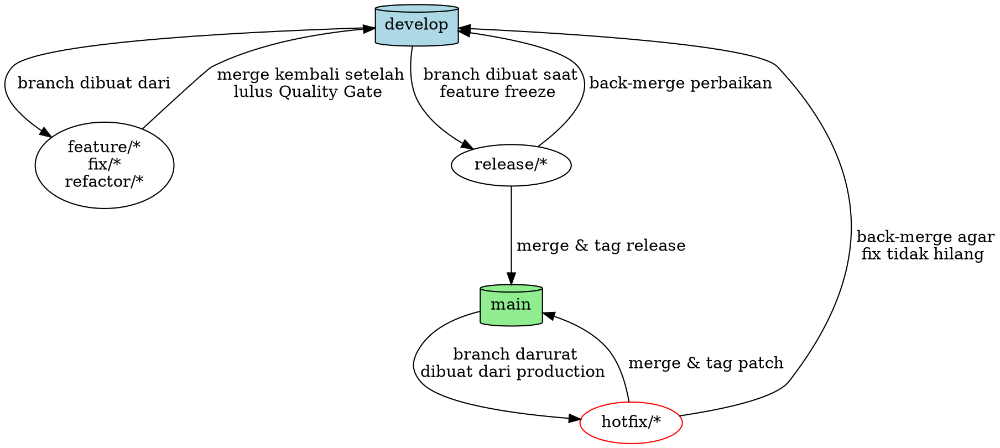

# Git Workflow — Top 1% Backend Engineering Protocol

Dokumen ini adalah SSOT perilaku AI agent terhadap Git. Setiap operasi yang menyentuh repositori Git — dari `git init` hingga `git push` — WAJIB mengikuti protokol ini tanpa pengecualian.

## 🔗 Posisi dalam Rantai Kerja

Skill ini adalah **tahap 5** — dan ia berada **SETELAH** gerbang persetujuan, bukan sebelumnya.

| # | Tahap | Dokumen |
| :-: | :--- | :--- |
| 1 | Routing task | `AGENTS.md` §2 |
| 2 | Sapu 10 lensa Panel Multi-POV | `skills/meta-panel/SKILL.md` bagian 1–2 |
| 3 | Pilih stack & arsitektur | `skills/meta-panel/references/decision-tree.md` |
| 4 | **BERHENTI — tunggu persetujuan user ("Gasskan")** | `AGENTS.md` §0.2 · **GERBANG MUTLAK** |
| 5 | **Branch, atomic commit, merge** | **`meta-git/SKILL.md` — Anda di sini** |
| 6 | Disiplin eksekusi + exit gate | `AGENTS.md` §5 |

> Nomor **§** selalu merujuk `AGENTS.md`. Untuk seksi milik skill lain dipakai kata "bagian"; seksi dokumen ini sendiri ditulis §1–§10 tanpa nama berkas.

**DILARANG membuat feature branch untuk eksekusi sebelum tahap 4 (persetujuan) terlewati.** Panel disajikan di dalam percakapan, bukan sebagai dokumen ter-commit — jadi sebelum "Gasskan" tidak ada berkas yang perlu masuk ke `main`/`develop`, dan working tree tetap bersih (`AGENTS.md` §8). Pembuatan branch `feature/*` dilakukan setelah persetujuan.

**Pengecualian Rute Eksekusi:** perbaikan trivial yang panelnya nihil temuan (`meta-panel` bagian 0.4) boleh langsung dikerjakan tanpa melewati tahap 3–4 — branch tetap dibuat sesuai §1 di bawah.

**Tiga sambungan yang WAJIB dijaga konsisten:**
- **Branch dan tiket papan adalah satu pasangan** (`skills/meta-board/SKILL.md`). Tiket dicatat lebih dulu dan menyebut nama branch-nya; branch dibuat dengan nama persis itu; commit pertama terjadi setelah tiketnya berstatus `doing`. Satu branch membawa satu tiket terbuka.
- Satu unit logis pekerjaan memetakan ke satu commit atomik (§5 di bawah); commit hanya setelah exit gate `AGENTS.md` §5.7 lulus.
- Batch menulis maksimal 3–4 berkas per giliran (`AGENTS.md` §5.3); tiap batch: test terkait → atomic commit → lanjut.

---

## §0. HUKUM BESI

Dua hukum yang DILARANG dilanggar dalam kondisi apa pun.

1. **SATU COMMIT = SATU UNIT LOGIS.** Commit yang mencampur fitur baru + refactor + config update dalam satu snapshot adalah pelanggaran. Pecah menjadi commit atomik berdasarkan *alasan perubahan*, bukan jumlah file.
2. **JANGAN COMMIT KE `main` ATAU `develop` SECARA LANGSUNG.** Semua pekerjaan WAJIB dilakukan di branch `feature/*`, `fix/*`, `hotfix/*`, atau `refactor/*`. Merge ke `develop` atau `main` hanya melalui mekanisme yang terkontrol (merge/PR).

---

## §1. BRANCHING MODEL — GIT FLOW



### Branch Utama (Permanen)

| Branch | Fungsi | Siapa yang merge ke sini |
| :--- | :--- | :--- |
| `main` | Kode yang sedang live di production. Setiap commit di sini HARUS bisa di-deploy. | Hanya dari `release/*` atau `hotfix/*` |
| `develop` | Integrasi development. Merepresentasikan "next release". | Dari `feature/*`, `fix/*`, `refactor/*` |

### Branch Sementara (Dibuat dan Dihapus Sesuai Kebutuhan)

| Branch | Dibuat dari | Merge kembali ke | Naming Convention |
| :--- | :--- | :--- | :--- |
| `feature/*` | `develop` | `develop` | `feature/add-checkout-api` |
| `fix/*` | `develop` | `develop` | `fix/cart-race-condition` |
| `refactor/*` | `develop` | `develop` | `refactor/extract-payment-service` |
| `release/*` | `develop` | `main` + `develop` | `release/1.2.0` |
| `hotfix/*` | `main` | `main` + `develop` | `hotfix/fix-crash-checkout` |
| `staging` | `release/*` | (environment branch, bukan merge target) | `staging` |

### Aturan Penamaan Branch

```
<type>/<deskripsi-singkat-kebab-case>

Contoh:
  feature/user-email-verification
  fix/duplicate-order-on-double-click
  hotfix/payment-timeout-500
  refactor/simplify-auth-middleware
  release/2.1.0
```

---

## §2. CONVENTIONAL COMMITS

Setiap commit message WAJIB mengikuti format ini. Tidak ada pengecualian.

### Format

```
<type>(<scope>): <deskripsi imperatif, ≤50 karakter>

<body opsional — jelaskan "apa" dan "mengapa", bukan "bagaimana">

<footer opsional — referensi issue, breaking changes>
```

### Tipe Commit

| Type | Kapan Digunakan | Contoh |
| :--- | :--- | :--- |
| `feat` | Fitur baru yang menambah kapabilitas | `feat(auth): add OAuth2 Google login` |
| `fix` | Perbaikan bug | `fix(cart): prevent negative quantity` |
| `docs` | Perubahan dokumentasi saja | `docs(readme): update API setup guide` |
| `style` | Formatting, whitespace, titik koma — TANPA perubahan logika | `style(api): fix indentation in routes` |
| `refactor` | Perubahan kode yang bukan fix dan bukan fitur baru | `refactor(order): extract tax calculator` |
| `perf` | Peningkatan performa | `perf(query): add composite index on orders` |
| `test` | Menambah atau memperbaiki test | `test(payment): add integration test for refund` |
| `build` | Perubahan build system atau dependensi | `build(deps): upgrade sqlx to 0.8` |
| `ci` | Perubahan konfigurasi CI/CD | `ci(github): add staging deploy workflow` |
| `chore` | Perubahan lain yang tidak menyentuh src atau test | `chore: update .gitignore` |
| `revert` | Membatalkan commit sebelumnya | `revert: revert "feat(auth): add OAuth2"` |

### Breaking Changes

Tambahkan `!` setelah type/scope, DAN jelaskan di footer:

```
feat(api)!: change paginated response format

BREAKING CHANGE: GET /users now returns { data: [], meta: { page, total } }
instead of a flat array. All clients must update their parsers.

Refs #234
```

### Aturan Penulisan

1. **Subject line:** imperatif ("add", bukan "added" atau "adds"), ≤50 karakter, tanpa titik di akhir
2. **Body:** pisahkan dari subject dengan baris kosong. Jelaskan konteks dan alasan.
3. **Footer:** referensi issue (`Closes #123`, `Fixes #456`, `Refs #789`)
4. **Bahasa:** commit message WAJIB Bahasa Inggris (standar industri global)

### Semantic Versioning (Otomatis jika `semantic-release` dipasang)

```
fix:  → patch bump  (1.0.0 → 1.0.1)
feat: → minor bump  (1.0.0 → 1.1.0)
!:    → major bump  (1.0.0 → 2.0.0)
```

---

## §2b. STACKED PRs & MICRO-BRANCHING (SOTA Devin Protocol)

Untuk fitur besar yang pecah menjadi banyak batch tugas:

```
develop
  ├── feature/20260806-core-schema (Batch 1: Contract Locking & Migrations)
  │     └── feature/20260806-domain-logic (Batch 2: Services & Repositories)
  │           └── feature/20260806-http-transport (Batch 3: Controllers & E2E)
```

1. **Micro-Branching per Batch:** Setiap batch yang bersifat independen dikerjakan dalam branch terisolasi yang di-stack di atas batch sebelumnya.
2. **Atomic Verification Gate:** Setiap micro-branch wajib melewati seluruh test unit/integrasi dan exit gate (`AGENTS.md` §5.7) sebelum di-merge ke branch fitur utama.
3. **Clean Squash/Rebase:** Saat seluruh batch selesai, branch di-squash/rebase secara bersih ke `develop`.

---

## §3. PROTOKOL GREENFIELD (Proyek Baru)

Urutan langkah yang WAJIB diikuti saat membuat proyek dari nol:

```
[Langkah 0: WAJIB SEBELUM APA PUN — Buat .gitignore]
  DILARANG membuat file kode, .env, config, dependensi, atau artefak
  build sebelum .gitignore ada dan ter-commit. Secret yang ter-stage
  sekali pun sulit dihapus permanen dari Git History.

  Larangan ini melindungi dari kebocoran kredensial dan artefak biner.
  Panel disajikan di percakapan, bukan sebagai berkas - jadi tidak ada
  dokumen perencanaan yang perlu mendahului .gitignore.

  Salin baseline .gitignore dari §8 dokumen ini ke root project:
  $ git init
  $ git checkout -b main
  
  Buat .gitignore terlebih dahulu (lihat §8 untuk baseline content).
  Pastikan sekurang-kurangnya mencakup: .env, .env.*, node_modules/,
  vendor/, target/, dist/, build/, .idea/, .vscode/
  
  Baru kemudian:
  $ git add .gitignore
  $ git commit -m "chore: add .gitignore before any other file"

[Langkah 1: Inisialisasi Repositori]
  $ git checkout -b main          # Branch utama (sudah ada dari Langkah 0)
  
  Buat initial commit dengan struktur dasar:
  $ git add .
  $ git commit -m "chore: initialize project structure"
  
  Buat branch develop:
  $ git checkout -b develop

[Langkah 2: Setup Git Tooling]
  Salin file dari resources/ skill ini ke root project:
  - .commitlintrc.json           (Conventional Commits enforcement)
  - .gitmessage                  (Template commit message)
  - .releaserc.json              (HANYA jika project butuh auto-versioning)
  
  Pasang hooks (jika project Node.js/TypeScript):
  $ npm install -D @commitlint/cli @commitlint/config-conventional husky
  $ npx husky init
  $ echo "npx --no -- commitlint --edit \$1" > .husky/commit-msg
  
  Untuk Go/Rust/PHP: commitlint tetap bisa digunakan via npx global,
  atau validasi format commit lewat CI pipeline (GitHub Actions).
  
  Commit setup:
  $ git add .
  $ git commit -m "build: add commitlint and git hooks"

[Langkah 3: Mulai Development]
  $ git checkout -b feature/<nama-fitur-pertama>
  
  ... kerjakan fitur ...
  
  Commit secara atomik (lihat §5).
  
  Setelah selesai:
  $ git checkout develop
  $ git merge feature/<nama-fitur-pertama>
  $ git branch -d feature/<nama-fitur-pertama>

[Langkah 4: Release Pertama]
  $ git checkout -b release/0.1.0
  
  - Update versi di package.json / Cargo.toml / composer.json
  - Update CHANGELOG.md
  - Test suite final
  
  $ git commit -m "chore(release): prepare v0.1.0"
  $ git checkout main
  $ git merge release/0.1.0
  $ git tag -a v0.1.0 -m "release: v0.1.0"
  $ git checkout develop
  $ git merge release/0.1.0
  $ git branch -d release/0.1.0
```

---

## §4. PROTOKOL BROWNFIELD (Repo Eksisting)

Urutan langkah WAJIB sebelum menyentuh kode di repo yang sudah ada:

```
[Langkah 1: Sinkronisasi]
  $ git fetch origin                    # Ambil perubahan terbaru
  $ git status                          # Cek apakah ada uncommitted changes
  
  Jika ada uncommitted changes:
    → BERHENTI. Tanya user apakah ingin stash atau commit dulu.
  
  $ git checkout develop                # Pastikan di branch develop
  $ git pull --rebase origin develop    # Rebase, BUKAN merge (history bersih)

[Langkah 1.5: Baseline Regresi]
  WAJIB jalankan test suite yang ada SEBELUM mengubah apa pun (sesuai AGENTS.md §5.1). Catat hasilnya.

[Langkah 2: Buat Branch Kerja]
  $ git checkout -b feature/<nama-fitur>    # atau fix/, refactor/, dll
  
  DILARANG langsung bekerja di develop atau main.

[Langkah 3: Kerjakan Fitur]
  ... eksekusi per batch, maksimal 3-4 berkas per giliran (AGENTS.md §5.3) ...
  
  Commit secara atomik (lihat §5).

[Langkah 4: Integrasi (Red Team Validation & Merge)]
  Khusus untuk fitur HTTP/API/UI, WAJIB menjalankan checklist serangan
  lensa Security/Ops/QA (meta-panel §1 lensa 4/5/7) terhadap server yang
  benar-benar menyala sebelum langkah integrasi ini boleh dijalankan.

  Sebelum merge ke develop, pastikan branch up-to-date:
  $ git fetch origin
  $ git rebase origin/develop          # Rebase di atas develop terbaru
  
  Jika ada conflict:
    → BERHENTI. Laporkan conflict ke user. DILARANG force resolve.
  
  $ git checkout develop
  $ git merge feature/<nama-fitur>     # Fast-forward jika memungkinkan
  $ git branch -d feature/<nama-fitur>

[Langkah 5: Hotfix (Bug Kritis di Production)]
  $ git checkout main
  $ git pull --rebase origin main
  $ git checkout -b hotfix/<deskripsi>
  
  ... perbaiki bug ...
  
  $ git commit -m "fix(<scope>): <deskripsi>"
  $ git checkout main
  $ git merge hotfix/<deskripsi>
  $ git tag -a v1.2.1 -m "hotfix: <deskripsi>"
  $ git checkout develop
  $ git merge hotfix/<deskripsi>       # Propagasi fix ke develop
  $ git branch -d hotfix/<deskripsi>
```

---

## §5. ATOMIC COMMIT — CARA MENGELOMPOKKAN PERUBAHAN

Ini adalah seni yang membedakan junior dan senior engineer. Satu task bisa menghasilkan banyak commit.

### Contoh: Task "Tambah Fitur Checkout"

```
SALAH (1 commit raksasa):
  "feat: add checkout feature with payment, email, and DB migration"

BENAR (4 commit atomik):
  1. "feat(db): add orders and order_items migration"
  2. "feat(order): implement order creation service"  
  3. "feat(payment): integrate Stripe checkout session"
  4. "feat(email): send order confirmation after payment"
```

### Decision Tree untuk Atomisitas

```
Apakah perubahan ini bisa di-revert secara independen
tanpa merusak perubahan lain?
├── YA → Ini HARUS jadi commit terpisah
└── TIDAK → Gabungkan dengan commit yang bergantung padanya
```

### Urutan Commit yang Benar

```
1. Infrastruktur dulu (migration, config, dependency)
2. Core logic (service, repository, domain model)
3. Integrasi (controller/handler, route, middleware)
4. Pelengkap (test, dokumentasi)
```

### Teknis: Cara Staging Parsial

Jika AI sudah mengubah banyak file sekaligus untuk satu task, gunakan `git add` per kelompok:

```bash
# Commit 1: Database migration
git add database/migrations/
git commit -m "feat(db): add orders table migration"

# Commit 2: Service layer
git add src/services/order_service.go src/repositories/order_repo.go
git commit -m "feat(order): implement order creation service"

# Commit 3: HTTP handler
git add src/handlers/order_handler.go src/routes/api.go
git commit -m "feat(api): add POST /orders endpoint"

# Commit 4: Tests
git add tests/
git commit -m "test(order): add integration tests for order creation"
```

### Co-Author Attribution Protocol (Pair Programming Trailer)

Untuk memunculkan atribusi kolaborasi ganda (*dual avatar*) di GitHub / GitLab, pesan commit yang dibuat oleh AI Agent dapat menyertakan Git trailer `Co-authored-by:` di bagian footer:

```text
feat(auth): implement jwt rs256 verification and test suite

Implement RS256 token validation with fail-fast env checks and unit tests.

Co-authored-by: aetheris <agents.aetheris@gmail.com>
```

> **Catatan Platform:**
> - **Di SEMUA platform:** `Co-authored-by: aetheris <agents.aetheris@gmail.com>` WAJIB hadir. Ini Gerbang Mutlak `AGENTS.md` §0.6 dan DILARANG digantikan trailer lain.
> - **Saat berjalan di Claude Code:** trailer `Co-Authored-By: Claude <noreply@anthropic.com>` boleh DITAMBAHKAN di bawahnya — menambah, bukan mengganti.
> - Trailer diletakkan di **baris paling akhir** setelah 1 baris kosong (*blank line*) pemisah.

### Rollback Protocol — Jika Quality Gate Gagal Mid-Atomic

Skenario: Commit 1 & 2 sudah dilakukan, Commit 3 gagal Quality Gate.

```bash
# JANGAN buat commit "fix" baru yang mengotori history.
# Lakukan rollback ke titik sebelum task dimulai:

# Cek berapa commit yang perlu di-undo
git log --oneline -5

# Undo N commit terakhir, tapi PERTAHANKAN perubahan di working tree
git reset --soft HEAD~N   # N = jumlah commit yang ingin di-undo

# Sekarang semua perubahan kembali ke staged state.
# Perbaiki masalah yang ditemukan Quality Gate.
# Kemudian re-commit secara bersih dari awal:
git add <file-group-1>
git commit -m "feat(scope): deskripsi unit logis 1"

git add <file-group-2>
git commit -m "feat(scope): deskripsi unit logis 2"
# ... dst
```

> **Aturan:** DILARANG membuat commit dengan pesan `"fix: try again"`,
> `"wip"`, `"temp"`, atau sejenisnya. Git history adalah dokumentasi
> permanent. Rollback + re-commit bersih adalah satu-satunya jalan.

---

## §6. BRANCH CLEANUP & MERGE PROTOCOL

**Urutannya mengikat — menu integrasi datang SETELAH suite hijau, bukan sebelumnya.**

1. **Jalankan test suite penuh.** Ada yang merah → BERHENTI di sini. DILARANG menyodorkan opsi integrasi di atas suite yang belum hijau; menawarkan pilihan seolah pekerjaannya sudah selesai adalah bentuk halus dari klaim palsu.
2. **Lolos exit gate** `AGENTS.md` §5.7 — bukti segar, output penuh, exit code.
3. **Kenali lingkungannya:** repo biasa, worktree, atau detached HEAD. Ketiganya butuh penanganan berbeda.
4. **Pastikan base branch-nya** — dari mana pekerjaan ini bercabang.
5. **Sajikan opsi, JANGAN pilih sendiri:** merge lokal · push untuk PR · biarkan apa adanya. Keputusan integrasi milik user; menebaknya adalah tindakan tak-terbalik yang diambil tanpa izin.
6. **Eksekusi pilihannya.** Bila hasilnya merge ke branch integrasi, catat di tiketnya: `board merged <id> --into <branch>` (`skills/meta-board/SKILL.md` bagian 1). Alat memeriksa ke git bahwa commit tiket itu memang sudah ada di branch tujuan. Push untuk PR belum merge; dicatat nanti setelah PR-nya masuk.
7. **Bersihkan — dengan pagar:**
   - Hapus branch/worktree **hanya** setelah pekerjaannya benar-benar terintegrasi.
   - **Membuang pekerjaan butuh kata persis `discard` dari user.** "ya", "oke", "hapus saja" TIDAK cukup. Penghapusan yang tidak bisa dibatalkan menuntut kata yang tidak bisa disalahartikan.
   - Menemukan berkas belum ter-commit saat bersih-bersih → **tunjukkan dulu ke user**, jangan hapus. Berkas untracked yang hilang tidak punya riwayat untuk memulihkannya.

**Worktree** (`AGENTS.md` §5.2): bila harness menyediakan tool native (`EnterWorktree` / `/worktree`), **pakai itu lebih dulu** — ia menangani penempatan dan pembersihan sendiri. `git worktree add` mentah di atas harness yang punya tool sendiri melahirkan state hantu yang tidak bisa dilacak lingkungannya. Jangan melawan harness.

---

## §7. PRE-COMMIT CHECKLIST

Sebelum SETIAP `git commit`, Main Agent WAJIB memverifikasi:

```
[ ] Commit message mengikuti Conventional Commits format (§2)
[ ] Perubahan dalam commit ini adalah SATU unit logis (§5)
[ ] Tidak ada file yang seharusnya masuk commit lain (staging parsial)
[ ] Patuh mutlak pada AGENTS.md §0 (Nol TODO, nol kredensial hardcode, telah ditest)
[ ] Tidak ada file temporary / debug yang ikut ter-stage
[ ] .gitignore sudah mencakup build artifacts, .env, node_modules, target/
```

---

## §8. GITIGNORE BASELINE

Setiap project WAJIB memiliki `.gitignore` yang minimal mencakup:

```gitignore
# Environment & Secrets
.env
.env.*
!.env.example

# Dependencies
node_modules/
vendor/
target/

# Build artifacts
dist/
build/
*.exe
*.dll
*.so
*.dylib

# IDE
.idea/
.vscode/
*.swp
*.swo
*~

# OS
.DS_Store
Thumbs.db

# Logs
*.log
logs/

# Coverage & Testing
coverage/
.nyc_output/
htmlcov/
```

---

## §9. COMMIT MESSAGE TEMPLATE

File `.gitmessage` yang disalin ke project dapat di-set sebagai template default:

```bash
git config commit.template .gitmessage
```

Ini akan muncul di editor setiap kali developer mengetik `git commit` tanpa `-m`, memandu format yang benar.

---

## §10. KAPAN PUSH KE REMOTE

```
Apakah branch ini sudah memiliki ≥1 commit yang lengkap dan teruji?
├── YA
│   ├── Apakah user sudah approve perubahan?
│   │   ├── YA → git push origin <branch-name>
│   │   └── TIDAK → BERHENTI. Tunggu approval.
│   │
└── TIDAK → Jangan push. Commit WIP ke lokal saja.
```

### Force Push Policy

- `git push --force` **DILARANG** di `main`, `develop`, `staging`, dan `release/*`
- `git push --force-with-lease` **BOLEH** hanya di branch `feature/*` milik sendiri setelah rebase
