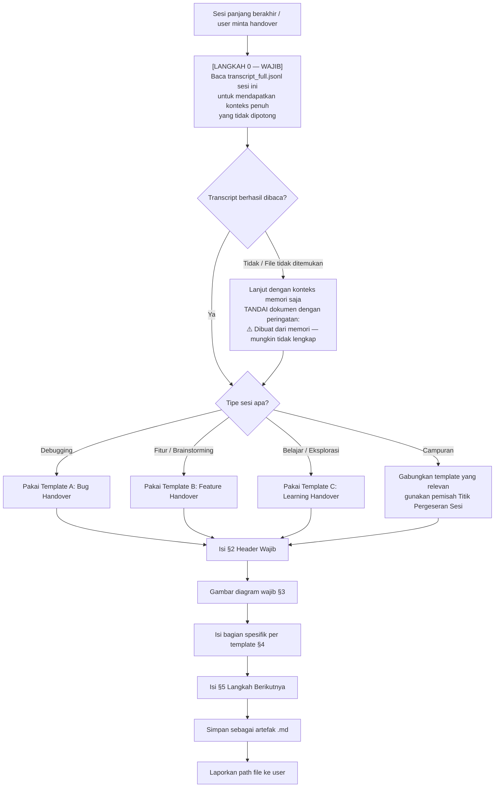

# 📋 meta-handover — Dokumen Serah Terima Sesi Kerja

> **Prinsip Inti:** Dokumen ini bukan ringkasan hemat token. Ia adalah rekonstruksi konteks penuh yang **padat tanpa redundansi** — setiap kalimat membawa informasi unik. Agent penerima harus bisa melanjutkan pekerjaan hanya dengan membaca dokumen ini, tanpa melihat riwayat chat sedikit pun.

---

## §0. Hukum Dokumen Ini

1. **DILARANG memotong informasi** dengan alasan menghemat panjang dokumen. Jika suatu detail berdampak pada keputusan teknis, ia wajib ada.
2. **DILARANG kata redundan.** Setiap kalimat harus unik secara informasi. "Kami memutuskan untuk menggunakan X karena Y" cukup satu kali — tidak perlu diulang di bagian lain.
3. **WAJIB ada minimal satu diagram** per dokumen (Mermaid flowchart, sequence diagram, atau architecture diagram). Tidak ada pengecualian.
4. **Format adaptif, urutan prioritas:**
   - 🥇 **Tabel** → untuk perbandingan, keputusan, daftar item berstruktur
   - 🥈 **Kode / Markdown spesifik** → untuk contoh teknis, konfigurasi, perintah
   - 🥉 **Paragraf** → untuk narasi kausal yang tidak bisa dibuat tabular
5. **Dokumen disimpan sebagai artefak** di direktori sesi yang sedang aktif.

---

## §1. Prosedur Pembuatan

> ⚠️ **LANGKAH 0 ADALAH GERBANG WAJIB.** Membuat handover dari konteks yang sudah terpotong di memori = membuat dokumen berlubang. Baca transcript penuh terlebih dahulu tanpa pengecualian.



**Langkah-langkah:**

1. **[WAJIB] Baca transcript penuh sesi ini** sebelum menulis apapun.
   Transcript tersimpan di:
   ```
   <AppDataDir>\brain\<conversation-id>\.system_generated\logs\transcript_full.jsonl
   ```
   Conversation ID sesi aktif tersedia di konteks sistem. Baca file ini dengan `view_file` atau `grep` untuk menemukan semua keputusan teknis, pertanyaan, dan jawaban yang mungkin sudah terpotong dari memori aktif.

2. **Identifikasi tipe sesi** dari transcript (debug, feature, learning, architecture, atau campuran).

3. **Kumpulkan semua keputusan teknis** dari transcript — termasuk keputusan yang ditolak beserta alasannya.

4. **Gambar diagram terlebih dahulu** — diagram memaksa Anda memetakan hubungan antar bagian sebelum menuliskan narasinya.

5. **Isi template yang sesuai** (lihat §4).

6. **Simpan dan laporkan** path artefak ke user.

---

## §2. Header Wajib (Semua Template)

Setiap dokumen handover WAJIB dibuka dengan blok ini:

```markdown
# 📋 Handover: [Judul Deskriptif Sesi]

| Field | Detail |
| :--- | :--- |
| **Tanggal Sesi** | [Tanggal & Waktu] |
| **Tipe Sesi** | Debugging / Feature Planning / Learning / Architecture |
| **Status Akhir** | ✅ Selesai / 🔄 Berlanjut / ⛔ Diblokir |
| **Teknologi / Stack** | [Bahasa, Framework, Tools yang relevan] |
| **File Utama yang Disentuh** | [Daftar file dengan path relatif] |
| **Bisa Dilanjutkan Tanpa Konteks Tambahan?** | Ya / Tidak — [Alasan jika Tidak] |
```

---

## §3. Diagram Wajib

Pilih tipe diagram yang paling relevan dengan sesi yang terjadi. Gunakan Mermaid.

| Tipe Sesi | Diagram yang Direkomendasikan |
| :--- | :--- |
| **Debugging** | `flowchart` — alur investigasi dari gejala ke akar masalah |
| **Feature / Brainstorming** | `flowchart` atau `sequenceDiagram` — alur data atau interaksi sistem |
| **Arsitektur** | `graph` atau `flowchart TD` — hubungan antar komponen |
| **Learning** | `flowchart TD` — peta konsep yang dipelajari (mindmap tidak didukung renderer) |
| **Database / Schema** | `erDiagram` — relasi antar entitas |

> **Aturan:** Jika tidak ada diagram tipe spesifik yang cocok, gunakan `flowchart TD` sebagai fallback. Tipe `mindmap` **tidak didukung** oleh renderer Antigravity — jangan gunakan.

---

## §4. Template per Tipe Sesi

> **Sesi Campuran:** Jika sesi dimulai sebagai satu tipe lalu bergeser ke tipe lain (contoh: debugging yang berakhir jadi feature planning setelah root cause ditemukan), **gabungkan template yang relevan** dalam satu dokumen. Gunakan sub-judul `## 🔀 Titik Pergeseran Sesi` sebagai penanda batas antara dua fase. Urutan penulisan mengikuti kronologi sesi — fase pertama ditulis lebih dulu. **DILARANG memilih hanya satu template dan membuang konteks fase lainnya.**

### Template A: Bug / Debugging Handover

```markdown
## 🔴 Gejala Awal
[Deskripsi tepat dari perilaku yang salah. Bukan interpretasi — fakta mentah apa yang terlihat/terbaca.]

## 🗺️ Peta Investigasi
[DIAGRAM WAJIB — flowchart dari gejala → hipotesis → pembuktian → akar masalah]

## 🔬 Temuan per Hipotesis

| Hipotesis | Metode Pembuktian | Hasil | Status |
| :--- | :--- | :--- | :--- |
| [Hipotesis 1] | [Cara kita membuktikan/membantahnya] | [Apa yang ditemukan] | ✅ Terbukti / ❌ Dibantah |
| [Hipotesis 2] | ... | ... | ... |

## 🎯 Akar Masalah (Root Cause)
[Satu paragraf padat. Jelaskan MENGAPA terjadi, bukan hanya APA yang terjadi.]

## 🔧 Solusi yang Diterapkan
[Kode atau deskripsi perubahan. Sertakan potongan kode jika relevan.]

## 🧪 Bukti Perbaikan
[Perintah yang dijalankan dan output yang membuktikan bug sudah hilang.]

## ⚠️ Risiko Sisa / Hal yang Belum Diperiksa
[Jika ada area terkait yang belum diverifikasi.]
```

---

### Template B: Feature / Brainstorming Handover

```markdown
## 🎯 Masalah yang Dipecahkan
[Satu paragraf: Masalah nyata apa, siapa yang terdampak, mengapa perlu diselesaikan sekarang.]

## 🗺️ Arsitektur / Alur Keputusan
[DIAGRAM WAJIB — alur data, component diagram, atau decision tree]

## ⚖️ Keputusan Teknis yang Dibuat

| Keputusan | Opsi yang Dipilih | Opsi yang Ditolak | Alasan |
| :--- | :--- | :--- | :--- |
| [Keputusan 1] | [Opsi terpilih] | [Opsi lain yang dipertimbangkan] | [Mengapa opsi terpilih lebih baik] |

## 📐 Rancangan Teknis
[Struktur folder, skema data, interface/contract yang sudah disepakati. Gunakan kode jika ada.]

## ✅ Yang Sudah Dikerjakan

| Komponen | Status | Keterangan |
| :--- | :--- | :--- |
| [Nama komponen] | ✅ Selesai / 🔄 Sebagian / ⬜ Belum | [Catatan penting] |

## 🚧 Hambatan & Risiko yang Diketahui
[Daftar blocker teknis atau ketidakpastian yang belum terjawab.]
```

---

### Template C: Learning / Eksplorasi Handover

```markdown
## 🎯 Tujuan Belajar
[Apa yang ingin dipahami di awal sesi ini.]

## 🗺️ Peta Konsep
[DIAGRAM WAJIB — mindmap atau flowchart hubungan antar konsep yang dipelajari]

## 📚 Konsep yang Dipelajari

| Konsep | Penjelasan Inti (1–2 kalimat) | Contoh Konkret | Gotcha / Jebakan |
| :--- | :--- | :--- | :--- |
| [Nama Konsep] | [Inti sarinya] | [Kode atau analogi] | [Hal yang sering disalahpahami] |

## 🔗 Hubungan Antar Konsep
[Paragraf yang menjelaskan bagaimana konsep-konsep di atas saling berkaitan. Tidak bisa ditabularkan.]

## 💡 Insight Kritis
[Maksimal 3–5 poin. Hal-hal yang TIDAK tertulis di dokumentasi resmi tapi ditemukan lewat diskusi ini.]

## ❓ Pertanyaan yang Belum Terjawab
[Daftar hal yang masih penasaran dan perlu dieksplorasi di sesi berikutnya.]
```

---

## §5. Penutup Wajib (Semua Template)

Setiap dokumen handover WAJIB ditutup dengan blok ini:

```markdown
## 🚀 Langkah Berikutnya

| Prioritas | Aksi | Prasyarat | Estimasi Kompleksitas |
| :---: | :--- | :--- | :--- |
| 🔴 Tinggi | [Aksi yang harus dilakukan pertama] | [Apa yang harus ada dulu] | Kecil / Sedang / Besar |
| 🟡 Sedang | [Aksi berikutnya] | ... | ... |
| 🟢 Rendah | [Nice-to-have] | ... | ... |

## 📎 Referensi & Artefak Terkait
- [Link ke file kode yang disentuh]
- [Link ke dokumen lain yang relevan]
- [Perintah penting yang perlu diingat]
```

---

## §6. Aturan Tambahan

- **Jangan tulis "kita membahas X"** — tulis langsung konten dari X. Dokumen ini bukan catatan rapat, tapi rekonstruksi pengetahuan.
- **Jangan tulis tanggal relatif** ("kemarin", "tadi"). Gunakan tanggal dan waktu absolut.
- **Jika ada kode yang relevan**, sertakan potongan langsung di dokumen (bukan hanya link), agar agent penerima tidak perlu membuka file terpisah untuk memahami konteks.
- **Asumsikan agent penerima tidak tahu apa-apa** — tulislah seolah dokumen ini adalah satu-satunya informasi yang diterima.
- **Gunakan contoh nyata sebagai acuan** — lihat [`examples/learning-golang-kalkulator-suhu.md`](./examples/learning-golang-kalkulator-suhu.md) untuk melihat bagaimana Template C diterapkan pada sesi belajar nyata, dan [`examples/mixed-debug-to-feature.md`](./examples/mixed-debug-to-feature.md) untuk contoh sesi campuran.
