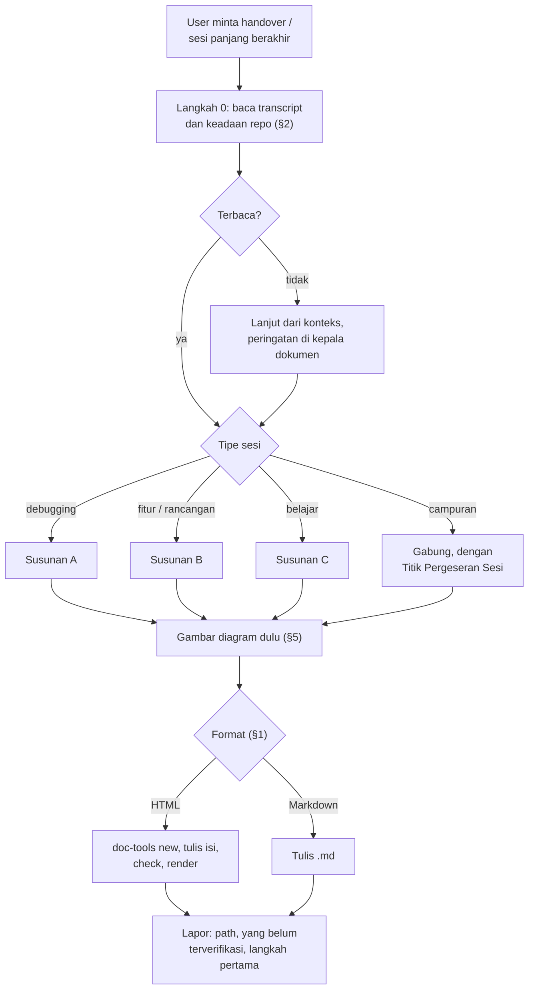

# meta-handover — Dokumen Serah Terima Sesi Kerja

> **Prinsip inti:** dokumen ini bukan ringkasan hemat token. Ia rekonstruksi konteks penuh yang padat tanpa pengulangan. Penerimanya, orang atau agen, harus bisa melanjutkan pekerjaan hanya dari dokumen ini.

---

## §0. Hukum

1. **DILARANG memotong informasi** demi panjang dokumen. Detail yang memengaruhi keputusan teknis wajib ada.
2. **DILARANG mengulang.** Satu keputusan ditulis sekali, di satu tempat.
3. **WAJIB membuka transcript sesi sebelum menulis** (§2). Handover dari konteks yang sudah terpotong adalah dokumen berlubang.
4. **WAJIB minimal satu diagram Mermaid** per dokumen (§5).
5. **Keluaran bawaan HTML, lewat `meta-prd`.** Gaya diambil dari `doc-tools` milik skill itu. DILARANG menulis atau menyalin CSS ke sini. Markdown hanya menurut §1.
6. **Label epistemik tetap berlaku** (`AGENTS.md` §3): `[fakta:sumber]` untuk yang dibuka atau dijalankan sendiri, `[inferensi]` untuk kesimpulan dari fakta, `[spekulasi]` untuk tebakan, `[memori-model]` untuk ingatan yang belum dicek. Yang tidak diverifikasi ditulis sebagai belum diverifikasi, dengan cara memverifikasinya. Penulis handover boleh memverifikasinya sendiri saat menulis; hasilnya dipisahkan dari hasil sesi ("dicek saat handover ditulis").
7. **Rahasia tidak ditulis.** Password, token, dan isi `.env` tidak masuk dokumen; cukup sebut di mana ia disimpan.

---

## §1. Memilih Format

| Keadaan | Format |
| :--- | :--- |
| User tidak menyebut format, pembacanya user atau orang lain | **HTML** |
| User meminta Markdown ("md saja", "untuk ditempel ke chat") | Markdown |
| Pembacanya agen lain (prompt sesi berikut, berkas handoff sub-agen) | Markdown |
| Dua pembaca: user membaca, agen melanjutkan | HTML untuk user; tawarkan versi Markdown dalam satu baris, jangan buat dua tanpa diminta |

User yang meminta handover "untuk agen lain" tidak dihitung sebagai pembaca kedua: pembacanya agen, formatnya Markdown. Baris terakhir hanya berlaku bila user sendiri bilang ia juga mau membacanya.

Agen membaca Markdown lebih murah daripada HTML; orang membaca HTML lebih enak. Itu satu-satunya alasan pemisahan ini. Isi dan susunan kedua format sama.

---

## §2. Langkah 0: Baca Transcript

Lokasi transcript berbeda per alat. Pakai baris yang sesuai dengan alat tempat Anda berjalan.

| Alat | Lokasi | Status |
| :--- | :--- | :--- |
| Claude Code | `~/.claude/projects/<slug-folder-kerja>/<session-id>.jsonl`. Slug adalah path folder kerja dengan pemisah diganti `-` (contoh `C--Projects-devivace-altrms`). | Diverifikasi 2026-11-10: folder itu ada dan memuat berkas sesi. |
| Claude Code, sesi sub-agen | `~/.claude/projects/<slug-folder-kerja>/<session-id>/subagents/agent-<id-agen>.jsonl` | Diverifikasi 2026-11-10 lewat uji skill ini. Berkas `tasks/<id>.output` di folder sementara sesi bisa kosong; jangan diandalkan. |
| Antigravity | `<AppDataDir>\brain\<conversation-id>\.system_generated\logs\transcript_full.jsonl` | Dari versi lama skill ini; belum diverifikasi ulang. |

Cara membacanya:

1. **Cari path-nya dari konteks dulu.** Bila sesi pernah diringkas otomatis, ringkasannya menyebut path transcript penuh; pakai itu. Bila tidak, cari di folder slug proyek itu di bawah `~/.claude/projects/` (bukan di folder kerja proyeknya). Berkas `.jsonl` yang paling baru diubah bisa jadi sesi yang sedang menulis handover ini, bukan sesi yang diserahterimakan: cocokkan id sesi atau isi pesan pertamanya.
2. **Jangan dibaca utuh bila besar.** Transcript sesi panjang bisa melebihi konteks. Cari dulu (`grep_search`) pesan user, kata "setuju", "tolak", "jangan", nama berkas, dan pesan commit; lalu baca potongan di sekitarnya.
3. **Yang wajib ditemukan:** semua pesan user, tiap keputusan berikut yang ditolak dan alasannya, tiap koreksi dari user, perintah verifikasi dan hasilnya, pekerjaan yang masih berjalan.
4. **Cocokkan dengan keadaan nyata.** Jalankan `git status`, `git log` secukupnya, dan lihat berkas yang disebut. Lihat juga tiket papan proyek itu yang terbuka (`board list --project <nama-folder>`, lalu `show` untuk yang disentuh sesi ini; `skills/meta-board/SKILL.md`): keputusan, kriteria selesai, dan catatan kemajuannya sudah tercatat di sana, jadi handover merujuk nomor tiketnya dan hanya menulis hal yang belum ada di tiket. Transcript mengatakan apa yang dimaksudkan; repo mengatakan apa yang terjadi. Proyek tanpa git: pakai cap waktu berkas, isi berkas yang disebut transcript, dan test sebagai gantinya, dan tulis di kepala dokumen bahwa tidak ada git.
5. **Selisih antara transcript dan keadaan nyata ditulis di kepala dokumen** sebagai peringatan (berkas berubah setelah sesi berakhir, perubahan yang tidak ada di transcript, test yang hasilnya berbeda), dan diulang singkat di risiko sisa. Selidiki secukupnya untuk menyebut apa yang berbeda; penyebab yang tidak diketahui ditulis tidak diketahui.

Transcript tidak ditemukan, tidak terbaca, atau kosong (0 byte): cari dulu di lokasi lain dari tabel di atas. Bila tetap tidak ada, lanjutkan dari konteks yang ada, dan **tulis peringatan di kepala dokumen** bahwa ia dibuat tanpa transcript dan bagian mana yang paling mungkin berlubang. DILARANG diam-diam melanjutkan.

**Bila penulisnya bukan agen sesi itu** (agen lain diminta menulis handover dari transcript): tidak ada "konteks yang ada" untuk diandalkan, jadi transcript dan keadaan nyata adalah satu-satunya sumber. Tulis di kalimat pembuka dokumen bahwa ia disusun pihak lain dari transcript, dan "dijalankan di sesi ini" di skill ini dibaca sebagai "tercatat di transcript, atau dijalankan ulang saat handover ditulis".

---

## §3. Prosedur

1. **Langkah 0** (§2).
2. **Tentukan tipe sesi** dari transcript, bukan dari kesan terakhir.
3. **Gambar diagram dulu.** Diagram memaksa hubungan antarbagian dipetakan sebelum narasinya ditulis.
4. **Tentukan lokasi dan nama.** Lokasi yang disebut user menang. Bila tidak disebut, ikuti folder dokumen proyek (`.docs/<proyek>/`, `docs/`); bila tidak ada, tanya. Nama: `<proyek>-handover-<YYYY-MM-DD>-<topik>.html` (atau `.md`), huruf kecil dan tanda hubung. `<topik>` dua sampai empat kata yang menyebut apa yang dikerjakan (`reimbursement`, `urutan-klaim-terbalik`), bukan hasilnya dan bukan kalimat.
5. **Jalur HTML:** `view_file` ke `skills/meta-prd/SKILL.md` (wajib dibuka, bukan dari ingatan), lalu ikuti langkah 4 sampai 7 di sana: `doc-tools.mjs new`, tulis isi dengan komponen dari `references/components.md`, `doc-tools.mjs check`, render terang, gelap, dan layar sempit.
6. **Jalur Markdown:** tulis langsung dengan susunan §4, tanpa membuka `meta-prd`. Judul bagian tanpa emoji. Padanan komponennya: kunci-nilai dan daftar berstruktur jadi tabel; pill status jadi satu kata tebal (**SELESAI**, **TERBUKTI**, **DIBANTAH**); callout jadi blockquote; kartu keputusan jadi sub-bagian berisi pertanyaan, pilihan, dan bawaan; urutan langkah jadi daftar bernomor; daftar sumber jadi tabel. Diagram Mermaid di Markdown tidak bisa dirender dari sini: periksa sintaksnya dengan membaca ulang, dan tulis di laporan bahwa diagramnya belum dirender.
7. **Lapor** ke user: path lengkap, apa yang belum terverifikasi, dan satu langkah pertama untuk sesi berikutnya.

---

## §4. Susunan Isi

Susunan ini acuan, bukan cetakan: bagian yang tidak punya isi dibuang, bukan diisi basa-basi. Dua pengecualian yang tetap ditulis walau kosong, satu baris masing-masing: keputusan yang ditolak dan koreksi dari user. "Tidak ada" di sana berarti sudah diperiksa; bagian yang hilang tidak bisa dibedakan dari yang lupa diperiksa. Kolom "Komponen" menunjuk kelompok cuplikan di `skills/meta-prd/references/components.md`; untuk Markdown pakai padanan polosnya.

### Kepala (semua tipe)

| Isi | Komponen |
| :--- | :--- |
| Judul yang menyebut hasil sesi, bukan "Handover sesi" | Kepala dokumen |
| Tanggal dan jam absolut dalam waktu lokal user dengan offsetnya (mis. 13.35 WIB), tipe sesi, status akhir (selesai, selesai dengan keputusan terbuka, berlanjut, terblokir), stack | Pilihan, keputusan, kunci-nilai (kunci-nilai) |
| Berkas utama yang disentuh, dengan path | Tabel |
| Branch, commit terakhir, apakah working tree bersih, apa yang belum di-push | Kunci-nilai |
| Bisa dilanjutkan tanpa konteks tambahan? Kalau tidak, apa yang kurang | Callout |

### Susunan A: debugging

| # | Bagian | Isi | Komponen |
| :-- | :--- | :--- | :--- |
| 01 | Gejala awal | Yang terlihat atau terbaca, apa adanya; bukan tafsiran | Kode, kutipan |
| 02 | Peta investigasi | Dari gejala ke hipotesis ke bukti ke akar masalah | Diagram |
| 03 | Temuan per hipotesis | Hipotesis, cara membuktikan, hasil, terbukti atau dibantah | Tabel dengan pill status |
| 04 | Akar masalah | Mengapa terjadi, bukan hanya apa | Callout |
| 05 | Perbaikan | Perubahan dan potongan kodenya | Kode |
| 06 | Bukti | Perintah yang dijalankan dan keluarannya, merah lalu hijau. Keluaran panjang boleh dipangkas ke baris yang membuktikan (nama test, jumlah lulus dan gagal, exit code), asal disebut bahwa dipangkas. | Kode |
| 07 | Risiko sisa | Area terkait yang belum diperiksa | Daftar periksa |

### Susunan B: fitur atau rancangan

| # | Bagian | Isi | Komponen |
| :-- | :--- | :--- | :--- |
| 01 | Masalah | Masalah nyata, siapa yang terdampak, kenapa sekarang | Paragraf |
| 02 | Alur atau arsitektur | Alur data, hubungan komponen, atau pohon keputusan | Diagram |
| 03 | Keputusan | Yang dipilih, yang ditolak, alasannya, siapa yang memutuskan | Pilihan, keputusan |
| 04 | Rancangan teknis | Struktur folder, skema, kontrak yang sudah disepakati | Kode, tabel |
| 05 | Yang sudah dikerjakan | Komponen, status, catatan | Tabel dengan pill status |
| 06 | Hambatan dan risiko | Blocker dan hal yang belum terjawab | Matriks risiko atau callout |

### Susunan C: belajar atau eksplorasi

| # | Bagian | Isi | Komponen |
| :-- | :--- | :--- | :--- |
| 01 | Tujuan belajar | Yang ingin dipahami di awal sesi | Paragraf |
| 02 | Peta konsep | Hubungan antar konsep | Diagram |
| 03 | Konsep | Inti, contoh konkret, jebakan | Tabel atau kartu |
| 04 | Hubungan antar konsep | Narasi yang tidak bisa ditabelkan | Paragraf |
| 05 | Temuan penting | Tiga sampai lima hal yang tidak tertulis di dokumentasi resmi | Callout |
| 06 | Belum terjawab | Pertanyaan untuk sesi berikutnya | Daftar periksa |

### Sesi campuran

Sesi yang bergeser tipe (debugging yang berakhir jadi perancangan fitur) memakai **kedua susunan dalam satu dokumen**, urut kronologis, dipisah bagian berjudul "Titik Pergeseran Sesi" yang menyebut apa yang memicu pergeserannya. DILARANG memilih satu susunan dan membuang konteks fase lainnya.

### Penutup (semua tipe)

| Bagian | Isi | Komponen |
| :--- | :--- | :--- |
| Langkah berikutnya | Aksi, prasyarat, ukuran (kecil, sedang, besar), urut prioritas. Aksi pertama cukup rinci untuk langsung dikerjakan. | Urutan dan waktu, atau tabel |
| Keputusan yang menunggu user | Pertanyaan, dua pilihan konkret, bawaan bila tidak dijawab | Pilihan, keputusan |
| Koreksi dari user di sesi ini | Apa yang dikoreksi dan aturan yang lahir darinya | Callout |
| Rujukan | Berkas, dokumen, dan perintah penting. Pekerjaan yang punya tiket papan disebut dengan **nomor tiketnya**; isi tiket (keputusan, kriteria selesai) tidak disalin ulang ke handover, dan handover ini ditautkan ke tiketnya (`skills/meta-board/SKILL.md` §1). | Daftar sumber |

---

## §5. Diagram

| Tipe sesi | Diagram |
| :--- | :--- |
| Debugging | `flowchart`: gejala ke akar masalah |
| Fitur, rancangan | `flowchart` atau `sequenceDiagram`: alur data atau interaksi |
| Arsitektur | `flowchart TD`: hubungan komponen |
| Belajar | `flowchart TD`: peta konsep |
| Skema data | `erDiagram` |

Ragu memilih: `flowchart TD`. Tipe `mindmap` tidak dipakai (catatan versi lama skill ini: renderer Antigravity tidak mendukungnya). Di HTML, diagram ditulis dengan komponen diagram `meta-prd` dan **wajib dilihat hasil render-nya**; diagram yang gagal di-render tampil sebagai teks mentah.

---

## §6. Aturan Menulis

- **Tulis isinya, bukan bahwa ia dibahas.** "Kita membahas cache" tidak membawa apa-apa; tulis keputusan cache-nya.
- **Tanggal absolut.** Tidak ada "kemarin" atau "tadi".
- **Potongan kode disertakan langsung** bila diperlukan untuk memahami keputusan; tautan saja tidak cukup.
- **Anggap penerima tidak tahu apa-apa** tentang sesi ini.
- **Bedakan yang dikerjakan dari yang direncanakan.** "Sudah" berarti ada commit atau keluaran perintah yang bisa ditunjuk.
- **Status kerja ditulis apa adanya**, termasuk test yang merah, langkah yang dilewati, dan proses latar yang masih berjalan.

---

## §7. Anti-Pattern

**Anti-Pattern 1: handover dari ingatan.** Menulis tanpa membuka transcript setelah konteks pernah diringkas. Keputusan yang ditolak dan koreksi user adalah yang pertama hilang.

**Anti-Pattern 2: catatan rapat.** Kronologi "lalu kami mencoba X" tanpa hasil akhirnya. Yang ditulis keadaan sekarang dan alasannya.

**Anti-Pattern 3: CSS sendiri.** Menyalin blok gaya dari dokumen lain atau menulis yang baru. Gaya hanya datang dari `doc-tools new`.

**Anti-Pattern 4: "selesai" tanpa bukti.** Status selesai untuk pekerjaan yang test-nya tidak dijalankan di sesi ini.

**Anti-Pattern 5: dua format tanpa diminta.** HTML dan Markdown sekaligus menggandakan yang harus dirawat. Buat satu, tawarkan yang lain.

---

## §8. Edge Case

**Edge Case 1: transcript terlalu besar.** Cari per kata kunci dan baca potongan; sebut di dokumen bagian mana yang hanya dibaca lewat pencarian.

**Edge Case 2: beberapa sesi untuk satu pekerjaan.** Handover hanya mencakup sesi ini; rujuk handover sebelumnya dengan path-nya, jangan disalin.

**Edge Case 3: pekerjaan di beberapa repo.** Satu dokumen, dengan keadaan git ditulis per repo.

**Edge Case 4: sub-agen masih berjalan.** Tulis apa yang ditugaskan, ke mana keluarannya, dan bahwa hasilnya belum ada. Jangan menulis perkiraan hasilnya.

**Edge Case 5: sesi tanpa kode.** Brainstorming atau keputusan karir. Bagian keadaan git dibuang; diagram tetap wajib.

**Edge Case 6: `doc-tools` tidak bisa dijalankan** (Node tidak ada). Laporkan ke user dan tawarkan Markdown; jangan menulis HTML tangan.

---

## §9. Contoh

Dua contoh di `examples/` ditulis dalam Markdown dengan gaya lama (judul ber-emoji). Yang diacu dari sana adalah **kepadatan dan kelengkapan isinya**, bukan tampilannya:

- `examples/learning-golang-kalkulator-suhu.md`: susunan C pada sesi belajar nyata.
- `examples/mixed-debug-to-feature.md`: sesi campuran dengan titik pergeseran.

## §10. Daftar Periksa Sebelum Lapor

- [ ] Transcript dibuka, atau peringatan tertulis di kepala dokumen.
- [ ] Keadaan git dicek dengan perintah, bukan diingat.
- [ ] Ada diagram, dan di HTML sudah dilihat hasil render-nya.
- [ ] Keputusan yang ditolak dan koreksi user tercatat.
- [ ] Tidak ada rahasia, tanggal relatif, atau klaim selesai tanpa bukti.
- [ ] HTML: `doc-tools check` lulus dan keluarannya dibaca.
- [ ] Nama berkas sesuai pola.
