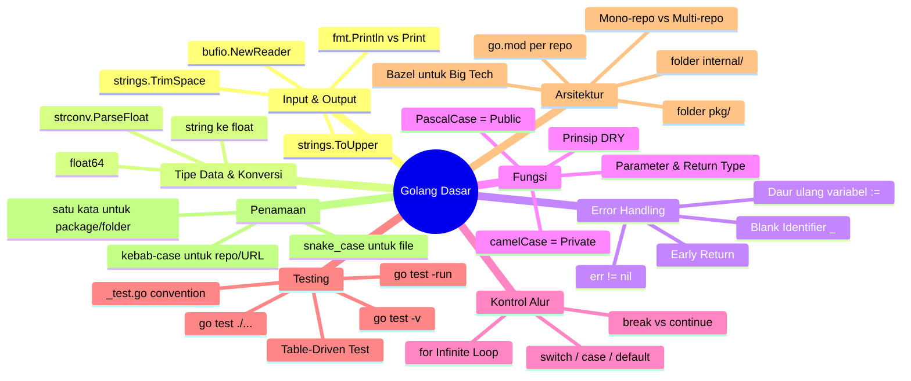

# 📋 Handover: Belajar Golang via Proyek Kalkulator Suhu

| Field | Detail |
| :--- | :--- |
| **Tanggal Sesi** | 2026-08-27, 08:54 – 14:00 WIB |
| **Tipe Sesi** | Learning / Eksplorasi |
| **Status Akhir** | ✅ Selesai — proyek kalkulator selesai hingga Part 6 + Unit Test |
| **Teknologi / Stack** | Go 1.24.3, standard library (`fmt`, `bufio`, `os`, `strconv`, `strings`, `testing`) |
| **File Utama yang Disentuh** | `main.go`, `main_test.go`, `go.mod` |
| **Bisa Dilanjutkan Tanpa Konteks Tambahan?** | Ya |

---

## 🗺️ Peta Konsep Golang yang Dipelajari

---

## 📚 Konsep yang Dipelajari

| Konsep | Penjelasan Inti | Contoh Konkret | Gotcha / Jebakan |
| :--- | :--- | :--- | :--- |
| `bufio.NewReader` | Pembaca input terminal yang kokoh, membaca sampai karakter `\n` terdeteksi | `reader := bufio.NewReader(os.Stdin)` | Jangan pakai `fmt.Scanln` — buggy saat input mengandung spasi |
| `strconv.ParseFloat` | Mengubah teks `"36.5"` menjadi angka `36.5`. Mengembalikan dua nilai: angka dan error | `suhu, err := strconv.ParseFloat(input, 64)` | Argumen `64` wajib disebut — menentukan presisi `float64` |
| `err != nil` | Cara Go menangani kegagalan. Tidak ada `try-catch`. Setiap fungsi rawan wajib dicek errornya langsung setelah dipanggil | `if err != nil { return }` | Membuang error ke `_` adalah dosa produksi — gunakan hanya saat belajar |
| Blank Identifier `_` | Menampung nilai yang sengaja diabaikan agar Go tidak complain *"declared and not used"* | `inputSuhu, _ := reader.ReadString('\n')` | Di aplikasi nyata, `_` untuk error = bug tersembunyi |
| Daur Ulang Variabel `:=` | Variabel bisa "ditiban" dengan `:=` selama ada minimal 1 variabel baru di sebelah kiri | `suhu, err := ...` lalu `inputSatuan, err := ...` | Tidak perlu membuat `err1`, `err2` — Go akan overwrite isi `err` |
| Visibilitas PascalCase | Huruf kapital pertama = Public (bisa diakses dari package lain) | `TestCelsiusToFahrenheit`, `fmt.Println` | Go tidak punya kata kunci `public`/`private` — cukup huruf pertama |
| Visibilitas camelCase | Huruf kecil pertama = Private (hanya di dalam package yang sama) | `celsiusToFahrenheit`, `suhu` | Struct field yang private tidak bisa di-marshal ke JSON dari luar package |
| `switch` / `case` / `default` | Pengganti rantai `if-else if` yang lebih bersih. `default` dijalankan jika tidak ada case yang cocok | `switch satuan { case "C": ... default: ... }` | Go tidak perlu `break` di setiap case (auto-break) — berbeda dari C/Java |
| `for {}` Infinite Loop | Satu-satunya cara looping di Go. Tanpa kondisi = berjalan selamanya | `for { ... }` | Go tidak punya `while`. Semua looping menggunakan `for` |
| `break` vs `continue` | `break` = keluar sepenuhnya dari loop. `continue` = lewati sisa iterasi ini, mulai iterasi berikutnya | `break` saat user ketik `Q`, `continue` saat input salah | `break` hanya keluar dari loop terdalam — waspada jika ada nested loop |
| Table-Driven Test | Pola pengujian Go: buat "tabel skenario" sebagai slice of struct, jalankan dengan loop | `tests := []struct{ name string; input float64; expected float64 }{}` | Tes yang tidak pernah dilihat gagal tidak membuktikan apa pun — wajib lihat MERAH dulu |
| `go test -run` | Menjalankan hanya satu fungsi atau sub-test spesifik | `go test -run TestCelsiusToFahrenheit/"Titik_beku_air"` | Spasi di nama sub-test diganti `_` saat dipakai di terminal |
| `go.mod` | KTP + Daftar Belanja proyek. Tanpanya `go test`/`go build` menolak jalan | `go mod init nama-proyek` | **1 Repositori Git = 1 `go.mod`** — bukan satu per fitur |
| `go test ./...` | Wildcard untuk menjalankan semua test di seluruh repo secara rekursif | `go test ./...` | Gagal jika ada sub-folder dengan `go.mod` berbeda (Skenario 2 Mono-repo) |

---

## 🔗 Hubungan Antar Konsep

Prinsip DRY (Don't Repeat Yourself) menjadi benang merah arsitektur kode. Alih-alih membuat 12 fungsi silang antar satuan suhu, semua input dikonversi ke Celsius sebagai jembatan, lalu disebarkan menggunakan fungsi `celsiusTo...` yang sudah ada. Pola ini hanya bisa bekerja bersih karena Go memisahkan fungsi ke unit-unit kecil (`camelCase`) yang bisa dipanggil dari mana saja dalam package yang sama.

Aturan visibilitas (`camelCase` vs `PascalCase`) terhubung langsung ke aturan penempatan file test (`_test.go` harus di folder yang sama dengan kode aslinya) — karena jika dipisahkan ke folder `tests/` ala Laravel, file test tidak akan bisa memanggil fungsi privat. Filosofi ini juga yang mendorong aturan bahwa Unit Test harus bersebelahan dengan kode aslinya, bukan dipusatkan di satu folder terpisah.

`go.mod` adalah jangkar yang menyatukan semua konsep ini: tanpanya, compiler tidak tahu batas wilayah proyek, sehingga `go test` tidak bisa memetakan mana file yang satu package dan mana yang bukan.

---

## 💡 Insight Kritis (Tidak Tertulis di Dokumentasi Resmi)

1. **`bufio.NewReader` bukan pilihan, tapi standar.** Dokumentasi resmi Go menampilkan `fmt.Scanln` sebagai contoh input, padahal di proyek nyata `Scanln` sering pecah saat user memasukkan spasi. `bufio` adalah cara yang benar dari awal.
2. **Mono-repo di Big Tech membutuhkan tim DevOps khusus (Bazel).** Tanpa alat build canggih, `go test ./...` di mono-repo dengan banyak `go.mod` akan rusak. Bazel menyelesaikan ini dengan dependency graph — tapi kurva belajarnya setara belajar bahasa baru.
3. **Folder `internal/` punya kekuatan magis dari compiler.** Ini bukan sekadar konvensi penamaan — compiler Go secara aktif menolak import dari luar proyek ke folder bernama `internal/`. Tidak perlu konfigurasi apapun.
4. **Table-Driven Test bukan sekadar gaya** — ia memaksa pemisahan antara data (skenario) dan logika (cara menguji). Ini membuat penambahan skenario edge-case semudah menambah satu baris tabel.
5. **-40°C = -40°F** adalah satu-satunya titik di mana skala Celsius dan Fahrenheit bertemu. Fakta fisika ini berguna sebagai kasus uji yang memverifikasi dua rumus sekaligus.

---

## ❓ Pertanyaan yang Belum Terjawab

- Bagaimana cara menulis test untuk fungsi yang membaca input dari terminal (`bufio.Reader`)? Perlu mocking `os.Stdin`.
- Bagaimana Go menangani konkurensi (Goroutine) dan kapan sebaiknya digunakan di proyek CLI?
- Bagaimana struktur proyek berubah saat kalkulator ini dikonversi menjadi Web API (`net/http`)?
- Apa perbedaan `go build` vs `go install` vs `go run` secara teknis?

---

## 🚀 Langkah Berikutnya

| Prioritas | Aksi | Prasyarat | Estimasi Kompleksitas |
| :---: | :--- | :--- | :--- |
| 🔴 Tinggi | Tambah Unit Test untuk semua fungsi konversi (bukan hanya `celsiusToFahrenheit`) | `main_test.go` sudah ada | Kecil |
| 🔴 Tinggi | Perbaiki presisi float di test menggunakan `math.Abs` | - | Kecil |
| 🟡 Sedang | Refactor fungsi konversi ke file terpisah (`converter.go`) untuk belajar multi-file package | Semua test lulus dulu | Sedang |
| 🟡 Sedang | Eksplorasi cara mock `os.Stdin` untuk test fungsi input | Pahami `io.Reader` interface | Sedang |
| 🟢 Rendah | Buat versi Web API menggunakan `net/http` dengan endpoint `POST /convert` | Pahami struct dan JSON marshaling | Besar |

## 📎 Referensi & Artefak Terkait

- `c:\Projects\practice\go-suhu\main.go` — kode kalkulator final (Part 6)
- `c:\Projects\practice\go-suhu\main_test.go` — unit test Table-Driven
- `c:\Projects\practice\go-suhu\go.mod` — module `kalkulator-suhu`, Go 1.24.3
- Perintah kunci: `go test -v`, `go test ./...`, `go test -run TestNama/"sub-test"`
