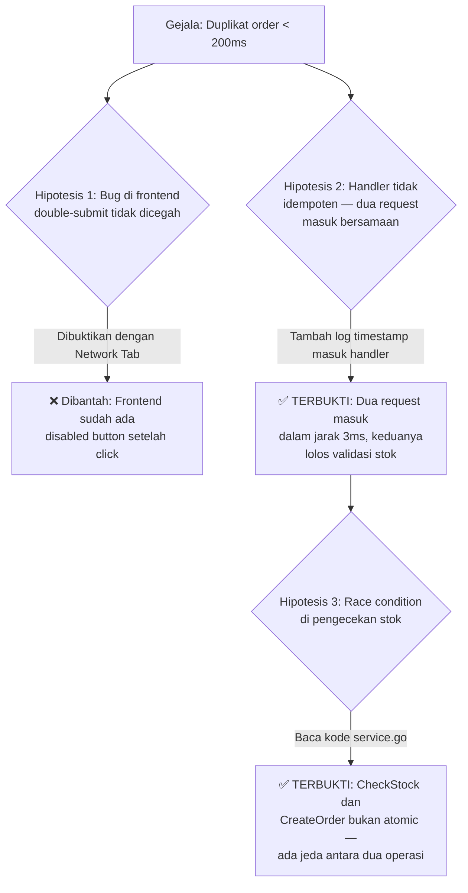
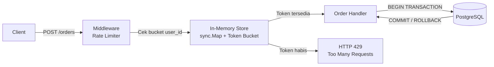

# 📋 Handover: Debug Race Condition → Feature Planning Rate Limiter

| Field | Detail |
| :--- | :--- |
| **Tanggal Sesi** | 2026-08-27, 10:00 – 13:00 WIB |
| **Tipe Sesi** | Debugging → Feature Planning (Campuran) |
| **Status Akhir** | 🔄 Berlanjut — root cause ditemukan, solusi dirancang, belum diimplementasi |
| **Teknologi / Stack** | Go 1.24.3, `net/http`, `sync.Mutex`, PostgreSQL |
| **File Utama yang Disentuh** | `internal/order/handler.go`, `internal/order/service.go` |
| **Bisa Dilanjutkan Tanpa Konteks Tambahan?** | Ya |

---

## 🔴 FASE 1 — Debugging

### Gejala Awal
Endpoint `POST /orders` menghasilkan duplikat order saat user mengklik tombol "Beli" dua kali cepat dalam < 200ms. Database memiliki dua baris order identik dengan `user_id` dan `product_id` yang sama dan `created_at` beda < 5ms.

### 🗺️ Peta Investigasi



### 🔬 Temuan per Hipotesis

| Hipotesis | Metode Pembuktian | Hasil | Status |
| :--- | :--- | :--- | :--- |
| Double-submit dari frontend | Inspeksi Network Tab browser, cek event listener tombol | Button sudah di-disable setelah click pertama — bukan sumber masalah | ❌ Dibantah |
| Dua request masuk handler bersamaan | Tambah `log.Printf` dengan timestamp nanosecond di awal handler | Dua request masuk dalam jarak 3ms, keduanya melewati validasi stok | ✅ Terbukti |
| Race condition di `CheckStock` → `CreateOrder` | Baca `service.go` baris 47–63, tidak ada lock | `CheckStock` dan `CreateOrder` adalah dua query terpisah tanpa transaksi — window vulnerability selama ~2ms | ✅ Terbukti |

### 🎯 Akar Masalah (Root Cause)
Fungsi `PlaceOrder` di `service.go` melakukan `CheckStock` dan `CreateOrder` sebagai dua query database terpisah tanpa membungkusnya dalam satu transaksi database (`BEGIN ... COMMIT`). Ketika dua goroutine Go menjalankan `PlaceOrder` secara konkuren, keduanya dapat melewati `CheckStock` (stok masih ada) sebelum salah satu sempat mengeksekusi `CreateOrder` (mengurangi stok). Hasilnya: dua order dibuat meski stok cukup untuk satu.

### ⚠️ Risiko Sisa
Solusi dengan database transaction akan memperbaiki duplikat, tapi tidak mencegah *thundering herd* — jika 1000 user mengklik bersamaan, 1000 goroutine tetap akan menyentuh database secara paralel. Ini membutuhkan solusi tambahan di layer atas (Rate Limiter).

---

## 🔀 Titik Pergeseran Sesi

Root cause ditemukan dan solusi database transaction diidentifikasi. Sesi bergeser dari **debugging** ke **feature planning** karena ditemukan kebutuhan Rate Limiter untuk mencegah *thundering herd* yang merupakan masalah arsitektur lebih luas.

---

## 🎨 FASE 2 — Feature Planning: Rate Limiter

### 🎯 Masalah yang Dipecahkan
Endpoint `POST /orders` rentan terhadap lonjakan request bersamaan dari satu user (double-submit) maupun dari banyak user (thundering herd). Database transaction menyelesaikan correctness, tapi tidak menyelesaikan beban — tanpa rate limiter, 1000 request tetap memukul DB bersamaan.

### 🗺️ Arsitektur Rate Limiter yang Dirancang



### ⚖️ Keputusan Teknis yang Dibuat

| Keputusan | Opsi yang Dipilih | Opsi yang Ditolak | Alasan |
| :--- | :--- | :--- | :--- |
| Algoritma Rate Limit | Token Bucket (per user_id) | Fixed Window Counter | Token Bucket lebih adil untuk burst traffic — user yang jarang request bisa akumulasi token |
| Storage Rate Limit State | `sync.Map` in-memory | Redis | Scope proyek masih single-instance. Redis ditambahkan nanti saat scale horizontal |
| Scope Rate Limit | Per `user_id` | Per IP Address | IP bisa shared (NAT, korporat) — `user_id` lebih akurat membatasi per orang |

### 📐 Rancangan Teknis yang Disepakati

```go
// internal/middleware/rate_limiter.go
type tokenBucket struct {
    tokens    float64
    lastRefil time.Time
    mu        sync.Mutex
}

// Rate: 2 request/detik per user, burst maksimal 5
const ratePerSecond = 2.0
const burstCapacity = 5.0
```

Middleware dipasang di layer router, **sebelum** handler, sehingga request yang ditolak tidak pernah menyentuh database.

### ✅ Yang Sudah Dikerjakan

| Komponen | Status | Keterangan |
| :--- | :--- | :--- |
| Identifikasi root cause race condition | ✅ Selesai | Lihat Fase 1 |
| Rancangan arsitektur rate limiter | ✅ Selesai | Diagram dan contract di atas |
| Implementasi `tokenBucket` struct | ⬜ Belum | Dimulai sesi berikutnya |
| Wrap `PlaceOrder` dalam DB transaction | ⬜ Belum | Dikerjakan bersamaan dengan rate limiter |
| Unit test untuk rate limiter | ⬜ Belum | Setelah implementasi |

---

## 🚀 Langkah Berikutnya

| Prioritas | Aksi | Prasyarat | Estimasi Kompleksitas |
| :---: | :--- | :--- | :--- |
| 🔴 Tinggi | Wrap `CheckStock` + `CreateOrder` dalam satu DB transaction di `service.go:47` | - | Kecil |
| 🔴 Tinggi | Implementasi `tokenBucket` dan middleware di `internal/middleware/rate_limiter.go` | Contract di atas sudah disepakati | Sedang |
| 🟡 Sedang | Unit test rate limiter: simulasi burst > 5 request, pastikan ke-6 dapat 429 | Implementasi selesai | Sedang |
| 🟢 Rendah | Ganti `sync.Map` dengan Redis saat perlu scale horizontal | Infrastruktur Redis tersedia | Besar |

## 📎 Referensi & Artefak Terkait

- `internal/order/service.go:47-63` — lokasi race condition (CheckStock + CreateOrder tanpa transaction)
- `internal/order/handler.go` — tempat middleware akan dipasang
- Go docs: `sync.Mutex`, `sync.Map`, `database/sql` Transactions
