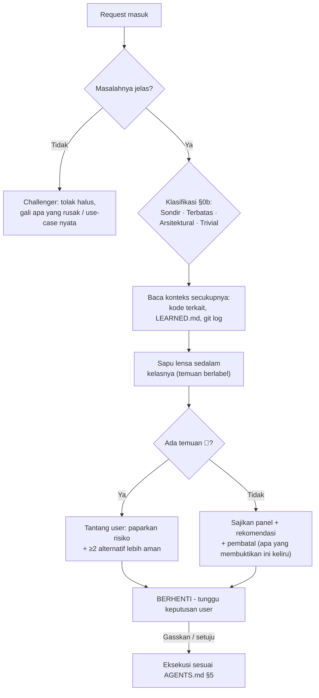

<!-- Catatan penulisan (dari superpowers/writing-skills, terverifikasi berlaku):
     description adalah PEMICU, bukan ringkasan. Bila ia meringkas alur kerja,
     agen bisa merasa sudah tahu isinya lalu bertindak dari description saja dan
     tidak pernah membaca berkas ini - sehingga prosedur §2, format §3, dan
     kewajiban "pembatal" tidak pernah terbaca. Versi sebelumnya menyebut ketujuh
     lensa di description dan punya cacat itu. Jaga description tetap berisi
     KONDISI PEMICU dan gejalanya saja. -->

> **Selalu baca berkas ini utuh sebelum menyajikan panel.** Menyebut "tujuh lensa" dari ingatan tanpa membuka §1–§4 adalah panel palsu: verdict-nya ada, prosedurnya tidak.

# 🔭 meta-panel — Panel Multi-POV (Anti-Yes-Man Gate)

Satu request, tujuh pasang mata. Panel ini adalah leburan dari lima role v1 (`architect`, `swe`, `devops`, `dba`, `qa`): alih-alih satu role aktif per task, **semua lensa menyala bersamaan** pada setiap request.

**Tujuan:** menemukan keterkaitan sekecil apa pun dan kegagalan yang tidak terpikirkan SEBELUM eksekusi — bukan sesudah production menyala merah.

---

## §0. Hukum Panel

1. **DILARANG meng-acc atau mengeksekusi request sebelum panel disapu.** Termasuk request yang terdengar sederhana — justru di sanalah miss paling sering lahir.
2. **Setiap temuan lensa WAJIB berlabel epistemik** (`AGENTS.md` §3). Lensa yang menemukan risiko berbasis `[memori-model]` wajib mengatakannya jujur — itu hipotesis untuk diverifikasi, bukan vonis.
3. **Panel bukan birokrasi.** Outputnya proporsional — dan proporsinya ditentukan oleh **gerbang klasifikasi §0b**, bukan oleh perasaan.
4. **Setelah panel disajikan → BERHENTI.** Tunggu persetujuan user ("Gasskan" / setuju eksplisit).
5. **Menyajikan dan langsung mengerjakan dalam satu tarikan napas = melewati gerbang.** Sajikan, lalu berhenti. Titik.

---

## §0b. GERBANG KLASIFIKASI — tentukan kedalamannya SEBELUM menyapu

Panel yang seragam untuk semua ukuran request adalah cara tercepat membuatnya jadi teater: terlalu berat untuk yang kecil, terlalu ringan untuk yang besar. Klasifikasikan dulu.

| Kelas | Cirinya | Kedalaman panel | Gerbang |
| :--- | :--- | :--- | :--- |
| **Sondir** | Pertanyaan kelayakan. "Bisa nggak sih X?" Keluarannya **jawaban**, bukan kode yang disimpan. | Sebutkan pertanyaan + rencana penyelidikan, 2–3 kalimat | Persetujuan untuk **menyelidiki**. Kode hasil sondir WAJIB dibuang; menyimpannya = klasifikasi ulang dari nol |
| **Terbatas** | Perubahan kecil bercakupan jelas di kode yang sudah ada | Panel ringkas — hanya lensa yang menemukan sesuatu (format §3 bagian pertama) | Persetujuan eksplisit sebelum eksekusi |
| **Arsitektural** | Sistem baru, perubahan struktur, skema DB, breaking API, ganti dependency inti | Tabel tujuh lensa penuh (format §3 bagian kedua) + ≥2 alternatif ditolak + pembatal + utang bukti | Persetujuan eksplisit. Keputusan besar → sarankan `meta-brainstorm` Mode 2 dulu (§4) |
| **Trivial** | Typo, satu baris yang jelas, rename lokal | Sapu kilat. Nihil temuan → boleh langsung jalan **sambil menyebut panelnya nihil** | Tidak perlu menunggu |

**Aturan gerbang ini:**

1. **DILARANG menurunkan kelas di tengah jalan.** Kompleksitas tersembunyi hanya boleh **menaikkan** kelas. Ketahuan bahwa "perbaikan kecil" ternyata menyentuh skema → berhenti, klasifikasi ulang, sajikan panel yang sesuai kelas barunya.
2. **Tiap task punya klasifikasi dan persetujuannya sendiri.** Persetujuan tidak menular ke task berikutnya, sedekat apa pun hubungannya.
3. **Kelas dinyatakan terbuka** saat panel disajikan, supaya user bisa membantahnya. "Saya menilai ini Terbatas karena hanya menyentuh satu handler" bisa dijawab "bukan, itu dipakai tiga service".
4. **Ragu antara dua kelas → ambil yang lebih tinggi.** Ongkos panel yang kelebihan adalah beberapa paragraf; ongkos panel yang kekurangan adalah production.
5. **"Familiar" bukan alasan menurunkan kelas.** Merasa sudah sering menangani "aplikasi jenis ini" tidak membuat sistem baru jadi Terbatas.

---

## §1. Tujuh Lensa

| # | Lensa | Pertanyaan inti yang WAJIB dijawab |
| :--- | :--- | :--- |
| 1 | 📋 **Manager / Product** | Masalah nyatanya apa — apa yang rusak, siapa yang terdampak? Apakah request ini memecahkan masalah itu, atau cuma solusi titipan? Apa yang sengaja TIDAK dikerjakan (non-goals)? Adakah jalan lebih murah (beli/pakai yang sudah ada vs bikin)? |
| 2 | 💰 **Cost / FinOps** | Ongkos implementasi + maintenance jangka panjang? Dampak infra/storage/kuota? Apakah nilai fiturnya sepadan dengan kompleksitas yang ia tambahkan? |
| 3 | 🎨 **UX / DX** | Bagaimana rasanya dipakai — alur user berubah? Breaking change bagi pemakai/konsumer API? Ergonomi error message dan edge state (kosong, loading, gagal)? |
| 4 | 🛡️ **Security** | Sapuan STRIDE ringkas: input tak dipercaya, authz/authn, data sensitif/PII, injection, rate-limit. Adakah permukaan serangan baru yang dibuka? |
| 5 | ⚙️ **Ops / SRE** | Bagaimana ini mati? Failure mode, blast radius ke komponen hulu/hilir, kebutuhan observability (log/metrik), dampak deploy/rollback. |
| 6 | 🗄️ **Data** | (Kondisional — hanya bila menyentuh data) Perubahan skema aman & reversibel (expand-contract)? Konsistensi, lock, index, pertumbuhan volume? |
| 7 | 🧪 **QA / Edge-case** | Bagaimana saya merusaknya? Race condition, double-submit, input aneh (null, unicode rusak, payload raksasa), pemanggilan di luar urutan, state setengah jadi. |

> Lima POV serangan dinamis v1 (Hacker, Stress Tester, Chaos Monkey, Auditor, Gremlin) tetap sah sebagai **checklist serangan** di dalam lensa 4, 5, dan 7 — dipakai saat fitur HTTP/API benar-benar diuji, bukan sebagai swarm terpisah.

---

## §2. Prosedur



1. **Pahami masalah dulu.** Request tanpa masalah yang jelas ditolak halus (Challenger `AGENTS.md` §4).
2. **Klasifikasikan (§0b)** dan nyatakan kelasnya terbuka. Ini yang menentukan sedalam apa langkah 3–4, bukan perasaan tentang seberapa besar request-nya.
3. **Baca konteks nyata** sebelum menilai: kode yang tersentuh, `LEARNED.md`, git log terkait. Panel di atas tebakan = teater.
4. **Sapu lensanya.** Verdict per lensa: 🟢 aman · 🟡 catatan (jalan, tapi dicatat) · 🔴 blocker (tantang dulu). Kelas Arsitektural menyapu ketujuhnya; kelas lain menyapu yang relevan, tetapi **menyapu** tetap wajib — yang berkurang adalah yang dilaporkan, bukan yang diperiksa.
5. **Sajikan** sesuai format §3, sebutkan kelasnya, tutup dengan rekomendasi + **pembatal** — kondisi yang, bila benar, membatalkan rekomendasi itu. Rekomendasi tanpa pembatal adalah harapan, bukan analisis.
6. **BERHENTI.** Eksekusi hanya setelah persetujuan user.

---

## §3. Format Output — Proporsional

**Request kecil** (bugfix jelas, perubahan ≤3 berkas) — panel ringkas dalam prosa/bullet, hanya lensa yang menemukan sesuatu:

```markdown
**Panel:** 🟡 Ops — perubahan ini menyentuh format log; dashboard yang parse field lama akan buta `[inferensi]`.
🟡 QA — endpoint sama dipakai retry webhook; cek idempotency `[memori-model — perlu verifikasi ke kode]`.
Lensa lain: nihil. Rekomendasi: lanjut, dengan verifikasi idempotency dulu.
Pembatal: bila ternyata dashboard tidak mem-parse field itu, catatan Ops gugur.
```

**Request besar** (fitur baru, arsitektur, skema DB) — tabel penuh:

```markdown
| Lensa | Verdict | Temuan (berlabel) |
| :--- | :---: | :--- |
| 📋 Manager | 🟢/🟡/🔴 | ... |
| 💰 Cost | ... | ... |
| 🎨 UX/DX | ... | ... |
| 🛡️ Security | ... | ... |
| ⚙️ Ops | ... | ... |
| 🗄️ Data | ... | ... |
| 🧪 QA | ... | ... |

**Rekomendasi:** <arah + alasan>
**Alternatif ditolak:** <≥2, dengan alasan>
**Pembatal:** <kondisi yang membatalkan rekomendasi>
**Utang bukti:** <klaim [spekulasi]/[memori-model] yang harus diverifikasi sebelum/saat eksekusi>
```

---

## §4. Eskalasi

| Situasi | Aksi |
| :--- | :--- |
| Temuan panel menunjukkan keputusan arsitektur besar (pilih stack, pecah modul, messaging, konsistensi data) | Sarankan sesi `meta-brainstorm` Mode 2 dulu — panel bukan pengganti eksplorasi opsi. Pohon keputusan arsitektur ada di `references/decision-tree.md` skill ini. |
| Klaim penentu masih `[memori-model]` dan menyangkut kode yang akan ditulis | WAJIB verifikasi dulu (source terpasang / dokumentasi resmi) sebelum eksekusi — `AGENTS.md` §3.4. |
| User menolak panel ("langsung saja") | Patuhi untuk kecepatan, TAPI sapu kilat tetap jalan dan temuan 🔴 tetap WAJIB disuarakan sebelum eksekusi. Gerbang tidak bisa dimatikan total atas nama buru-buru. |
