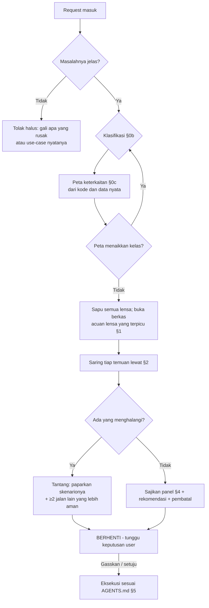

<!-- Catatan penulisan (dari superpowers/writing-skills, terverifikasi berlaku):
     description adalah PEMICU, bukan ringkasan. Bila ia meringkas alur kerja,
     agen bisa merasa sudah tahu isinya lalu bertindak dari description saja dan
     tidak pernah membaca berkas ini. Jaga description tetap berisi KONDISI
     PEMICU dan gejalanya saja. -->

> **Selalu baca berkas ini utuh sebelum menyajikan panel.** Menyebut "sepuluh lensa" dari ingatan tanpa membuka §0–§5 adalah panel palsu: verdict-nya ada, prosedurnya tidak.

# meta-panel — Panel Multi-POV (Anti-Yes-Man Gate)

Satu request, sepuluh pasang mata, masing-masing setara orang senior atau lead di perannya. Panel ini leburan lima role v1 (`architect`, `swe`, `devops`, `dba`, `qa`): alih-alih satu role aktif per task, semua lensa menyala bersamaan pada setiap request.

**Tujuan:** menemukan keterkaitan dan kegagalan yang tidak terpikirkan SEBELUM eksekusi.

**Ukuran berhasilnya satu:** user membaca panelnya dan menemukan hal yang belum ia pikirkan, tertulis cukup konkret untuk langsung ditindak. Panel yang isinya sekadar ada akan dilewati, dan panel yang dilewati tidak menjaga apa-apa.

| Berkas | Isi | Dibuka saat |
| :--- | :--- | :--- |
| `references/peta-keterkaitan.md` | Cara menelusuri apa saja yang ikut tersentuh sebuah perubahan | Setiap panel kelas Terbatas ke atas |
| `references/lens-product.md` … `lens-domain.md` | Satu berkas per lensa: cara berpikir senior di peran itu, kasus tepi per kategori, cara mengeceknya di kode | Lensa itu terpicu (§1) |
| `references/proyek-baru.md` | Alur proyek dari nol: urutan pertanyaan tiap peran, arah desain, dokumen yang dihasilkan | Proyek baru (§5) |
| `references/decision-tree.md` | Pohon keputusan stack dan arsitektur | Eskalasi §5 |

---

## §0. Hukum Panel

1. **DILARANG meng-acc atau mengeksekusi request sebelum panel disapu.** Termasuk request yang terdengar sederhana — justru di sanalah miss paling sering lahir.
2. **Setiap temuan lensa WAJIB berlabel epistemik** (`AGENTS.md` §3). Di percakapan labelnya ditulis sebagai kata, bukan kode: "sudah saya cek di berkas X", "kesimpulan saya dari X", "dugaan, belum saya cek".
3. **Panel bukan birokrasi.** Kedalamannya ditentukan gerbang klasifikasi §0b, bukan perasaan.
4. **Setelah panel disajikan → BERHENTI.** Tunggu persetujuan user ("Gasskan" / setuju eksplisit). Kelas Trivial dengan panel nihil boleh langsung jalan sambil menyebut panelnya nihil.
5. **Menyajikan dan langsung mengerjakan dalam satu tarikan napas = melewati gerbang.**
6. **Temuan tanpa skenario konkret BUKAN temuan.** "Perhatikan keamanan", "perlu dipikirkan performanya", "pastikan ada validasi" DILARANG. Standarnya di §2.
7. **"Nihil" WAJIB menyebut apa yang diperiksa.** "Lensa lain: nihil" tanpa keterangan tidak bisa dibedakan dari lensa yang tidak pernah dibuka.
8. **DILARANG menyelipkan perubahan perilaku di luar kalimat request.** Hal yang menurut Anda "sekalian saja" atau "demi konsistensi" disajikan sebagai opsi terpisah dengan dampak konkretnya, apalagi bila menyentuh uang, pajak, izin, atau data orang lain.

---

## §0b. GERBANG KLASIFIKASI — tentukan kedalamannya SEBELUM menyapu

| Kelas | Cirinya | Yang dikerjakan panel | Gerbang |
| :--- | :--- | :--- | :--- |
| **Sondir** | Pertanyaan kelayakan. "Bisa nggak sih X?" Keluarannya **jawaban**, bukan kode yang disimpan. | Sebutkan pertanyaan + rencana penyelidikan, 2–3 kalimat | Persetujuan untuk **menyelidiki**. Kode hasil sondir WAJIB dibuang; menyimpannya = klasifikasi ulang dari nol |
| **Trivial** | Typo, satu baris yang jelas, rename lokal | Sapu kilat §0c butir 1 saja. Nihil → boleh langsung jalan **sambil menyebut panelnya nihil dan apa yang dicek** | Tidak perlu menunggu |
| **Terbatas** | Perubahan kecil bercakupan jelas di kode yang sudah ada | Peta keterkaitan §0c penuh + lensa yang terpicu (§1), dengan berkas acuannya | Persetujuan eksplisit sebelum eksekusi |
| **Arsitektural** | Sistem baru, perubahan struktur, skema DB, breaking API, ganti dependency inti | Peta keterkaitan + semua lensa dengan berkas acuannya + ≥2 alternatif ditolak + pembatal + utang bukti | Persetujuan eksplisit. Keputusan besar → `meta-brainstorm` Mode 2 dulu; perlu dibaca orang lain → dokumen lewat `meta-prd` (§5) |

**Aturan gerbang ini:**

1. **DILARANG menurunkan kelas di tengah jalan.** Kompleksitas tersembunyi hanya boleh **menaikkan** kelas. Ketahuan bahwa "perbaikan kecil" ternyata menyentuh skema atau komponen bersama → berhenti, klasifikasi ulang, sajikan panel yang sesuai kelas barunya.
2. **Tiap task punya klasifikasi dan persetujuannya sendiri.** Persetujuan tidak menular ke task berikutnya, sedekat apa pun hubungannya.
3. **Kelas dinyatakan terbuka** saat panel disajikan, dengan alasannya, supaya user bisa membantahnya.
4. **Ragu antara dua kelas → ambil yang lebih tinggi.**
5. **"Familiar" bukan alasan menurunkan kelas.**
6. **Peta keterkaitan bisa menaikkan kelas.** Perubahan satu berkas yang ternyata dipakai tiga modul bukan lagi Trivial.

---

## §0c. PETA KETERKAITAN — wajib sebelum lensa mana pun

Hampir semua panel yang meleset di proyek user meleset di sini, bukan di lensa: yang diubah ternyata dipakai tempat lain, atau modul kembarannya sudah memecahkan hal yang sama. Enam pertanyaan, dijawab dari **kode dan data nyata**, bukan dari dugaan. Cara menelusurinya per stack ada di `references/peta-keterkaitan.md`.

| # | Pertanyaan | Yang dicari |
| :-- | :--- | :--- |
| 1 | **Siapa lagi yang memakai yang akan saya ubah?** | Semua pemanggil fungsi, kelas, route, view, kolom, key response. Jumlahnya disebut. |
| 2 | **Apakah ada modul kembaran?** | Modul sejenis yang sudah memecahkan hal yang sama (mis. `off` vs `booking`). Dibaca dulu; ia bukti termurah. |
| 3 | **Komponen bersama apa yang tersentuh?** | Policy, Gate, middleware, FormRequest, helper, partial view, config, tabel lookup. Melonggarkan satu = melonggarkan semua pemakainya. |
| 4 | **Kontrak apa yang berubah?** | Bentuk request/response, nama key **dan maknanya**, skema, event, format berkas, URL. |
| 5 | **Apa kata riwayat nyata?** | `failed_jobs`, tabel log, `git log` berkasnya, isu lama. Jangan menilai "jarang terjadi" dari membaca kode. |
| 6 | **Test apa yang sudah menjaga ini, dan dengan aktor apa?** | Test yang ada, apakah menembus jalur sukses, apakah aktornya role sungguhan atau role sakti. |

Hasilnya ditulis di panel sebagai **"Yang ikut tersentuh"**: dua sampai enam baris, tiap baris menyebut nama dan jumlah. Bila sebuah pertanyaan tidak bisa dijawab (tidak ada akses, repo tidak lengkap), tulis itu sebagai utang bukti, jangan dilewati diam-diam.

---

## §1. Sepuluh Lensa

Tiap lensa berpikir sebagai orang senior atau lead di perannya: bukan "apakah ini bekerja", melainkan "bagaimana ini gagal enam bulan lagi, dan siapa yang menanggungnya". Berkas acuan dibuka **bila pemicunya ada**; membuka semuanya untuk perubahan satu label hanya membakar konteks.

| # | Lensa | Setara | Pertanyaan inti | Pemicu membuka berkasnya | Berkas |
| :-- | :--- | :--- | :--- | :--- | :--- |
| 1 | **Manager / Product** | Senior PM, engineering lead | Masalah nyatanya apa, bagi siapa? Request ini memecahkannya, atau cuma solusi titipan? Apa yang sengaja TIDAK dikerjakan? Adakah jalan lebih murah? | Fitur baru, perubahan alur, request tanpa masalah yang jelas, ada kata "sekalian" | `lens-product.md` |
| 2 | **Cost / FinOps** | Engineering manager yang memegang anggaran | Berapa ongkos membangun, menjalankan, dan merawatnya? Sepadan dengan nilainya? Apa yang tumbuh tanpa batas? | Dependency baru, layanan berbayar, job terjadwal, penyimpanan berkas, data yang tumbuh, pekerjaan lebih dari beberapa hari | `lens-cost.md` |
| 3 | **UX / DX** | Senior product designer, API lead | Bagaimana rasanya dipakai oleh tiap peran, di tiap keadaan (kosong, memuat, gagal, sebagian)? Apa yang berubah bagi pemakai lama dan konsumer API? | Apa pun yang terlihat user, pesan error, form, tabel, perubahan response API | `lens-ux.md` |
| 4 | **Security** | Senior application security engineer | Siapa yang sekarang bisa melakukan atau melihat sesuatu yang sebelumnya tidak bisa? Input mana yang tidak dipercaya? | Auth, izin, role, data pribadi, upload, input bebas, URL keluar, laporan atau export, endpoint baru | `lens-security.md` |
| 5 | **Ops / SRE** | Senior SRE yang memegang on-call | Bagaimana ini mati, siapa yang tahu duluan, dan bagaimana mundurnya? | Deploy, migrasi, job, antrian, integrasi pihak ketiga, cron, config, cache, apa pun yang jalan tanpa ditonton | `lens-ops.md` |
| 6 | **Data** | Senior DBA, data engineer | Apakah perubahan skema aman dan bisa dibalik? Query-nya lewat index? Data lama bagaimana? | Migrasi, query baru atau berubah, laporan, impor/ekspor, perubahan makna kolom, hapus data | `lens-data.md` |
| 7 | **QA / Edge-case** | Senior QA, SDET | Bagaimana saya merusaknya? Urutan, waktu, jumlah, peran, dan keadaan setengah jadi mana yang belum dipikirkan? | Selalu, untuk kelas Terbatas ke atas | `lens-qa.md` |
| 8 | **Backend / Arsitektur** | Senior backend engineer, tech lead | Di mana kode ini seharusnya tinggal menurut pola repo ini? Pintu masuk lain mana yang berujung di kode yang sama? Apa yang tersisa saat separuh pekerjaannya gagal atau dipanggil dua kali? | Logika bisnis di server, lapisan baru (service, helper, job, event), transaksi, integrasi antarbagian atau pihak luar, proyek lama yang polanya belum dikenali | `lens-backend.md` |
| 9 | **Legal dan kepatuhan** (bersyarat) | Orang yang tahu kapan harus bertanya ke bagian hukum | Adakah kewajiban di luar kode yang tersentuh, dan siapa yang berwenang memutuskannya? | HANYA bila ada: data pribadi, uang atau pajak, library, font, gambar, atau data milik pihak lain, peluncuran ke publik, kontrak klien | `lens-legal.md` |
| 10 | **Domain / aturan bisnis** | Analis bisnis senior yang paham bidangnya | Aturan bisnis mana yang disentuh, dari mana asalnya, dan apakah masih sejalan dengan aturan yang sudah berjalan? | Batas, jatah, tarif, rumus, periode, status dan alurnya, persetujuan, apa pun yang berbunyi "maksimal", "wajib", "otomatis", "per bulan" | `lens-domain.md` |

> Lima POV serangan dinamis v1 (Hacker, Stress Tester, Chaos Monkey, Auditor, Gremlin) tetap sah sebagai **checklist serangan** di dalam lensa 4, 5, dan 7 — dipakai saat fitur HTTP/API benar-benar diuji, bukan sebagai swarm terpisah.

**Menyapu tetap wajib untuk semuanya.** Yang ditentukan pemicu hanya apakah berkas acuannya dibuka. Lensa yang tidak terpicu tetap dijawab satu baris di panel: apa yang dilihat dan kenapa tidak relevan. Lensa 9 satu-satunya yang boleh dijawab "tidak ada pemicunya" tanpa keterangan lain.

**Dua lensa punya batas wewenang.** Lensa 9 tidak memutuskan apa yang sah dan DILARANG menulis isi pasal, tarif, atau tenggat dari ingatan. Lensa 10 tidak menjadi sumber aturan bisnis: aturan datang dari user, dokumen perusahaan, atau kode yang sudah berjalan. Temuan keduanya hampir selalu berbentuk "perlu keputusanmu" atau "tanyakan ke siapa".

---

## §2. Standar Temuan

Satu temuan memuat empat hal. Kurang satu, ia belum layak dikirim.

| Bagian | Isinya | Contoh |
| :--- | :--- | :--- |
| **Skenario** | Siapa, melakukan apa, dalam keadaan apa. Bisa dibayangkan terjadi hari Selasa jam sepuluh. | "HRD membuka daftar cuti di portal web setelah izin `off>view` dilonggarkan untuk API." |
| **Akibat** | Apa yang rusak, bagi siapa, seberapa besar. | "Semua pengajuan pending dan ditolak se-perusahaan ikut tampil ke pemegang izin biasa." |
| **Bukti** | Dari mana Anda tahu, dan seberapa yakin. | "`OffPolicy::viewAny` dipakai portal web dan API; query DataTables di web tidak punya pembatas sendiri. Sudah saya baca di dua berkas itu." |
| **Usul** | Yang paling mudah dibalik lebih dulu. | "Longgarkan di controller API saja, policy tidak disentuh." |

**Tiga tingkat, ditulis dengan kata:**
- **Menghalangi** — kalau dikerjakan apa adanya, sesuatu yang sudah jalan akan rusak, data bocor atau hilang, atau perubahan tidak bisa dibalik. Panel menantang dulu dan menyodorkan ≥2 jalan lain.
- **Perlu keputusanmu** — ada dua arah yang sama-sama masuk akal dan pilihannya milik user (perilaku produk, teks yang tampil, cakupan).
- **Catatan** — boleh jalan, tapi user perlu tahu.

**Uji cepat sebelum mengirim sebuah temuan:**

| Tanya | Kalau jawabannya "ya" |
| :--- | :--- |
| Bisakah kalimat ini ditempel ke request lain tanpa diubah? | Terlalu umum. Sebut berkas, peran, input, atau angkanya. |
| Apakah user sudah pasti tahu ini? | Buang. Konsekuensi aturan yang user tetapkan sendiri bukan temuan. |
| Apakah ini "bagaimana kalau X tidak ada" tanpa bukti X bisa tidak ada? | Buang, atau cek dulu apakah X memang bisa tidak ada. |
| Apakah saya menilai seberapa sering dari membaca kode? | Tanyakan riwayatnya dulu (§0c butir 5). |
| Apakah sudah dijawab lapis lain? | Cek pemanggil dan penyaring di atasnya sebelum mengusulkan penjaga baru. |

Contoh temuan yang ditolak dan versi layaknya ada di tiap berkas lensa.

---

## §3. Prosedur



1. **Pahami masalah dulu.** Request tanpa masalah yang jelas ditolak halus (`AGENTS.md` §4). Kalimat ambigu soal cakupan (global atau per user, semua peran atau satu) ditanyakan balik dengan dua contoh konkret, bukan ditafsirkan.
2. **Klasifikasikan (§0b)** dan nyatakan kelasnya beserta alasannya.
3. **Buat peta keterkaitan (§0c).** Baca kode yang tersentuh, modul kembarannya, `LEARNED.md`, dan riwayatnya. Panel di atas tebakan adalah teater. Cari juga keputusan lama soal hal yang sama di papan (`skills/meta-board/SKILL.md` §1) dan sebut di panel bila ada.
4. **Sapu semua lensa.** Buka berkas acuan lensa yang terpicu dan jalankan katalog kasus tepinya terhadap request ini. Katalog itu daftar hal untuk **dicek**, bukan daftar untuk disalin ke panel.
5. **Saring (§2).** Yang lolos hanya temuan dengan skenario, akibat, bukti, dan usul.
6. **Tulis kriteria selesai** untuk kelas Terbatas ke atas: tiga sampai lima hal yang bisa diamati dan membuktikan permintaannya terpenuhi (§4). Permintaan berupa daftar banyak poin: tampilkan juga pembagiannya menjadi tiket dan branch (`skills/meta-board/SKILL.md` §2), mengikuti yang disebut user atau sebagai usul bila user tidak menyebut.
7. **Sajikan (§4)**, tutup dengan rekomendasi + **pembatal** — kondisi yang, bila benar, membatalkan rekomendasi itu.
8. **BERHENTI.** Eksekusi hanya setelah persetujuan user.
9. **Setelah disetujui: catat tiketnya dulu** (`skills/meta-board/SKILL.md`, wajib dibuka), baru eksekusi. "Selesai kalau", keputusan user, "yang sengaja tidak dikerjakan", dan "belum saya verifikasi" dari panel ini menjadi isi tiketnya.

---

## §4. Format Keluaran

Panel dibaca manusia di percakapan. Bahasa sehari-hari, tanpa istilah internal skill ini ("kelas Terbatas", "lensa 4", "blast radius" tanpa penjelasan), tanpa emoji verdict. Nama berkas disebut sekali. Opsi ditulis sebagai paragraf atau butir, bukan tabel, kecuali user meminta.

**Urutannya tetap:**

```markdown
**Yang kamu minta:** <satu kalimat, dengan kata-kata user sendiri>
**Ukuran perubahannya:** <kecil / sedang / besar> karena <alasan konkret>.

**Yang ikut tersentuh**
- <nama> dipakai di <jumlah> tempat: <daftar singkat>.
- <modul kembaran> sudah menangani hal serupa dengan cara <...>.

**Yang menghalangi** (kalau ada)
1. <Skenario>. <Akibat>. <Bukti dan seberapa yakin>. Usul: <...>.

**Yang perlu keputusanmu** (kalau ada)
1. <Pertanyaan dengan dua contoh konkret>. Bawaan saya: <...>, karena <...>.

**Catatan** (kalau ada)
- <Skenario singkat dan akibatnya>.

**Sudah dicek dan aman**
- <Lensa atau hal>: <apa yang dilihat, kenapa aman>. Satu baris per hal.

**Saran saya:** <arah + alasan>.
**Selesai kalau:**
- <hal yang bisa diamati: siapa, melakukan apa, melihat apa>.
- <satu kasus yang harus ditolak, dan apa yang tampil>.
**Saya batalkan saran ini kalau:** <kondisi>.
**Belum saya verifikasi:** <klaim yang masih dugaan dan cara termurah mengeceknya>.
```

- **Perubahan kecil:** bagian yang kosong dibuang. Lima sampai sepuluh baris sudah cukup, asal "Yang ikut tersentuh" dan "Sudah dicek dan aman" tetap ada.
- **Perubahan besar:** semua bagian terisi, ditambah **Jalan lain yang saya tolak** (≥2, masing-masing dengan alasan dan apa yang membuatnya jadi pilihan lebih baik).
- **"Selesai kalau" adalah kriteria penerimaan**, bukan daftar pekerjaan: tiga sampai lima baris yang bisa diperiksa orang lain tanpa membaca kode, minimal satu untuk jalur normal dan satu untuk yang harus ditolak. Ia ditulis dari sudut pengguna ("karyawan dengan tiga klaim melihat pesan X saat mengajukan yang keempat"), bukan dari sudut kode ("method Y ditambah"). Lensa QA mencari cara merusak; kriteria ini menyatakan apa yang dijanjikan. Setelah disetujui user, kriteria ini menjadi dasar test dan bisa langsung dijadikan pemeriksaan `meta-swipe`. Definisi selesai yang berlaku untuk semua pekerjaan (test, linter, bukti segar) tetap `AGENTS.md` §5.7 dan tidak diulang di sini.
- **Pertanyaan ke user disaring:** tanya hanya yang tidak bisa diputuskan dari request dan kode. Putuskan bawaan yang masuk akal, nyatakan, dan tanya sisanya.
- **Yang diusulkan duluan adalah yang paling mudah dibalik.** Memblokir hanya untuk aksi yang merusak, mengikuti pola blokir yang sudah ada di kode.
- **Perilaku lama dan usulan baru dipisah terang** saat memperluas pola yang sudah ada, dengan menyebut dari berkas mana perilaku lama itu.

---

## §5. Eskalasi

| Situasi | Aksi |
| :--- | :--- |
| Temuan panel menunjukkan keputusan arsitektur besar (pilih stack, pecah modul, messaging, konsistensi data) | Sarankan sesi `meta-brainstorm` Mode 2 dulu — panel bukan pengganti eksplorasi opsi. Pohon keputusan arsitektur ada di `references/decision-tree.md` skill ini. |
| Keputusannya perlu dibaca, disetujui, atau diingat orang lain | Sarankan dokumen lewat `skills/meta-prd/SKILL.md`: PRD bila yang dipertanyakan apa dan untuk siapa, RFC bila caranya, ADR bila keputusannya sudah diambil. Dokumen ditulis setelah user setuju dokumennya perlu; panel tetap disajikan di percakapan. |
| Klaim penentu masih dugaan dan menyangkut kode yang akan ditulis | WAJIB verifikasi dulu (source terpasang / dokumentasi resmi) sebelum eksekusi — `AGENTS.md` §3.4. |
| Proyek baru dari nol, atau modul besar yang belum punya pola | `view_file` ke `references/proyek-baru.md` (wajib dibuka). Tiap peran bertanya berurutan, keputusannya ditulis sebagai dokumen lewat `meta-prd`, dan arah desain disajikan sebagai tiga contoh yang bisa dibuka. Panel biasa baru jalan setelah fondasi itu disetujui. |
| User ingin berdiskusi dengan satu peran ("menurut orang security gimana", "tanya ke finops", "ngobrol dulu soal ini") | Itu percakapan, bukan gerbang: `skills/meta-brainstorm/SKILL.md` Mode 3. Berkas lensa peran itu tetap menjadi acuannya. |
| Proyek baru atau keputusan arsitektur yang salah pilihnya mahal | Boleh menawarkan swarm **satu kalimat, sekali**, tidak diulang di permintaan yang sama bila user tidak menanggapi. Swarm HANYA dijalankan bila user sendiri menyebut "swarm" (`shared/tool-claude-code.md` CC-1). Susunannya di §5b. |
| Penyebab masalahnya belum diketahui | Bukan urusan panel. Pindah ke `skills/meta-debug/SKILL.md`; panel dibuat setelah akarnya ketemu. |
| User menolak panel ("langsung saja") | Patuhi untuk kecepatan, TAPI peta keterkaitan butir 1 dan sapuan kilat tetap jalan, dan temuan yang menghalangi tetap WAJIB disuarakan sebelum eksekusi. Gerbang tidak bisa dimatikan total atas nama buru-buru. |
| User bertanya "ada yang aneh?" | Cari cakupan yang tidak masuk akal di rancangannya. Kalau setelah disapu memang tidak ada, jawab "tidak ada". Itu jawaban sah. |

---

## §5b. Swarm Tiga Agen (manual)

Hanya atas permintaan user. Gunanya satu: mendapat pandangan yang **tidak saling terpengaruh** untuk keputusan besar. Untuk permintaan sehari-hari, satu agen dengan berkas lensa sudah menemukan hal yang sama dengan ongkos jauh lebih kecil (uji 10 November 2026).

| Agen | Lensa yang dipegang |
| :--- | :--- |
| Produk dan bisnis | Product (1), Cost (2), Legal (9), aturan bisnis (10) |
| Pengalaman pengguna | UX / DX (3), dan arah desain bila proyek baru |
| Rekayasa | Security (4), Ops (5), Data (6), QA (7), Backend (8) |

Aturannya mengikuti `AGENTS.md` §6.1:

1. **Maksimal tiga, hanya membaca.** Tidak ada agen yang menulis berkas proyek atau commit.
2. **Serah terima lewat berkas.** Permintaan user dan konteksnya ditulis ke satu berkas; tiap agen menerima path berkas itu dan path berkas lensanya, bukan riwayat percakapan.
3. **Tiap agen tidak diberi kesimpulan agen utama.** Memberi hipotesis berarti memesan konfirmasi.
4. **Laporan agen bukan bukti.** Agen utama mengecek tiap klaim kode yang akan dipakai, lalu menyusun satu panel dengan format §4. Ketidaksepakatan antaragen disajikan sebagai temuan, bukan dirata-ratakan.
5. **Ongkosnya disebut sebelum mulai**: tiga agen berarti tiga kali membaca repo.

---

## §6. Sebelum Mengirim Panel

```
[ ] Peta keterkaitan dibuat dari kode nyata; jumlah pemakai disebut
[ ] Modul kembaran dicari dan dibaca (atau dinyatakan tidak ada)
[ ] Tiap temuan punya skenario, akibat, bukti, usul
[ ] Tidak ada kalimat yang bisa ditempel ke request lain
[ ] Lensa tanpa temuan menyebut apa yang dilihat
[ ] Tiap lensa yang berkasnya dibuka terlihat di panel dengan namanya: sebagai temuan, keputusan, atau satu baris "sudah dicek"
[ ] Angka hitungan (jumlah berkas, pemanggil, test) disertai apa yang dihitung, supaya bisa diulang
[ ] Tidak ada perubahan perilaku di luar kalimat request yang terselip di saran
[ ] Pertanyaan ke user hanya yang tidak bisa saya putuskan sendiri
[ ] Dugaan ditulis sebagai dugaan, dengan cara mengeceknya
[ ] Ada "selesai kalau" yang bisa diperiksa tanpa membaca kode (Terbatas ke atas)
[ ] Lensa legal dan domain bertanya, tidak memutuskan; tidak ada isi aturan dari ingatan
[ ] Ada "saya batalkan saran ini kalau"
[ ] Setelah mengirim: berhenti
[ ] Setelah disetujui: tiket papan dicatat sebelum kode ditulis
```
