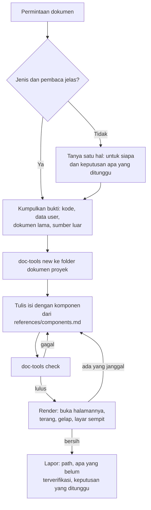

> **Selalu baca berkas ini utuh sebelum menulis dokumen.** Gaya dokumen user sudah ditetapkan dan disimpan sebagai berkas; menebaknya dari ingatan menghasilkan halaman yang "mirip" tapi berbeda, dan user sudah menolak itu.

# meta-prd - Dokumen HTML dengan Satu Gaya

Skill ini menulis dokumen untuk dibaca manusia dan menyimpannya sebagai satu berkas HTML mandiri. **Yang diikat skill ini adalah gayanya, bukan strukturnya.** Struktur menyesuaikan isi; acuannya ada di `references/structures.md` dan boleh dilanggar dengan alasan.

| Berkas | Isi |
| :--- | :--- |
| `assets/component-gallery.html` | **Sumber tunggal gaya.** Semua komponen, tampil dengan isi contoh. Buka di browser untuk melihat pilihan yang ada. |
| `assets/doc-template.html` | Kerangka kosong dengan gaya yang sama. Titik mulai setiap dokumen. |
| `scripts/doc-tools.mjs` | `new` (salin kerangka), `check` (periksa dokumen), `sync` (salin gaya dari galeri). |
| `references/components.md` | Kapan memakai tiap komponen, kapan jangan, dan cuplikan HTML-nya. |
| `references/structures.md` | Acuan susunan PRD, RFC, ADR, dan laporan. Acuan, bukan kewajiban. |

---

## §0. Hukum Dokumen

1. **Gaya datang dari berkas, bukan dari ingatan.** Dokumen WAJIB dimulai dari `doc-tools.mjs new`. DILARANG mengetik ulang, meringkas, atau menyunting isi blok `<style id="doc-style">` dan `<script id="doc-script">`. `check` membandingkan keduanya dengan galeri dan gagal bila berbeda satu karakter pun.
2. **Fakta dulu, bentuk kemudian.** Baca kode, data, dan dokumen milik user sebelum menulis. Label epistemik `AGENTS.md` §3 berlaku penuh di dalam dokumen: angka tanpa sumber DILARANG, kutipan WAJIB verbatim dan bersumber, sumber yang gagal dibuka dicatat gagal.
3. **Struktur mengikuti isi.** Susunan di `references/structures.md` adalah acuan. Bagian yang tidak punya isi nyata dibuang, bukan diisi kalimat pengisi.
4. **Dokumen bukan gerbang.** Menulis PRD atau RFC tidak menggantikan panel dan tidak menggantikan persetujuan user. Dokumen yang mengusulkan perubahan berakhir dengan keputusan yang diminta, lalu berhenti (`AGENTS.md` §0.2).
5. **Selesai berarti `check` lulus DAN halamannya sudah dirender.** Exit code 0 dari `check` membuktikan kerangkanya utuh; ia tidak membuktikan halamannya terbaca. Dua-duanya wajib sebelum melapor (`AGENTS.md` §5.7).

---

## §1. Pilih Jenisnya

Jenis menentukan pertanyaan yang dijawab, bukan daftar bagian yang wajib diisi.

| Jenis | Menjawab | Pembaca utama | Tanda Anda salah pilih |
| :--- | :--- | :--- | :--- |
| **PRD** | Masalah apa, untuk siapa, apa yang dianggap berhasil, apa yang sengaja tidak dikerjakan | Pemilik produk, user, tim | Isinya didominasi nama tabel dan endpoint - itu RFC |
| **RFC** | Bagaimana membangunnya, pilihan apa yang ditimbang, kenapa yang ini, apa risikonya | Engineer yang akan mengerjakan dan meninjau | Tidak ada alternatif yang ditolak - itu rencana kerja, bukan RFC |
| **ADR** | Satu keputusan: konteksnya, keputusannya, akibatnya | Engineer di masa depan yang bertanya "kenapa begini" | Lebih dari satu keputusan dalam satu berkas - pecah |
| **Laporan / peta / rencana** | Apa yang ditemukan atau apa urutan kerjanya | Yang meminta | Memaksakan susunan PRD pada sesuatu yang bukan produk |

Ragu antara PRD dan RFC: tulis PRD pendek dulu. RFC di atas masalah yang belum disepakati adalah kerja yang akan diulang.

Hubungan dengan `meta-panel`: panel berjalan di setiap request dan hasilnya di percakapan. Bila panel menilai request berkelas Arsitektural dan keputusannya perlu dibaca atau disetujui orang lain, panel menyarankan jenis dokumen dari tabel ini. Dokumen ditulis **setelah** user setuju dokumennya memang perlu.

---

## §2. Prosedur



1. **Tentukan jenis dan pembaca** (§1). Kalau dua-duanya bisa disimpulkan dari permintaan dan kode, jangan bertanya.
2. **Kumpulkan bukti.** Sumber terdekat dulu: kode proyek, data milik user, dokumen yang sudah ada. Web setelah itu. Catat tiap sumber untuk tabel bukti di akhir dokumen.
3. **Tentukan lokasi dan nama.** Ikuti folder dokumen yang sudah dipakai proyek: periksa `.docs/<proyek>/`, `docs/`, lalu tanya bila tidak ada. Nama berkas mengikuti tabel di bawah: huruf kecil semua, dipisah tanda hubung, diawali nama proyek supaya tetap jelas saat berkasnya dikirim sendirian. DILARANG menimpa dokumen lama; `new` menolak berkas yang sudah ada. Dokumen lama dengan pola nama lain (mis. `PRD-SSO.html`) DILARANG diganti namanya tanpa diminta.

   | Jenis | Pola | Contoh |
   | :--- | :--- | :--- |
   | PRD | `<proyek>-<topik>-prd.html` | `hris-reimbursement-prd.html` |
   | RFC | `<proyek>-<topik>-rfc.html` | `hris-antrian-notifikasi-rfc.html` |
   | ADR | `<proyek>-adr-<nomor 4 digit>-<keputusan>.html` | `hris-adr-0007-antrian-di-database.html` |
   | Rencana | `<proyek>-<topik>-plan.html` | `pentahoot-motion-plan.html` |
   | Laporan | `<proyek>-<topik>-report.html` | `hris-audit-izin-report.html` |
   | Handover | `<proyek>-handover-<YYYY-MM-DD>-<topik>.html` | `hris-handover-2026-11-10-reimbursement.html` |
   | Swipe | `<proyek>-swipe-<YYYY-MM-DD>-<cakupan>.html` | `hris-swipe-2026-11-10-reimbursement.html` |

   Handover dan swipe diberi tanggal karena dibuat berulang; PRD, RFC, dan ADR tidak, karena satu berkas per topik. Nomor ADR berurutan per proyek: lihat nomor terakhir di foldernya sebelum memberi nomor baru. Dua dokumen berjenis sama di hari yang sama dibedakan lewat topiknya, bukan lewat akhiran `-2`.
4. **Buat kerangka:**
   ```bash
   node ~/.gemini/config/skills/meta-prd/scripts/doc-tools.mjs new <lokasi>/<nama>.html
   ```
5. **Tulis isi** (§3). Ganti semua `{{...}}`, tambah bagian, pilih komponen menurut fungsinya. Sunting hanya di luar blok gaya dan skrip.
6. **Periksa:**
   ```bash
   node ~/.gemini/config/skills/meta-prd/scripts/doc-tools.mjs check <lokasi>/<nama>.html
   ```
   Baca keluarannya penuh, termasuk jumlah bagian dan tautan yang diperiksa. Angka nol di sana berarti pemeriksa tidak membaca apa-apa, bukan dokumennya bersih.
7. **Render.** Buka halamannya dan lihat sendiri di tema terang, gelap, dan lebar sempit. Tanpa browser yang bisa dikendalikan, pakai Edge atau Chrome headless untuk tangkapan layar, lalu baca gambarnya. Tidak bisa dirender sama sekali: katakan itu di laporan, jangan menyiratkan sudah dilihat.
8. **Lapor** path lengkap berkasnya, apa yang belum terverifikasi, dan keputusan yang ditunggu dari user.

---

## §3. Cara Menulisnya

**Kepala dokumen**
- `eyebrow`: `JENIS · TOPIK · STATUS`, huruf besar diurus CSS.
- `h1`: kalimat yang menyebut hasilnya, bukan label. "Reimbursement tanpa kertas untuk karyawan lapangan", bukan "PRD Reimbursement".
- `lede`: dua sampai tiga kalimat. Apa ini, untuk siapa, disusun dari apa.
- `meta`: tanggal absolut, basis kode atau data (commit, tanggal data), status.
- Kolom kanan `header.doc` boleh diisi ringkasan angka (`.progress`, `.stat`) bila ada; kosongkan bila tidak.

**Badan**
- Bagian `00` selalu **Ringkasan**: dua kartu (apa yang ditemukan atau diusulkan) dan, bila ada batas atau risiko yang harus dibaca dulu, satu `callout warn`.
- Satu bagian menjawab satu pertanyaan. Dibuka `p.sub` satu sampai dua kalimat, lalu isi.
- Nomor bagian dua digit, berurutan dari `00`. Daftar isi dibangun otomatis dari bagian; jangan ditulis tangan.
- Pilih komponen dari fungsinya: perbandingan setara memakai kartu, daftar berkolom memakai tabel, urutan memakai `.steps`, pilihan memakai `.option` dengan kelebihan, kekurangan, dan pembatal. Rincian di `references/components.md`.
- Alur lebih dari tiga langkah atau lebih dari dua pihak: diagram Mermaid di dalam `.diagram`, bukan paragraf.
- Bagian terakhir sebelum sumber: **keputusan yang dibutuhkan**, satu kartu `.decision` per pertanyaan, masing-masing dengan bawaan yang diusulkan.
- Bagian penutup: **daftar sumber** dengan ID, tier, dan status, termasuk yang gagal dibuka.

**Bahasa**
- Bahasa Indonesia sehari-hari. Kalimat lengkap, kata kerja jelas, satu gagasan per kalimat.
- Sebut angka dengan satuannya, tanggal dengan tahunnya, berkas dengan path-nya.
- Kutipan asli dikumpulkan di tempatnya (blockquote atau sel tabel), tidak diselipkan di tengah kalimat Indonesia.
- DILARANG: sapaan promosi, kalimat penutup yang berbunyi seperti pepatah, tebal di tiap baris, istilah internal skill ("blast radius", "kelas Terbatas") tanpa penjelasan, dan paragraf yang hanya mengulang judulnya.

**Tampilan**
- DILARANG menambah ornamen di luar galeri: garis gradien, garis aksen tebal di sisi kartu, maskot atau ilustrasi hiasan, emoji di judul, bayangan baru, warna di luar token.
- Butuh sesuatu yang belum ada di galeri: tambahkan ke galeri dulu (§4), jangan ke satu dokumen. Aturan yang benar-benar hanya milik satu halaman ditaruh di `<style id="page-style">` terpisah dan hanya memakai token yang ada.
- `style="..."` sebaris hanya untuk `width` pada meter dan custom property pada roadmap. `check` menolak sisanya.

---

## §4. Merawat Gaya

Galeri adalah sumber tunggal. Kerangka dan semua dokumen menyalin darinya.

| Mau apa | Caranya |
| :--- | :--- |
| Menambah atau mengubah komponen | Sunting `assets/component-gallery.html`: CSS di `doc-style`, perilaku di `doc-script`, dan satu contoh tampil di badan galeri. Lalu `sync`, lalu `node scripts/doc-tools.test.mjs`, lalu tambahkan cuplikannya ke `references/components.md`. |
| Memperbarui dokumen lama ke gaya terbaru | `node scripts/doc-tools.mjs sync <dokumen.html>`, lalu `check`, lalu render ulang. |
| Skill lain butuh keluaran HTML (`meta-handover`, `meta-swipe`) | Memanggil `doc-tools.mjs new` dan `check` yang sama. DILARANG menyalin CSS ke skill lain. |

Perubahan gaya adalah perubahan yang terlihat di semua dokumen berikutnya, jadi ia lewat panel dan persetujuan user seperti perubahan lain.

---

## §5. Anti-Pattern

| DILARANG | Kenapa |
| :--- | :--- |
| Menulis halaman dari nol "dengan gaya yang sama" | Hasilnya selalu sedikit berbeda, dan tiap dokumen jadi punya gaya sendiri |
| Mengisi semua bagian acuan walau tidak ada isinya | Pembaca belajar melewati dokumen Anda |
| Tile angka besar untuk angka tanpa sumber | Angka yang paling menonjol justru yang paling tidak bisa dipertanggungjawabkan |
| Menyembunyikan sumber yang gagal dibuka | Dokumen terlihat lebih kokoh daripada buktinya |
| Melapor selesai setelah `check` hijau tanpa membuka halamannya | `check` tidak melihat tabel yang meluber atau teks yang terpotong |
| Menaruh keputusan penting di tengah paragraf | Pembaca yang memindai tidak akan menemukannya; pakai kartu keputusan |
| RFC tanpa opsi yang ditolak | Itu pemberitahuan, bukan usulan |

---

## §6. Sebelum Melapor

```
[ ] doc-tools check: exit 0, jumlah bagian dan tautan yang diperiksa masuk akal
[ ] Halaman dirender dan dilihat: terang, gelap, layar sempit
[ ] Tidak ada angka tanpa sumber; kutipan verbatim; sumber gagal tercatat gagal
[ ] Tiap bagian punya isi nyata; yang kosong sudah dibuang
[ ] Keputusan yang ditunggu tertulis sebagai kartu, dengan bawaan yang diusulkan
[ ] Laporan ke user menyebut path lengkap dan apa yang belum terverifikasi
```
