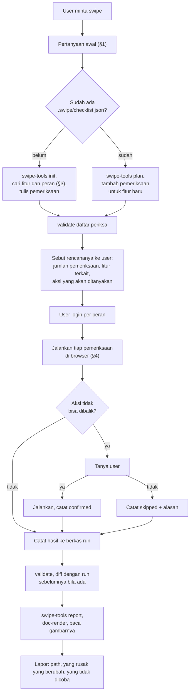

# meta-swipe — Mencoba Aplikasi di Browser, per Peran, dengan Jejak

> **Prinsip inti:** yang dilaporkan adalah apa yang **terlihat di browser**, bukan apa yang menurut kode seharusnya terjadi. Tiap pemeriksaan punya langkah, harapan, dan hasil yang tercatat, supaya swipe berikutnya bisa mengulang langkah yang sama dan menunjukkan apa yang berubah.

Berkas pendamping:

| Berkas | Isi |
| :--- | :--- |
| `scripts/swipe-tools.mjs` | `init`, `validate`, `plan`, `diff`, `report`. Menjaga data swipe tetap sah dan membangun laporannya. |
| `references/checklist-format.md` | Bentuk `checklist.json` dan berkas hasil, aturan tiap kolom, contoh lengkap. |
| `references/swipe-playbook.md` | Cara menemukan fitur terkait, apa yang dicoba di tiap jenis layar, dan perilaku alat browser yang perlu diketahui. |

---

## §0. Hukum

1. **Hanya bila diminta.** Swipe tidak pernah dijalankan sebagai langkah verifikasi atas inisiatif sendiri. User pernah menolak cek lewat browser di beberapa proyek.
2. **Hanya alamat yang disebut user**, dan hanya alamat lokal atau dev. Alamat di luar `localhost`, `*.localhost`, `*.test`, `*.local`, dan IP privat ditolak `validate` sampai user menegaskan alamat itu sendiri. Tautan yang keluar dari alamat itu tidak diikuti.
3. **Password tidak diketik dan tidak ditulis.** User login sendiri sebagai tiap peran; agen meneruskan dari sesi itu. Berkas swipe yang memuat password, token, atau cookie ditolak `validate`.
4. **Aksi yang tidak bisa dibalik ditanyakan dulu**, satu per satu: hapus, kirim email atau pesan keluar, persetujuan yang memicu pembayaran, impor massal, tutup periode. Tanpa jawaban ya dari user, pemeriksaannya dicatat `skipped` dengan alasannya.
5. **Data buatan swipe tidak dibersihkan otomatis.** Semua yang dibuat dicatat di `created`; user yang memutuskan nasibnya.
6. **Yang tidak dicoba ditulis tidak dicoba.** DILARANG mencatat `pass` untuk pemeriksaan yang hanya dibaca kodenya, atau untuk layar yang tidak terbuka.
7. **Laporan dibuat dari data, lewat `swipe-tools report`.** DILARANG menulis atau menyunting HTML laporan dengan tangan, dan DILARANG menulis CSS. Gayanya datang dari `meta-prd`.
8. **Temuan bukan izin memperbaiki.** Swipe berakhir di laporan. Perbaikan atas temuannya lewat `meta-debug` atau panel seperti permintaan lain.

---

## §1. Pertanyaan Awal

Tanyakan hanya yang belum terjawab oleh pesan user, dalam satu giliran:

1. **Peran apa saja**, dan alamat tiap peran (contoh: HRD di `hrd.localhost`, karyawan di `karyawan.localhost`).
2. **Fitur apa**: semua, atau fitur tertentu. Untuk fitur tertentu, fitur terkaitnya dicari sendiri (§3) dan disebutkan ke user sebelum mulai.
3. **Apakah server sudah menyala**, dan dari branch atau commit mana. Agen tidak menyalakan server, migrasi, atau seeder tanpa diminta.

Yang tidak perlu ditanyakan: tempat menyimpan daftar periksa (selalu `.swipe/` di repo proyek), format laporan (selalu HTML), dan pembersihan data (tidak pernah otomatis).

---

## §2. Prosedur



1. **Pertanyaan awal** (§1).
2. **Siapkan daftar periksa.**
   ```bash
   node ~/.gemini/config/skills/meta-swipe/scripts/swipe-tools.mjs init <folder proyek> --project <nama-proyek>
   ```
   Bila `.swipe/checklist.json` sudah ada, jangan `init`; baca dan tambahi. Bentuk berkasnya di `references/checklist-format.md` (`view_file`, wajib dibuka saat pertama menulis daftar periksa).
3. **Cari fitur, peran, dan fitur terkait** (§3), lalu tulis pemeriksaannya. Tiap pemeriksaan: satu peran, satu fitur, langkah yang bisa diulang orang lain, dan satu harapan yang bisa diamati.
4. **Periksa dan lihat rencananya:**
   ```bash
   node ~/.gemini/config/skills/meta-swipe/scripts/swipe-tools.mjs validate <proyek>/.swipe/checklist.json
   node ~/.gemini/config/skills/meta-swipe/scripts/swipe-tools.mjs plan <proyek>/.swipe/checklist.json --feature <fitur>
   ```
   `plan` ikut menampilkan pemeriksaan milik fitur terkait dan menandai `ASK FIRST` pada yang tidak bisa dibalik.
5. **Sebut rencananya ke user sebelum mulai**: berapa pemeriksaan, fitur terkait apa yang ikut, dan aksi mana yang akan ditanyakan. Lalu minta user login sebagai tiap peran.
6. **Jalankan** tiap pemeriksaan menurut §4. Catat hasilnya ke `<proyek>/.swipe/runs/<YYYY-MM-DD>-<cakupan>.json` begitu satu peran selesai, jangan ditumpuk di ingatan sampai akhir.
7. **Periksa data dan bandingkan:**
   ```bash
   node ~/.gemini/config/skills/meta-swipe/scripts/swipe-tools.mjs validate <checklist> <run>
   node ~/.gemini/config/skills/meta-swipe/scripts/swipe-tools.mjs diff <checklist> <run lama> <run baru>
   ```
8. **Buat laporan** di folder dokumen proyek, dengan nama `<proyek>-swipe-<YYYY-MM-DD>-<cakupan>.html` (aturan lokasi dan nama di `meta-prd` §2):
   ```bash
   node ~/.gemini/config/skills/meta-swipe/scripts/swipe-tools.mjs report <checklist> <run> --prev <run lama> --out <lokasi>/<nama>.html
   node ~/.gemini/config/skills/meta-prd/scripts/doc-render.mjs <lokasi>/<nama>.html --out <folder scratch>
   ```
   `report` menolak data yang tidak sah dan menolak menimpa berkas yang ada (`--replace` untuk membuat ulang dari data yang diperbaiki). Gambar hasil render WAJIB dibaca.
9. **Lapor** ke user: path laporan, yang rusak, yang berubah dibanding swipe sebelumnya, data yang dibuat, dan yang tidak dicoba beserta alasannya.

---

## §3. Menentukan Apa yang Dicoba

**"Semua"** berarti semua menu yang terlihat oleh tiap peran yang diminta, ditambah halaman yang hanya bisa dicapai lewat tombol di dalamnya. Daftar awalnya diambil dari menu dan daftar route, bukan dari ingatan.

**Satu fitur** berarti fitur itu ditambah yang berkaitan. Empat tempat mencarinya, rinciannya di `references/swipe-playbook.md`:

| Sumber | Yang dicari |
| :--- | :--- |
| Route | Semua alamat fitur itu, termasuk aksi yang tidak punya menu (setujui, batalkan, unduh, cetak) |
| Menu dan tautan | Dari mana fitur itu dicapai, dan ke mana ia menaut |
| Izin dan policy | Peran mana yang boleh apa; tiap perbedaan izin adalah satu pemeriksaan per peran |
| Data bersama | Fitur lain yang membaca atau mengubah tabel yang sama: dashboard, laporan, ekspor, notifikasi |

Fitur terkait dicatat di `features[].related` supaya swipe berikutnya otomatis mengikutkannya. Sebutkan ke user fitur terkait apa yang ditemukan dan dari mana; ia bisa mencoretnya.

Untuk tiap fitur dan tiap peran, minimal ada pemeriksaan untuk: jalur normal sampai selesai, satu input yang salah, dan satu hal yang **tidak boleh** dilakukan peran itu.

---

## §4. Menjalankan Satu Pemeriksaan

1. **Pastikan sesinya benar.** Buka alamat peran itu dan baca siapa yang sedang login di halaman. Dialihkan ke halaman login berarti sesi belum ada: minta user login, jangan mengisi form login.
2. **Nyalakan pencatatan console dan jaringan sebelum aksinya.** Pencatatan baru mulai setelah alatnya dipanggil sekali di tab itu, dan tidak bisa dinyalakan di tab kosong: buka halamannya, panggil pembaca console dan jaringan sekali, baru muat ulang atau lakukan aksinya.
3. **Ikuti langkahnya persis.** Kalau langkah di daftar periksa tidak bisa diikuti lagi (tombolnya pindah, namanya berubah), itu temuan: catat, lalu perbarui langkahnya.
4. **Tunggu, baru baca.** Membaca halaman tepat setelah klik sering mengembalikan halaman lama. Tunggu sebentar, lalu baca alamat dan isi halamannya.
5. **Bandingkan dengan harapan**, lalu baca console dan jaringan. Pemeriksaan yang layarnya benar tetapi memunculkan error console atau permintaan gagal dicatat `fail` bila harapannya menyebut "tanpa error", atau `pass` dengan error-nya dicatat bila tidak; `diff` akan menandainya sebagai error baru.
6. **Catat** `observed` dengan apa yang tampil, bukan tafsirannya: "Halaman kosong bertuliskan Internal Server Error, isian Catatan hilang", bukan "validasi gagal".

Status yang dipakai:

| Status | Artinya | Wajib ada |
| :--- | :--- | :--- |
| `pass` | Dijalankan, hasilnya sesuai harapan | `observed` |
| `fail` | Dijalankan, hasilnya tidak sesuai | `observed`, dan error console atau jaringan bila ada |
| `blocked` | Tidak bisa dijalankan karena sesuatu rusak atau belum siap (server mati, data prasyarat tidak ada, langkah sebelumnya gagal) | `reason` |
| `skipped` | Sengaja tidak dijalankan (tidak bisa dibalik dan user bilang tidak, atau di luar yang diminta) | `reason` |

---

## §5. Batas yang Sudah Diketahui

Dari uji coba 10 November 2026 pada aplikasi contoh lokal dengan ekstensi Claude in Chrome:

| Hal | Keadaannya |
| :--- | :--- |
| Satu peran per host (`hrd.localhost`, `karyawan.localhost`) | Tiap host punya sesi sendiri, jadi dua peran bisa terbuka bersamaan di dua tab. Terbukti. |
| Semua peran di satu host | Hanya satu sesi; berganti peran berarti user logout dan login lagi. Selesaikan semua pemeriksaan satu peran dulu. Belum dicoba. |
| Sesi terbawa ke tab baru | Ya, dalam jendela yang sama. Terbukti. |
| User login dengan password lalu agen meneruskan | Aplikasi contoh tidak memakai password, jadi serah terima ini belum teruji pada aplikasi sungguhan. |
| Tampilan HP | Tidak bisa: jendela yang dikendalikan tidak mengecil. Minta tangkapan layar ke user bila perlu. |
| Dialog bawaan browser (`alert`, `confirm`) | Menghentikan alat browser. Jangan mengklik tombol yang memunculkannya tanpa memberi tahu user. |
| Antigravity | Belum dicoba sama sekali. |
| Isi database | Tidak diperiksa; laporan hanya memuat yang terlihat di browser. |

---

## §6. Anti-Pattern

**Anti-Pattern 1: "sudah jalan" dari membaca kode.** Mencatat `pass` karena controller-nya terlihat benar. Yang dicatat hanya yang terlihat di layar.

**Anti-Pattern 2: langkah yang tidak bisa diulang.** "Coba fitur klaim" bukan langkah. "Buka `/claims/new`, isi Catatan saja, klik Simpan" bisa diulang orang lain dan swipe berikutnya.

**Anti-Pattern 3: hanya jalur bahagia.** Tiap fitur dicoba juga dengan input salah dan oleh peran yang tidak berhak.

**Anti-Pattern 4: mengisi form login.** Walau password-nya terlihat di seeder atau `.env`. User yang login.

**Anti-Pattern 5: merapikan sendiri.** Menghapus data uji, memperbaiki bug yang ditemukan, atau menyalakan ulang server di tengah swipe tanpa diminta.

**Anti-Pattern 6: menyunting laporan.** Laporan yang salah diperbaiki di datanya, lalu dibuat ulang dengan `--replace`.

---

## §7. Edge Case

**Edge Case 1: sesi habis di tengah swipe.** Pemeriksaan sesudahnya dialihkan ke login. Berhenti, minta user login lagi, ulangi pemeriksaan terakhir; jangan mencatatnya `fail`.

**Edge Case 2: pemeriksaan bergantung pada hasil peran lain.** Karyawan mengajukan, HRD menyetujui, karyawan melihat statusnya. Urutkan lintas peran, dan bila langkah awal gagal, yang bergantung dicatat `blocked`.

**Edge Case 3: aplikasi berubah banyak sejak swipe terakhir.** Banyak langkah tidak bisa diikuti. Perbarui daftar periksa dulu, dan sebut di laporan bahwa perbandingan dengan swipe lama tidak setara.

**Edge Case 4: swipe kedua pada data yang sudah dikotori swipe pertama.** Hasil bisa berbeda karena datanya, bukan kodenya. Catat di `notes` keadaan data saat mulai.

**Edge Case 5: browser yang dikendalikan ada di komputer lain.** Ekstensi bisa terhubung ke browser di mesin lain, dan `localhost` di sana bukan server ini. Pastikan halaman pertama benar-benar aplikasi yang dimaksud sebelum melanjutkan.

**Edge Case 6: user meminta alamat staging atau produksi.** Staging: minta user menegaskan alamatnya, catat `nonLocalConfirmed`, dan semua aksi tulis diperlakukan sebagai tidak bisa dibalik. Produksi: tolak aksi tulis; hanya pemeriksaan baca, dan itu pun setelah user menegaskan.

---

## §8. Daftar Periksa Sebelum Lapor

- [ ] Hanya alamat yang disebut user yang dibuka.
- [ ] Tidak ada password yang diketik atau ditulis.
- [ ] Tiap aksi yang tidak bisa dibalik ditanyakan, dan jawabannya tercatat.
- [ ] `validate` lulus untuk daftar periksa dan berkas run.
- [ ] `diff` dijalankan bila ada run sebelumnya.
- [ ] Laporan dibuat `swipe-tools report`, dirender, dan gambarnya dibaca.
- [ ] Laporan ke user menyebut yang tidak dicoba dan data yang dibuat.
- [ ] Tab yang dibuka untuk swipe ditutup.
